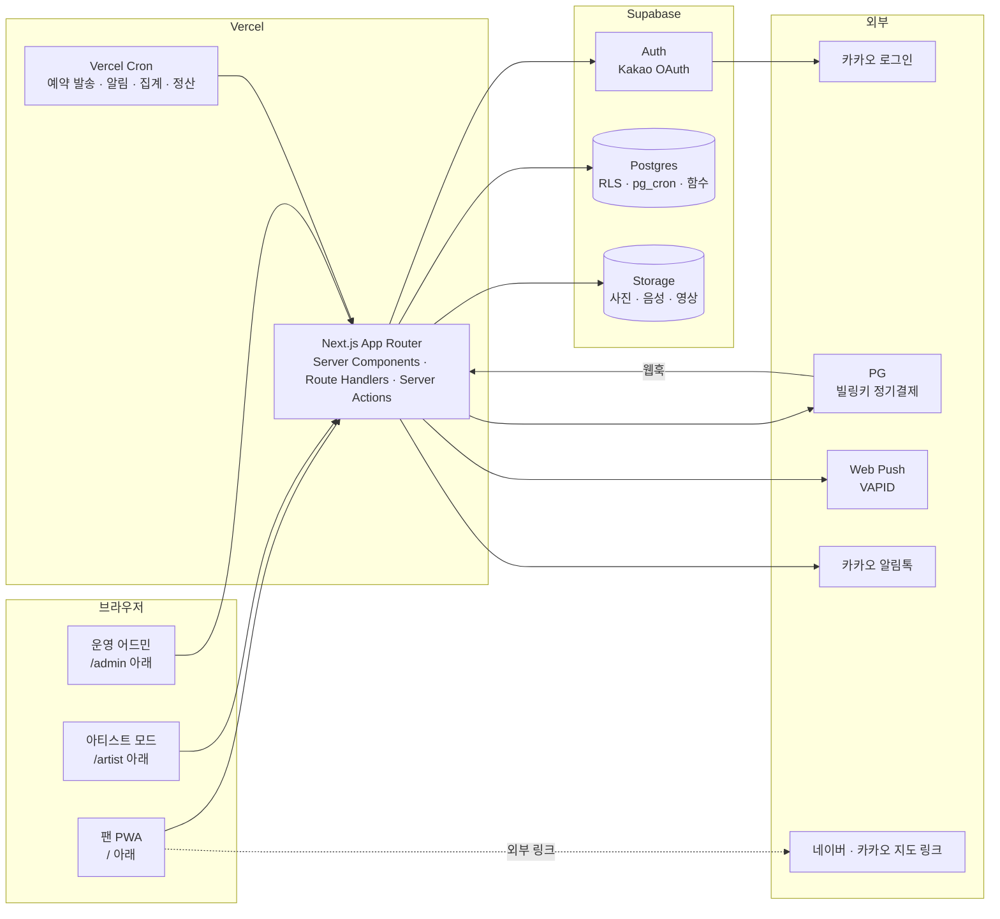
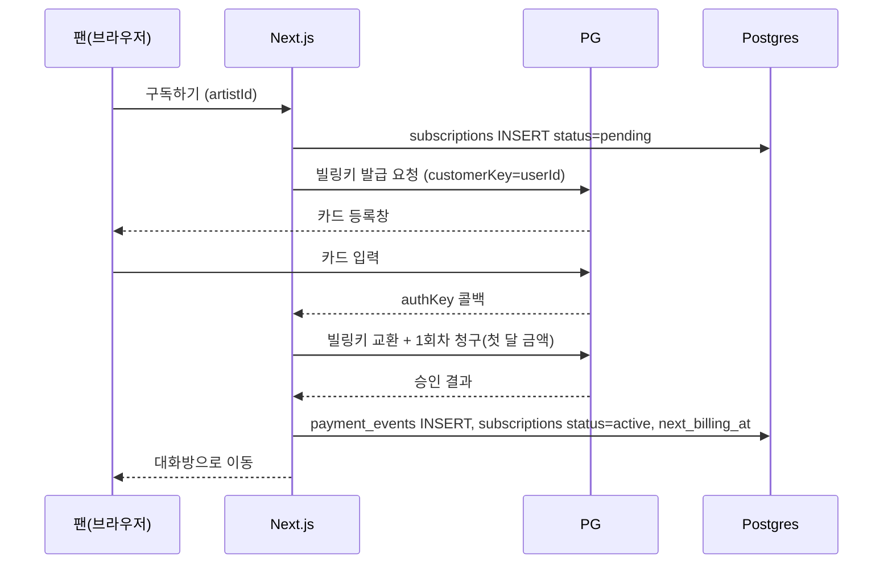
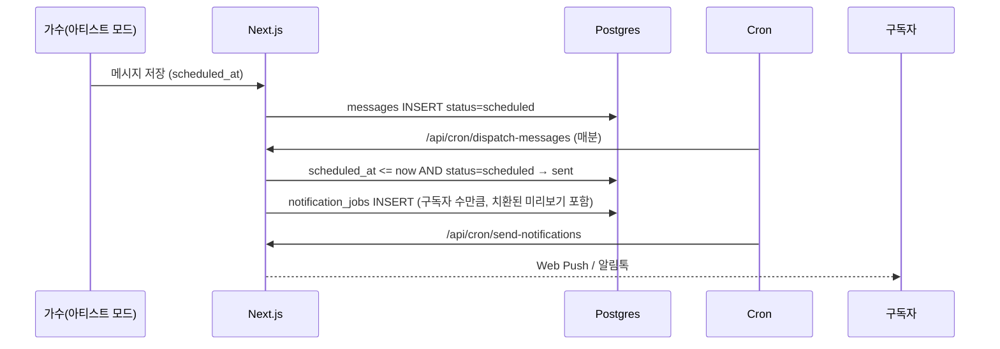

# 01. 아키텍처 설계

> 기준: 개발기획안 3장(시스템 구성), 4장(기술 스택), 9장(비기능 요구사항)

---

## 1. 시스템 구성

하나의 Next.js 프로젝트가 팬 화면, 아티스트 모드, 운영 어드민을 모두 담는다. 역할(role)에 따라 라우트 그룹이 갈린다.



| 구성 요소 | 책임 | 비고 |
| --- | --- | --- |
| Next.js (Vercel) | 모든 화면, API, 서버 로직, 배치 진입점 | 단일 배포 단위 |
| Supabase Auth | 카카오 OAuth, 세션, JWT | `role`은 `profiles` 테이블에 둔다(JWT 커스텀 클레임은 2차) |
| Supabase Postgres | 모든 영속 데이터, RLS, 집계 함수 | 정합성이 중요한 구독·결제·포인트는 DB 함수+트랜잭션 |
| Supabase Storage | 미디어 원본·변환본 | 버킷별 접근 정책, 서명 URL |
| Vercel Cron | 분 단위 예약 발송, 일 단위 알림, 주·월 단위 집계·정산 | 실제 로직은 서비스 함수에 있고 Cron은 호출만 |
| PG | 빌링키 발급, 정기 청구, 웹훅 | `PaymentProvider` 인터페이스로 격리 |

---

## 2. 핵심 기술 결정과 근거

### 2.1 PWA + 웹 결제 (기획안의 인앱 결제를 대체)

**문제:** 기획안의 "앱 안 결제(인앱 결제)"는 스토어에 올린 네이티브 앱에서만 가능하다. Next.js 웹앱으로는 구조적으로 불가능하고, 네이티브 래핑(Capacitor) + 스토어 심사까지 하면 11/30을 지킬 수 없다.

**결정:** MVP는 PWA로 배포하고 결제는 PG 정기결제(빌링키)로 한다.

| 비교 항목 | 스토어 인앱 결제 | PG 정기결제 (채택) |
| --- | --- | --- |
| 11/30 가능 여부 | 불가 (래핑 + 심사 2~4주) | 가능 (PG 심사 1~2주, 병행 가능) |
| 결제 수단 | 스토어가 정함(휴대폰·간편결제는 제한적) | 카드·카카오페이·휴대폰 모두 가능 → 결정 사항 충족 |
| 수수료 | 15~30% | 3% 내외 |
| 첫 달 1,000원 | 인트로 오퍼 | 1회차 금액을 서버에서 지정 |
| 해지·환불 | 스토어가 처리, 서버 알림으로 수신 | 우리가 처리 → 정책을 우리가 정의해야 함 |
| 중장년 UX | 스토어 결제창(익숙함) | PG 결제창(카드 등록 1회, 이후 자동) |

**감수할 것:** 환불 정책·고객센터 대응을 직접 해야 한다. 홈 화면 추가 안내 화면이 필요하다(iOS는 공유 → 홈 화면에 추가).
**되돌릴 길:** `PaymentProvider` 인터페이스에 스토어 구현체를 추가하고 Capacitor로 래핑하면 네이티브 앱으로 확장된다. 도메인 로직(구독 상태 기계, 정산)은 변하지 않는다.

### 2.2 Supabase Auth + Kakao 프로바이더

Supabase Auth가 카카오 OAuth를 지원한다. 세션·리프레시·JWT를 직접 구현하지 않는다. 가입 직후 DB 트리거가 `profiles` 행을 만든다. 카카오 동의 항목(닉네임, 연령대, 성별)은 프로바이더 스코프로 받아 `profiles`에 저장한다. 알림톡용 채널 추가는 카카오 비즈니스 채널 친구 추가 링크를 온보딩 마지막에 보여 준다(OAuth 스코프와 별개).

### 2.3 메시지 1회 저장, 조회 시 치환

기획안 7장 원칙 그대로. `messages` 테이블에 원문(`{이름}` 포함)을 한 번 저장하고, 조회 API에서 요청자의 `call_name`으로 치환한다. 치환 함수는 `src/server/services/message/render.ts` 한 곳에만 있고 대화방·푸시·맛보기·아티스트 미리보기가 모두 그 함수를 쓴다.

### 2.4 배치: Vercel Cron → Route Handler → 서비스

| 작업 | 주기 | 경로 |
| --- | --- | --- |
| 예약 메시지 발송 | 매 1분 | `/api/cron/dispatch-messages` |
| 푸시·알림톡 발송 큐 처리 | 매 1분 | `/api/cron/send-notifications` |
| 결제 예정 하루 전 안내 | 매일 10:00 KST | `/api/cron/notify-billing` |
| 일정 하루 전 알림 | 매시 정각 실행, `schedule.notice_hour_kst`(기본 10시)일 때만 발송 | `/api/cron/notify-schedules` |
| 가수 주간 활동량 집계 | 매주 월 00:10 KST | `/api/cron/aggregate-weekly-stats` |
| 월 정산 계산 | 매월 1일 09:00 KST | `/api/cron/settle` |

> **Vercel Pro 필수:** 무료(Hobby) 플랜은 크론을 하루 1번만 허용하고 실행 시각도 ±59분 흔들린다. 매분 크론(예약 발송, 알림 큐)이 있으므로 preview·production 모두 Pro 플랜에서 운영한다. (D-11)

Cron Route Handler는 `CRON_SECRET` 헤더를 검증하고 해당 서비스 함수를 호출만 한다. 로직이 Route Handler 안에 들어가면 테스트도 재사용도 안 된다.

### 2.5 푸시: Web Push + 알림톡 이중화

- Web Push(VAPID): 즉시성. iOS 16.4+는 홈 화면에 추가한 PWA에서만 동작하므로 온보딩에서 안내한다.
- 카카오 알림톡: 결제 전날 안내, 일정 전날 안내 등 **반드시 도달해야 하는 것**. 템플릿 사전 심사 필요.
- 두 채널 모두 `NotificationChannel` 인터페이스 구현체이며 `notification_jobs` 큐 테이블을 거친다. 발송 실패는 재시도 3회 후 `failed`.

### 2.6 미디어: Supabase Storage + 서명 URL

- 업로드: 서버가 서명 업로드 URL을 발급(`POST /api/media/upload-url`), 브라우저가 직접 Storage로 올린다. 서버를 거치지 않으므로 Vercel 함수 용량 제한을 피한다.
- 사진은 업로드 전 브라우저에서 긴 변 1,600px로 줄인다(기획안 F-06). 음성·영상은 길이 제한만 검사.
- 버킷: `message-media`(구독자만 읽기), `board-media`(로그인 사용자 읽기), `avatars`(공개).

---

## 3. 핵심 데이터 흐름

### 3.1 구독 결제 (신규)



- 청구 금액은 `app_settings`의 `subscription.price_krw`, `subscription.intro_price_krw`에서 읽는다.
- 결제 성공 신호는 **PG 서버 응답**으로만 인정한다. 브라우저 콜백만으로 구독을 열지 않는다(기획안 9.3).

### 3.2 정기 갱신

Cron(`notify-billing`)이 `next_billing_at`이 내일인 구독에 알림톡·푸시를 보낸다. 갱신 청구는 PG의 자동 청구 기능이 아니라 **우리 Cron이 `next_billing_at`이 지난 활성 구독을 골라 빌링키로 청구**한다(금액·주기 통제, 재시도 정책 소유). 실패 시 `grace` 상태로 3일 유예 후 `expired`.

### 3.3 가수 메시지 발송



- 발송 5분 이내 취소(F-09): `sent_at`으로부터 `message.cancel_window_minutes`(설정값) 안이면 `canceled`로 바꾸고 아직 안 나간 `notification_jobs`를 삭제한다. 이미 나간 푸시는 되돌릴 수 없으므로 대화방에서만 사라진다.
- 구독자 1,000명 기준 1분 내 푸시: `notification_jobs`를 500개 단위로 배치 발송. Web Push 라이브러리의 병렬 전송 사용.

### 3.4 `{이름}` 치환과 과거 메시지 범위

```
GET /api/artists/{id}/messages?cursor=
→ 구독 확인 → messages WHERE sent_at >= subscription.started_at - visible_before_days
→ render(body, profile.call_name) → 응답
```

`visible_before_days`는 `app_settings`의 `message.visible_before_subscription_days`(기본 7).

---

## 4. 디렉토리 구조

```
trotyou/
├── AGENTS.md                  # 에이전트 지침 (CLAUDE.md는 이 파일의 심볼릭 링크)
├── docs/                      # 이 설계 문서 세트
├── supabase/
│   ├── migrations/            # SQL 마이그레이션 (02_database.md)
│   ├── seed.sql               # 개발용 시드 (가수 2명, 설정값)
│   └── config.toml
├── src/
│   ├── app/
│   │   ├── (fan)/             # 팬 화면. 하단 탭 레이아웃
│   │   │   ├── layout.tsx
│   │   │   ├── page.tsx                 # H-01 홈
│   │   │   ├── artists/
│   │   │   │   ├── page.tsx             # M-01 내 가수
│   │   │   │   └── [artistId]/
│   │   │   │       ├── page.tsx         # M-02 대화방 / M-05 맛보기(비구독)
│   │   │   │       └── subscribe/page.tsx # M-04
│   │   │   ├── board/[artistId]/...     # B-01~03
│   │   │   ├── points/page.tsx          # P-01
│   │   │   ├── schedules/...            # C-01, C-02
│   │   │   └── me/...                   # U-01~03
│   │   ├── (onboarding)/      # S-01~S-04. 탭 없는 레이아웃
│   │   ├── artist/            # A-01~A-03. role=artist 전용
│   │   ├── admin/             # 운영 어드민. role=admin 전용
│   │   ├── api/
│   │   │   ├── auth/callback/route.ts
│   │   │   ├── cron/*/route.ts
│   │   │   ├── webhooks/payment/route.ts
│   │   │   └── media/upload-url/route.ts
│   │   └── layout.tsx         # 글자 크기 data-attribute 주입
│   ├── components/
│   │   ├── ui/                # Button, Text, Input, Card … (디자인 토큰만 사용)
│   │   ├── fan/               # 팬 화면 조립 컴포넌트
│   │   ├── artist/
│   │   └── admin/
│   ├── server/
│   │   ├── services/          # 도메인 로직. 외부 I/O는 adapters를 통해서만
│   │   │   ├── auth/
│   │   │   ├── subscription/
│   │   │   ├── message/
│   │   │   ├── board/
│   │   │   ├── point/
│   │   │   ├── schedule/
│   │   │   ├── notification/
│   │   │   └── settlement/
│   │   ├── adapters/          # 외부 시스템 구현체
│   │   │   ├── payment/       # PaymentProvider 인터페이스 + toss.ts
│   │   │   ├── notification/  # NotificationChannel + webpush.ts, alimtalk.ts
│   │   │   └── storage/
│   │   ├── db/                # Supabase 클라이언트 생성(서버·관리자), 타입
│   │   └── settings/          # app_settings 읽기 + 캐시 + zod 스키마
│   ├── config/
│   │   ├── env.ts             # zod로 검증한 환경 변수. process.env 직접 접근 금지
│   │   ├── routes.ts          # 경로 상수
│   │   └── constants.ts       # 바뀌지 않는 기술 상수만 (예: 커서 페이지 크기)
│   ├── lib/                   # 순수 유틸 (date, format, validation)
│   ├── messages/
│   │   └── ko.json            # 사용자 노출 문구 전부
│   └── types/
├── tests/
│   ├── unit/
│   ├── integration/           # Supabase 로컬 DB 대상
│   └── e2e/                   # Playwright (출시 기준 시나리오)
├── .codex/config.toml         # Codex 프로젝트 설정
├── vercel.json                # Cron 정의
└── package.json
```

**레이어 규칙 (의존 방향은 아래로만):**

```
app (UI · Route Handler · Server Action)
  → server/services (도메인)
    → server/adapters (외부 I/O), server/db, server/settings
      → config, lib, types
```

- `app`은 `adapters`를 직접 부르지 않는다.
- `services`는 `next/*`를 import하지 않는다(테스트 가능성).
- `components/ui`는 도메인 타입을 모른다.

---

## 5. 환경 구성

| 환경 | Supabase | Vercel | PG | 용도 |
| --- | --- | --- | --- | --- |
| local | `supabase start` (Docker) | `next dev` | 테스트 키 | 개발 |
| preview | 별도 프로젝트 `trotyou-staging` | PR별 프리뷰 | 테스트 키 | QA, 사용성 테스트 |
| production | `trotyou-prod` | production | 라이브 키 | 출시 |

- Supabase 프로젝트와 Vercel 함수 리전은 모두 **서울**로 맞춘다(지연 시간, 개인정보 국내 처리).
- 유료 전환: Vercel Pro(상업 서비스·매분 크론), Supabase Pro(무료 플랜은 미사용 시 일시 정지). 둘 다 해외 서비스라 AI 솔루션 지원금으로 낼 수 없다. (D-11)

환경 변수는 `src/config/env.ts`에서 zod로 검증한다. 누락 시 빌드가 실패해야 한다.

```ts
// src/config/env.ts (발췌)
const schema = z.object({
  NEXT_PUBLIC_SUPABASE_URL: z.string().url(),
  NEXT_PUBLIC_SUPABASE_ANON_KEY: z.string().min(1),
  SUPABASE_SERVICE_ROLE_KEY: z.string().min(1),
  PAYMENT_PROVIDER: z.enum(['toss', 'mock']),
  TOSS_SECRET_KEY: z.string().optional(),
  TOSS_WEBHOOK_SECRET: z.string().optional(),
  VAPID_PUBLIC_KEY: z.string().min(1),
  VAPID_PRIVATE_KEY: z.string().min(1),
  ALIMTALK_API_KEY: z.string().optional(),
  CRON_SECRET: z.string().min(16),
  NEXT_PUBLIC_APP_URL: z.string().url(),
});
export const env = schema.parse(process.env);
```

---

## 6. 비기능 요구사항 구현 매핑

| 기획안 기준 | 구현 |
| --- | --- |
| 홈 3초 이내 | 홈은 Server Component로 첫 페인트. 이미지는 `next/image` + Storage 변환본 |
| 대화방 1초 이내(최근 30개) | `messages` 커서 페이지네이션, `(artist_id, sent_at desc)` 인덱스, 30은 `app_settings` |
| 발송 1분 내 푸시 | 3.3의 큐 + 배치 병렬 발송. 부하 테스트는 `tests/load/` |
| 가수에게 팬 실명·연락처 비노출 | 아티스트 모드 API는 `profiles`의 `call_name`만 조인. RLS로 `kakao_id`, `phone` 컬럼 차단 |
| 금칙 패턴 차단 | `src/lib/validation/forbidden-patterns.ts` + `app_settings`의 패턴 목록 |
| 글자 크기 3단계 즉시 반영 | `<html data-font-scale="normal|large|xlarge">` + CSS 변수 (05_frontend.md) |
| 만 14세 미만 제한 | 카카오 연령대 스코프로 판별. 미제공 시 자체 확인 체크박스 |
