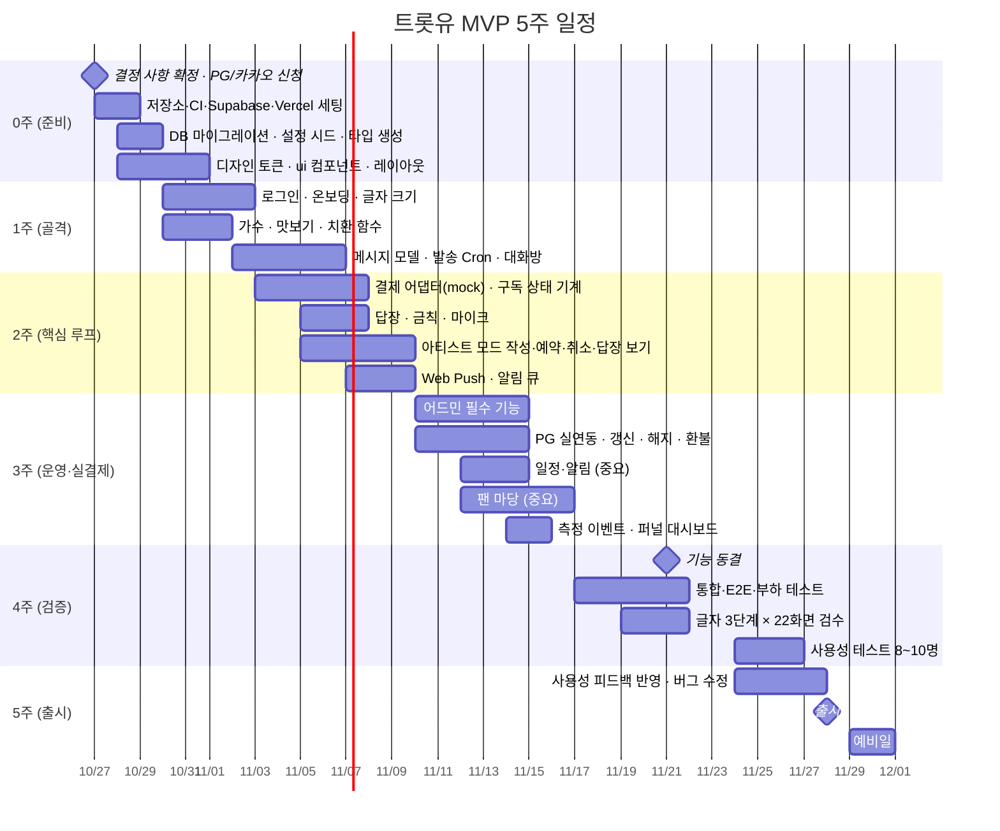

# 07. 개발 일정 (2026-10-27 ~ 2026-11-30)

> 기획안은 12주를 잡았다. 실제 가용 기간은 **5주**다. 인원 3명 + 에이전트(Codex·Claude Code) 병행을 전제로 범위를 자르고 일정을 다시 짠다.
> 목표 출시일: **11/28(금)**. 11/30(일)은 마지노선이지 목표가 아니다. 주말에 출시하지 않는다.

---

## 1. 범위 컷 라인

기획안 MVP 항목을 세 단계로 나눈다. **"필수"만으로 출시 가능해야 하고, "중요"는 일정 여유가 있을 때, "선택"은 11/30 이후다.**

| 등급 | 기능 | 판단 근거 |
| --- | --- | --- |
| **필수** | 카카오 로그인·온보딩(글자 크기, 부를 이름, 가수 고르기, 홈 화면 추가 안내) | 북극성 지표의 입구 |
| **필수** | 맛보기 메시지 | 전환 퍼널 |
| **필수** | 구독 결제(PG 빌링키, 첫 달 1,000원, 갱신, 해지, 결제 전날 알림) | 수익 |
| **필수** | 가수 메시지 수신(글·사진·음성·영상), `{이름}` 치환, Web Push | 핵심 가치 |
| **필수** | 답장(글, 마이크, 금칙 차단) | **북극성 지표** |
| **필수** | 아티스트 모드(작성·예약·취소·미리보기·받은 답장·이번 주 활동량) | 공급 측 없으면 서비스 안 돔 |
| **필수** | 어드민: 가수 등록·계정 발급·맛보기 지정·구독 현황·설정값 편집 | 출시 운영 최소 |
| **필수** | 측정 이벤트 10종, 개인정보처리방침·약관, 고객센터 화면 | 출시 기준 |
| **중요** | 공식 일정·하루 전 알림 | 가치 있지만 없어도 핵심 루프 완성 |
| **중요** | 어드민: 콘텐츠 캘린더, 활동량 대시보드 | 가수 관리 편의 |
| **중요** | 팬 마당(글·댓글·좋아요·신고·자동 숨김) | 무료 활동. 커뮤니티 관리 부담 동반 |
| **선택** | 출석·미션 포인트 | 사용처가 2차라서 지금 없어도 체감 차이 작음 |
| **선택** | 활동 등급(새싹·열성·골수) | 팬 마당에 종속 |
| **선택** | 정산 리포트·엑셀 | 첫 정산은 12월 초. 11/30 이후 1주 안에 만들어도 됨 |
| **선택** | 카카오 알림톡 | 템플릿 심사 변수. Web Push로 출시하고 알림톡은 심사 통과 즉시 추가 |

> **결정 D-5:** 위 분류에 동의하는지 10/27까지 확인. "중요"를 "필수"로 올리면 그만큼 다른 것을 내려야 한다.

---

## 2. 주차별 일정

### 주차별 완료 정의

| 주차 | 끝나는 날 | 이 날 반드시 되어야 하는 것 |
| --- | --- | --- |
| 0주 | 10/30(목) | `npm run check:all` 통과하는 빈 앱이 preview에 배포됨. 마이그레이션 14개 적용, 시드 가수 2명 |
| 1주 | 11/6(목) | 카카오 로그인 → 온보딩 → 가수 고르기 → 맛보기까지 preview에서 됨. 어드민이 넣은 메시지가 Cron으로 발송되어 대화방에 `{이름}` 치환되어 보임 |
| 2주 | 11/13(목) | mock 결제로 "구독 → 메시지 → 답장" 루프 완성. 가수 계정으로 메시지 작성·예약·취소. Web Push 도착 |
| 3주 | 11/20(목) | 실PG 1,000원 결제·환불 확인. 어드민으로 가수·맛보기·설정 관리. 일정·팬 마당 중 가능한 것 |
| 4주 | 11/27(목) | 출시 기준(§4) 체크리스트 전부 통과. 사용성 테스트 결과 반영 |
| 5주 | 11/28(금) | production 배포, 모니터링 |

---

## 3. 역할 분담 (3명 + 에이전트)

작업 지시는 **사람이 직접, 업무 시간 안에서만** 한다. 퇴근 후나 밤에 돌아가는 에이전트 작업은 없다.

| 담당 | 영역 | 에이전트 활용 방식 |
| --- | --- | --- |
| A (리드) | 아키텍처, DB, 결제·구독, Cron, 코드 리뷰 전담 | 설계 문서를 기준으로 Codex에 유스케이스 단위 구현 지시. 리뷰는 사람이 |
| B (프론트) | 디자인 토큰, ui 컴포넌트, 팬 화면, PWA·푸시 | Codex로 화면 조립. 글자 3단계 스크린샷을 에이전트가 생성 |
| C (풀스택) | 아티스트 모드, 어드민, 게시판·일정, 측정 | Codex로 어드민 CRUD 대량 생성, Claude Code로 복잡한 집계 |

### 병목과 완화

| 병목 | 완화 |
| --- | --- |
| 리뷰어 1명 | PR 300줄 제한. 에이전트 PR은 `check:all` 통과 + 자동 리뷰(Codex review) 거친 뒤 사람이 본다 |
| PG 심사 지연 | mock 어댑터로 결제 없이 전체 흐름 개발. 라이브 키는 3주차에만 필요 |
| 가수 계약 지연 | 시드 가수 2명으로 개발·테스트. 계약 없으면 출시 대신 사용성 테스트 반복(기획안 11장 원칙) |
| 알림톡 심사 | 선택 항목. Web Push로 출시 |
| 사용성 테스트 참가자 모집 | 2주차에 PM이 섭외 시작 |

---

## 4. 출시 기준 (11/27 체크)

기획안 12장을 PWA 기준으로 고친 것이다.

- [ ] 계약 가수 2명 이상, 가수별 맛보기 5개 이상
- [ ] 사용성 테스트: 8~10명 중 80% 이상이 도움 없이 "가입 → 구독 → 첫 답장"을 5분 내 완료 (preview URL)
- [ ] 결제: 신규·갱신·해지·환불 — mock 통합 테스트 전부 통과 + 실PG 신규·환불 1회 확인
- [ ] 메시지 발송 후 1분 내 푸시 (구독자 1,000명 k6 테스트)
- [ ] 글자 3단계 × 주요 화면 22개 스크린샷 검수 완료
- [ ] 측정 이벤트 10종이 `analytics_events`에 쌓이고 퍼널 대시보드에 표시
- [ ] 개인정보처리방침·이용약관 게시, 고객센터 전화·카톡 연결
- [ ] iOS Safari(홈 화면 추가) · Android Chrome에서 푸시 수신 확인
- [ ] 로그에 개인정보 없음 (redact 테스트)
- [ ] `app_settings` 전 키가 어드민에서 편집 가능

---

## 5. 11/30 이후 즉시 (12월 1주)

- 정산 리포트·엑셀 (첫 정산 12월 초)
- 알림톡 (심사 통과 시)
- 출석·포인트, 활동 등급
- 사용성 테스트에서 나온 개선 2차분
