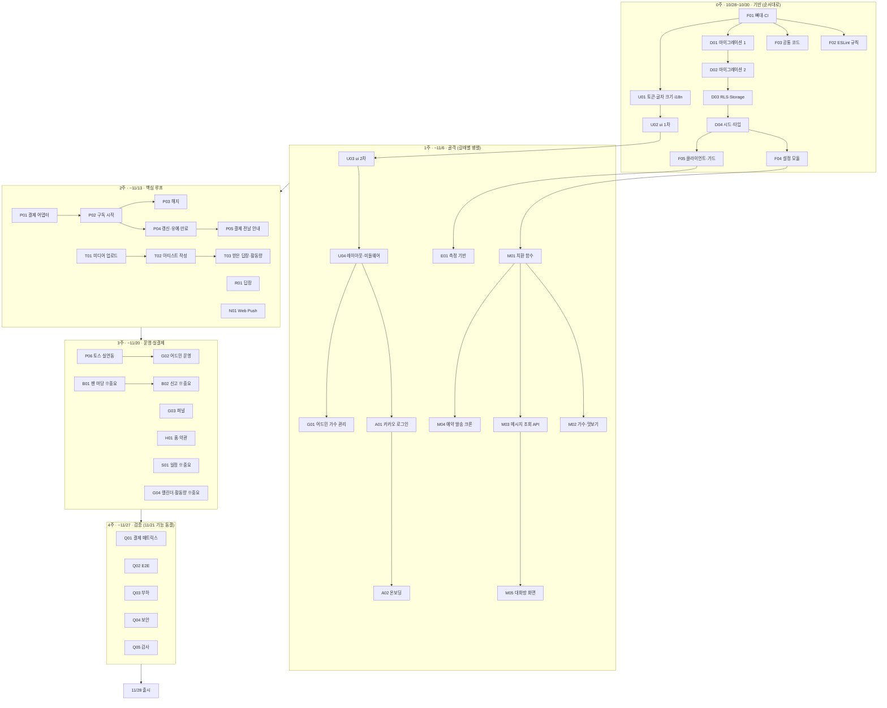

# 10. 개발 계획과 작업 카드

> 작성일: 2026-10-27 (카드 형식 통일판) · 기준: 문서 00~08 (10/27 보정 반영)
> 기간: 10/28(수) ~ 11/28(금) 출시, 11/29~30 예비일
> 이 문서는 **에이전트가 읽는 작업 지시서**다. 사람은 `[작업] W1-M03`처럼 작업 번호만 보내고, 에이전트는 이 문서에서 카드를 찾아 `AGENTS.md`의 절차대로 일한다. 사람이 쓰는 법은 `11_agent_playbook.md`.

---

## 1. 카드 읽는 법

### 1.1 카드 한 장의 모양

```
#### {카드 ID} {카드 이름}
`종류: …` · `프로필: …` · `담당: …` · `크기: …` · `선행: …` · `실행: …`

- 목표: 이 카드가 끝나면 무엇이 되는가
- 읽을 문서: 반드시 먼저 읽을 설계 문서 섹션
- 만들 파일: 만들거나 고칠 파일. 이 목록 밖은 고치지 않는다
- 하지 말 것: 이 카드에서 특히 하면 안 되는 것
- 완료 기준: 전부 테스트나 확인 결과로 증명해야 끝난다
- 따라 할 코드: 같은 패턴으로 이미 만들어진 파일
- 구현 메모: 문서에 없는 기술 결정. 이미 정해졌으니 다시 고민하지 않는다
```

### 1.2 꼬리표의 뜻

| 꼬리표 | 값 | 에이전트가 하는 일 |
| --- | --- | --- |
| 종류 | `설정` | 도구·설정 파일 위주. 화면 스크린샷 없음 |
| | `DB` | 마이그레이션·pgTAP. 로컬 Supabase 필요 |
| | `서버` | 서비스·라우트. 도메인 로직은 테스트 먼저 |
| | `화면` | 글자 크기 3단계 스크린샷을 찍는다(AGENTS.md 절차 6) |
| | `서버+화면` | 둘 다 |
| | `검증` | 테스트·점검 위주. **버그를 찾으면 고치지 말고 보고**한다 |
| | `사람` | 에이전트는 하지 않는다. 받으면 멈추고 알린다 |
| 프로필 | `chore` `default` `high` `critical` `deep` | `critical`이면 계획만 내고 멈춰서 승인을 기다린다. 모델·effort는 사람이 열 때 정한다(`scripts/work.sh`가 자동으로) |
| 담당 | A 리드 · B 프론트 · C 풀스택 | A만 마이그레이션을 만든다. B만 `src/components/ui/`를 고친다 |
| 크기 | S 반나절 이하 · M 하루 · L 1~2일 | 에이전트 작업 + 사람 리뷰 포함 |
| 선행 | 카드 ID | 이 카드들이 `develop`에 머지돼 있어야 시작한다 |
| 실행 | `로컬` / `클라우드 가능` | `로컬`은 Docker(로컬 Supabase)가 필요하거나 사람이 화면을 바로 봐야 하는 카드 |

### 1.3 모든 카드에 공통인 완료 기준

카드마다 다시 적지 않는다. 항상 적용된다.

- `npm run check:all` 통과
- Docker가 있으면 `npm run test:db`, `npm run test:integration`도 통과. 없으면 테스트를 작성만 하고 보고에 "CI에서 확인"이라고 적는다
- 새 숫자·문구·경로·식별자는 06 §1 표의 자리에만 있다
- 새 서비스 함수마다 테스트가 있다
- 완료 보고(AGENTS.md "완료 보고")

---

## 2. 사람이 해야 하는 일 (에이전트가 못 하는 일)

계정 생성, 계약, 심사, 비밀 키 발급은 에이전트에게 맡기지 않는다. 늦어지면 개발이 막히는 순서대로 적었다.

| ID | 할 일 | 마감 | 막히는 카드 |
| --- | --- | --- | --- |
| H-01 | GitHub 저장소 `trotyou` 생성. `main`·`develop` 보호 규칙(PR 필수, CI 통과 필수). 머지 방식은 **Squash만 허용, 커밋 제목 = PR 제목**(에이전트가 선행 카드 머지 여부를 이것으로 확인한다). 이 문서 묶음을 첫 커밋 | 10/28 오전 | 전부 |
| H-02 | Supabase **staging** 프로젝트 생성(리전 서울). URL·anon key·service role key 확보 | 10/28 | W0-D01 이후 staging 배포 |
| H-03 | Vercel 팀 **Pro** 전환, 저장소 연결, 함수 리전 서울(icn1), preview 환경 변수 입력 (D-11) | 10/29 | 매분 크론 배포 |
| H-04 | 카카오 디벨로퍼스 앱 생성, Redirect URI 등록(staging), **비즈니스 정보 인증 + 동의 항목 검수 신청** (D-12) | 10/28 신청 | W1-A01 |
| H-05 | 토스페이먼츠 가맹 + **자동결제(빌링)** 계약 신청. 카카오페이·휴대폰 빌링 가능 여부 확인 (D-1, D-2) | 10/28 신청 | W3-P06 |
| H-06 | VAPID 키 생성(`npx web-push generate-vapid-keys`), `CRON_SECRET` 생성(32자 이상 무작위). 비밀번호 관리자에 보관 | 10/29 | W1-M04, W2-N01 |
| H-07 | Codex 클라우드 환경 `trotyou-staging` 생성 (`08 §4.2`). **W0-F01 머지 후** | 10/29 | 클라우드 병렬 작업 |
| H-07b | GitHub 알림 설정: 내 PR의 CI 실패를 메일·모바일로 받기 | 10/28 | PR·CI 확인 (08 §4.4) |
| H-08 | 시드 가수 2명의 프로필 사진·소개 글, 맛보기 메시지 예시 5개씩 (실제 계약 전이면 "예시"로 표기) | 11/3 | W1-M02 화면 확인 |
| H-09 | 사용성 테스트 참가자 8~10명 섭외 (50~60대) | 11/14 | W4-Q06 |
| H-10 | 로폼으로 약관·개인정보처리방침·환불 정책 초안 작성 → 검토 (D-9) | 11/17 | W3-H01 |
| H-11 | production: Supabase **Pro**(서울), Vercel production 환경 변수, 토스 라이브 키, 카카오 운영 Redirect URI, 도메인 | 11/25 | W5-L01 |

---

## 3. 전체 흐름



### 주차별 완료 정의 (07 §2와 같음)

| 끝나는 날 | 이 날 preview에서 되어야 하는 것 |
| --- | --- |
| 10/30(목) | `check:all`과 CI가 통과하는 빈 앱이 preview에 배포됨. 마이그레이션 14개 적용, 시드 가수 2명 |
| 11/6(목) | 카카오 로그인 → 온보딩 → 가수 고르기 → 맛보기. 어드민이 넣은 메시지가 크론으로 발송되어 대화방에 `{이름}`이 바뀌어 보임 |
| 11/13(목) | mock 결제로 "구독 → 메시지 → 답장" 루프 완성. 가수 계정으로 작성·예약·취소. Web Push 도착 |
| 11/20(목) | 실결제 1,000원 결제·환불 확인. 어드민으로 가수·맛보기·설정 관리. 일정·팬 마당 중 가능한 것 |
| 11/27(목) | 출시 기준(07 §4) 전부 통과 |

---

## 4. 작업 카드

### 0주차 · 기반 (10/28~10/30)

| ID | 이름 | 담당 | 프로필 | 크기 | 선행 |
| --- | --- | --- | --- | --- | --- |
| W0-F01 | 저장소 뼈대·CI | A | default | M | H-01 |
| W0-F02 | ESLint 규칙(하드코딩·레이어) | A | high | M | W0-F01 |
| W0-F03 | 공통 기반 코드 | A | default | S | W0-F01 |
| W0-D01 | 마이그레이션 1 (0001~0005) | A | critical | L | W0-F01 |
| W0-D02 | 마이그레이션 2 (0006~0012) | A | high | L | W0-D01 |
| W0-D03 | RLS·Storage (0013~0014) | A | critical | L | W0-D02 |
| W0-D04 | 시드·DB 타입 | A | default | S | W0-D03 |
| W0-F04 | 설정 모듈 | A | high | M | W0-D04, W0-F03 |
| W0-F05 | 클라이언트·권한 가드·withCron·container | A | high | M | W0-D04, W0-F03 |
| W0-U01 | 디자인 토큰·글자 크기·i18n 기반 | B | default | M | W0-F01 |
| W0-U02 | ui 컴포넌트 1차 | B | default | M | W0-U01, W0-F02 |

#### W0-F01 저장소 뼈대·CI
`종류: 설정` · `프로필: default` · `담당: A` · `크기: M` · `선행: H-01` · `실행: 로컬`

- **목표:** 이후 모든 작업이 올라갈 빈 앱과 자동 검사(CI)를 만든다.
- **읽을 문서:** 01 §4(디렉토리), 01 §5(환경), 06 §8(Git·CI), 06 §9(npm 스크립트)
- **만들 파일:** `package.json`, `package-lock.json`, `tsconfig.json`, Next.js·Tailwind·PostCSS 설정 파일, `.prettierrc`, `vitest.config.ts`, `playwright.config.ts`, `supabase/config.toml`, `src/config/env.ts`, `.env.example`, `.gitignore`, `.github/workflows/ci.yml`, `README.md`, `src/app/layout.tsx`, `src/app/page.tsx`, 01 §4의 빈 폴더(`.gitkeep`)
- **하지 말 것:** 화면 만들기, DB 스키마, 우리 ESLint 규칙(W0-F02), 실제 비밀 값. 이미 있는 `docs/`, `AGENTS.md`, `CLAUDE.md`, `.github/ISSUE_TEMPLATE/`, `.github/prompts/`, `.github/pull_request_template.md`, `.codex/`, `scripts/work.sh`는 건드리지 않는다
- **완료 기준:**
  - [ ] `npm run check:all` 통과
  - [ ] `env.ts`의 필수 값을 하나 빼면 `build`가 실패한다(확인 결과를 보고에 적기)
  - [ ] 서버 비밀 값을 담은 모듈을 클라이언트 컴포넌트에서 import하면 `build`가 실패한다
  - [ ] CI의 `check` 잡과 `db` 잡이 모두 초록(드래프트 PR로 확인)
  - [ ] Vercel preview 배포 성공(사람이 확인. 보고에 "사람 확인 필요"로 표시)
- **따라 할 코드:** 없음(첫 카드)
- **구현 메모:**
  - Next.js App Router, TypeScript, `src/` 폴더, Tailwind, import 별칭 `@/*`, npm. `create-next-app`이 비어 있지 않은 폴더라며 거부하면 임시 폴더에 만들어 옮긴다. 버전은 설치 시점 안정판, lock 파일 커밋.
  - tsconfig: `strict`, `noUncheckedIndexedAccess`, `exactOptionalPropertyTypes`.
  - ESLint는 `create-next-app` 기본만. Prettier 추가.
  - Vitest 프로젝트 2개: `unit`(`src/**/*.test.ts(x)`, `tests/unit/**`), `integration`(`tests/integration/**`). 테스트가 없어도 통과(`passWithNoTests`).
  - Playwright는 설치와 설정 파일만.
  - Supabase CLI는 devDependency로 설치 후 `npx supabase init`.
  - 스크립트: 06 §9 그대로 + `"test:db": "supabase test db"`.
  - `env.ts`: 서버 전용 값과 `NEXT_PUBLIC_` 값을 나눈다. 서버 전용 모듈 첫 줄에 `import 'server-only'`.
  - CI: `develop`·`main` 대상 PR과 push. `check` 잡(Node LTS, `npm ci`, lint, typecheck, test, build. build용 env는 workflow에 테스트용 가짜 값으로). `db` 잡(`supabase/setup-cli` 액션, `supabase start`, `npm run test:db`, `npm run test:integration`).
  - `.gitignore`: `.env*` 무시하되 `.env.example`은 포함. `test-results/` 무시.

#### W0-F02 ESLint 규칙
`종류: 설정` · `프로필: high` · `담당: A` · `크기: M` · `선행: W0-F01` · `실행: 클라우드 가능`

- **목표:** 하드코딩 금지와 레이어 규칙을 사람 대신 lint가 잡는다.
- **읽을 문서:** 06 §1, 06 §2, 06 §5
- **만들 파일:** `eslint.config.mjs`, `tests/lint/rules.test.ts`
- **하지 말 것:** 위반 예시 파일을 `src/` 아래에 두기. 규칙을 통과시키려고 예외 폴더를 넓히기
- **완료 기준:**
  - [ ] 아래 규칙마다 위반 예시가 오류로 잡히는 테스트
    - 숫자 리터럴(0, 1, -1, 배열 인덱스 제외), `console.*`, `any`
    - `process.env` 직접 접근(`src/config/env.ts`만 예외)
    - JSX 안의 한글 문자열
    - `/artists`, `/board`, `/schedules`, `/me`, `/admin`, `/artist`, `/api`로 시작하는 문자열(`src/config/routes.ts`만 예외)
    - `src/app/**`, `src/components/**`에서 `@/server/adapters/*`, `@/server/db/*` import
    - `src/server/services/**`에서 `next/*` import, 전역 `fetch`, `process.env`
    - `src/components/ui/**`에서 `@/server/*`, `@/types/database` import
    - `src/lib/**`에서 `@/server/*` import
    - `src/app/**`, `src/components/{fan,artist,admin}/**`에서 JSX `button`, `a`, `input`
  - [ ] 예외 폴더(`src/config/**`, `tests/**`, `scripts/**`, `*.config.*`)에서는 오류가 안 나는 테스트
  - [ ] 기존 코드 전부 lint 통과
- **따라 할 코드:** 없음
- **구현 메모:**
  - 테스트는 ESLint Node API의 `lintText(code, { filePath: 'src/server/services/x.ts' })`처럼 가상 경로를 줘서 검사한다.
  - 알려진 구멍(예: 파일 맨 위 `const MAX = 100`으로 숫자를 숨기는 것)은 막지 못해도 된다. 대신 보고의 "추측한 것"에 적는다.

#### W0-F03 공통 기반 코드
`종류: 서버` · `프로필: default` · `담당: A` · `크기: S` · `선행: W0-F01` · `실행: 클라우드 가능`

- **목표:** 모든 기능이 같이 쓰는 작은 부품을 먼저 만든다.
- **읽을 문서:** 03 §2.1·§2.2·§4·§5, 05 §3, 06 §6
- **만들 파일:** `src/lib/result.ts`, `src/server/errors.ts`, `src/lib/logger.ts`, `src/config/routes.ts`, `src/config/constants.ts`, `src/config/analytics-events.ts`, `src/lib/format.ts`, `src/lib/date-kst.ts`, 각 파일의 단위 테스트
- **하지 말 것:** 시간을 함수 안에서 직접 읽기(`new Date()`). 날짜 함수는 시각을 인자로 받는다
- **완료 기준:**
  - [ ] `Result` 헬퍼(`ok`, `err`, 타입 좁히기) 테스트
  - [ ] 에러 코드 → HTTP 상태 매핑이 03 §2.2 표와 같다는 테스트
  - [ ] 로거가 가림 대상(`call_name`, `phone`, `nickname`, `email`, `authorization`)을 출력하지 않는 테스트
  - [ ] `routes.ts`에 05 §3 표의 경로가 모두 있다(동적 경로는 함수)
  - [ ] `date-kst.ts`: "KST 오늘 날짜"와 "KST 이번 주 월요일"이 UTC 14:59/15:00 경계에서 맞다는 테스트
  - [ ] `formatKrw(6500)` → `6,500원`
- **따라 할 코드:** 없음
- **구현 메모:** `Result` 모양은 `{ ok: true, data } | { ok: false, error: { code, message, details? } }`. 에러 코드는 `as const` 객체 + 유니온. 로거 가림 키 목록은 `constants.ts`에.

#### W0-D01 마이그레이션 1 (0001~0005)
`종류: DB` · `프로필: critical` · `담당: A` · `크기: L` · `선행: W0-F01` · `실행: 로컬`

- **목표:** 사용자·가수·구독·결제 테이블과 구독 상태 함수를 만든다.
- **읽을 문서:** 02 §1, §2, §3.1~§3.4 (00 §3-1의 10/27 보정 반영본), 04 §2
- **만들 파일:** `supabase/migrations/0001_enums.sql`, `0002_settings.sql`, `0003_profiles.sql`, `0004_artists.sql`, `0005_subscriptions_payments.sql`, `supabase/tests/0003_profiles.test.sql`, `supabase/tests/0005_subscription_state.test.sql`
- **하지 말 것:** 0006 이후 테이블. RLS(W0-D03)
- **완료 기준:**
  - [ ] `npm run db:reset` 성공
  - [ ] `transition_subscription`: 02 §3.4의 허용 전이 전부 성공, 그 밖의 조합 전부 `INVALID_TRANSITION`(조합을 빠짐없이 나열한 pgTAP)
  - [ ] `has_active_access`: canceled라도 `current_period_end` 전이면 true, 지나면 false, pending·expired는 false
  - [ ] 회원 생성 시 `profiles`와 `notification_preferences`가 자동으로 생긴다
  - [ ] `payment_events`는 UPDATE·DELETE가 막힌다(service role로 시도해도)
- **따라 할 코드:** 없음
- **구현 메모:**
  - 모든 테이블의 `updated_at`은 공용 트리거 함수 `set_updated_at()` 하나로 갱신한다.
  - `security definer` 함수에는 모두 `set search_path = public`.
  - `handle_new_user`는 카카오 메타데이터 키가 없어도 실패하지 않게(`coalesce`, 없으면 null). 실제 키 이름은 W1-A01에서 확인한다.
  - `payment_events` 변경 금지는 트리거(`raise exception`)로 한다. 권한 회수만으로는 service role을 막지 못한다.

#### W0-D02 마이그레이션 2 (0006~0012)
`종류: DB` · `프로필: high` · `담당: A` · `크기: L` · `선행: W0-D01` · `실행: 로컬`

- **목표:** 메시지, 게시판, 포인트, 일정, 알림 큐, 집계, 측정 테이블을 만든다.
- **읽을 문서:** 02 §3.5~§3.11
- **만들 파일:** `supabase/migrations/0006_messages_replies.sql` ~ `0012_analytics.sql`(02 §6 이름), `supabase/tests/0007_board.test.sql`, `0008_points.test.sql`, `0012_analytics.test.sql`
- **하지 말 것:** 0001~0005 수정(고칠 게 보이면 보고만)
- **완료 기준:**
  - [ ] 신고 3건이면 글이 자동 숨김. 임계값은 `app_settings`에서 읽고, 값이 없으면 숨기지 않는다
  - [ ] 같은 KST 날짜에 출석 포인트 두 번 적립하면 실패
  - [ ] 좋아요·댓글 추가와 삭제에 따라 `like_count`, `comment_count`가 맞게 바뀐다
  - [ ] `analytics_events`에 2026-10 ~ 2027-03 월별 파티션이 있고, `ensure_analytics_partition(date)`로 다음 달 파티션을 만들 수 있다
- **따라 할 코드:** `supabase/migrations/0001~0005`(`set_updated_at`, `search_path` 패턴)
- **구현 메모:** `like_count`·`comment_count`는 트리거로 유지. `analytics_events` PK는 `(id, occurred_at)`.

#### W0-D03 RLS·Storage (0013~0014)
`종류: DB` · `프로필: critical` · `담당: A` · `크기: L` · `선행: W0-D02` · `실행: 로컬`

- **목표:** 남의 데이터가 새지 않게 DB 단에서 막는다.
- **읽을 문서:** 02 §4(표 전부), 02 §5
- **만들 파일:** `supabase/migrations/0013_rls_policies.sql`, `0014_storage_buckets.sql`, `supabase/tests/0013_rls.test.sql`, `0014_storage.test.sql`, `docs/02_database.md`(§4에 `get_replies_for_artist` 한 줄 추가)
- **하지 말 것:** 가수 계정에 `profiles` 조회 정책 열기
- **완료 기준 (pgTAP, 역할을 바꿔 가며):**
  - [ ] 모든 테이블에 RLS가 켜져 있다(빠진 테이블을 찾는 테스트)
  - [ ] 팬 A가 팬 B의 구독·결제·포인트·답장을 못 본다
  - [ ] 구독 안 한 팬은 맛보기 외 메시지를 못 본다
  - [ ] 팬이 자기 `profiles.role`, `is_restricted`를 못 바꾼다
  - [ ] 가수 계정은 `get_replies_for_artist`로 자기 가수의 답장과 팬 `call_name`만 받는다. `nickname`·`phone`은 어디로도 못 본다
  - [ ] 일반 사용자는 `notification_jobs`, 남의 `settlements`를 못 본다
  - [ ] 버킷 3개가 02 §5대로 만들어지고, 구독자가 아닌 사람은 `message-media`를 직접 읽지 못한다
- **따라 할 코드:** `supabase/tests/0005_subscription_state.test.sql`
- **구현 메모:**
  - 역할 판별 함수는 `auth_user_role()`(02 §4. `current_role`은 예약 이름이라 못 씀), `is_artist_member()`. 둘 다 `stable security definer`, `search_path` 고정.
  - 팬의 `profiles` 수정은 열 단위 권한으로 막는다: `revoke update on profiles from authenticated; grant update (call_name, font_scale, phone, kakao_channel_added) on profiles to authenticated;`
  - `get_replies_for_artist(p_artist uuid, p_cursor ...)`: `is_artist_member` 확인 후 답장 + `call_name`만 돌려주는 `security definer` 함수.
  - pgTAP 역할 전환: `set local role authenticated` + `set_config('request.jwt.claims', ...)`.

#### W0-D04 시드·DB 타입
`종류: DB` · `프로필: default` · `담당: A` · `크기: S` · `선행: W0-D03` · `실행: 로컬`

- **목표:** 개발과 테스트가 같은 데이터에서 시작하게 한다.
- **읽을 문서:** 02 §3.1 초기값 표(10/27 추가 키 포함), 07 §2
- **만들 파일:** `supabase/seed.sql`, `scripts/seed-users.ts`, `src/types/database.ts`, `tests/integration/forbidden-patterns.test.ts`
- **하지 말 것:** 비밀번호를 저장소나 로그에 남기기
- **완료 기준:**
  - [ ] `app_settings` 키 목록이 02 §3.1 표와 정확히 같다(통합 테스트)
  - [ ] `db:reset` 후 `seed-users` 실행으로 팬 2명·가수 1명·어드민 1명이 로그인할 수 있다
  - [ ] 금칙 패턴(DB에 들어간 값으로 검사): 휴대폰 번호·계좌번호·URL은 걸리고, `2026-11-28` 같은 날짜, `6,500원` 같은 금액, `010`만 있는 문장은 안 걸린다
  - [ ] `src/types/database.ts`가 `npm run db:types` 결과와 같다
- **따라 할 코드:** 없음
- **구현 메모:**
  - 가수 2명(B등급 1, C등급 1)은 이름 앞에 `(예시)`. 가수마다 발송된 메시지 10개, 그중 맛보기 5개.
  - `moderation.profanity_words`는 자리만 잡는 짧은 목록. 설명에 "운영팀이 채움"이라고 적는다.
  - `seed-users.ts`는 Supabase Admin API를 쓰고, 비밀번호는 실행할 때 env로 받는다.

#### W0-F04 설정 모듈
`종류: 서버` · `프로필: high` · `담당: A` · `크기: M` · `선행: W0-D04, W0-F03` · `실행: 클라우드 가능`

- **목표:** "운영 값은 `app_settings`에서"라는 규칙을 타입 안전하게 쓰게 한다.
- **읽을 문서:** 02 §3.1, 03 §2.3, 06 §1
- **만들 파일:** `src/server/settings/registry.ts`, `src/server/settings/get.ts`, `src/server/settings/source.ts`, `tests/unit/settings/*.test.ts`, `tests/integration/settings-keys.test.ts`
- **하지 말 것:** 키마다 getter 함수를 따로 만들기
- **완료 기준:**
  - [ ] `getSetting('reply.max_length')`의 반환 타입이 자동으로 `number`다. 없는 키는 타입 오류(`expectTypeOf` 등)
  - [ ] `getSettings([...])`로 여러 키를 한 번에
  - [ ] 캐시 시간이 지나면 다시 읽는다
  - [ ] DB에 키가 없거나 스키마와 안 맞으면 키 이름이 들어간 오류
  - [ ] 레지스트리 키 목록 = DB `app_settings` 키 목록(통합)
- **따라 할 코드:** `src/lib/result.ts`, `src/config/constants.ts`
- **구현 메모:**
  - `settingsRegistry = { 'reply.max_length': { schema: z.number().int().positive(), description: '...' }, ... } as const`. 02 §3.1 키 전부.
  - 이 레지스트리로 W3-G02 어드민 설정 화면이 폼을 자동으로 만든다. 스키마에서 입력 종류(숫자·문자·불리언·JSON)를 알 수 있게 둔다.
  - DB 접근은 `SettingsSource` 인터페이스로 받는다. 테스트에서는 메모리 구현. 캐시 시간은 `constants.ts`.

#### W0-F05 Supabase 클라이언트·권한 가드·withCron·container
`종류: 서버` · `프로필: high` · `담당: A` · `크기: M` · `선행: W0-D04, W0-F03` · `실행: 클라우드 가능`

- **목표:** 모든 서버 코드가 같은 방식으로 DB에 접근하고 권한을 검사하고 시간을 읽게 한다.
- **읽을 문서:** 03 §2.4, 03 §5, 06 §6, 01 §2.4
- **만들 파일:** `src/server/db/client.ts`, `src/server/auth/guard.ts`, `src/server/cron/with-cron.ts`, `src/server/container.ts`, `src/lib/clock.ts`, 각 테스트
- **하지 말 것:** 가드에서 throw. 서비스에서 `new Date()`
- **완료 기준:**
  - [ ] `requireUser`, `requireActiveUser`(이용 제한 사용자 거부), `requireRole`, `requireArtistMember`, `requireSubscriber` 각각 성공·실패 테스트. 실패는 `Result`(UNAUTHENTICATED, FORBIDDEN, SUBSCRIPTION_REQUIRED)
  - [ ] `withCron`: 시크릿 없음 401, 틀림 401, 맞음 200
  - [ ] `createContainer()`가 env에 따라 실제/모의 어댑터를 고른다
  - [ ] 고정 시각 `clock`으로 시간 의존 함수를 테스트하는 예시 테스트 1개
- **따라 할 코드:** `src/lib/result.ts`, `src/server/errors.ts`, `src/server/settings/`
- **구현 메모:**
  - `@supabase/ssr`로 서버용(쿠키)·관리자용(service role)·브라우저용. 서버·관리자 파일은 `import 'server-only'`.
  - `withCron`은 시간 차 공격을 피하는 비교, 시간 제한(`constants.ts`), 시작·끝·오류 로그.
  - container의 deps: `{ db, settings, clock, logger }` + 이후 카드가 추가할 `payment`, `notification`, `storage`, `analytics` 자리. `clock`은 `now()`만 있는 인터페이스.

#### W0-U01 디자인 토큰·글자 크기·i18n 기반
`종류: 설정` · `프로필: default` · `담당: B` · `크기: M` · `선행: W0-F01` · `실행: 클라우드 가능`

- **목표:** 글자 크기 하나로 앱 전체가 바뀌는 장치와, 문구를 코드 밖에 두는 장치.
- **읽을 문서:** 05 §2, 05 §6
- **만들 파일:** `src/config/design-tokens.ts`, `src/app/globals.css`, `src/app/layout.tsx`(수정), `src/lib/font-scale.ts`, `scripts/check-contrast.mjs`, `src/i18n/` 설정(next-intl), `src/messages/ko.json`(뼈대), 테스트
- **하지 말 것:** 화면 만들기(갤러리는 W0-U02). px 고정값
- **완료 기준:**
  - [ ] normal·large·xlarge에서 본문·제목·설명·버튼·간격 CSS 변수 값이 각각 다르다(테스트)
  - [ ] 루트 레이아웃이 서버에서 `<html data-font-scale>`을 넣는다. 로그인 전에는 쿠키 값(쿠키 이름은 config)
  - [ ] `npm run check:contrast`: 실제로 같이 쓰는 글자색·배경색 쌍 전부 4.5:1 이상
  - [ ] `t('common.loading')` 같은 호출이 서버·클라이언트 컴포넌트 둘 다에서 동작
- **따라 할 코드:** 없음
- **구현 메모:** 단위는 rem(휴대폰 글꼴 설정을 따라가게). 05 §2.1의 px 값을 rem으로 옮긴다. 토큰 객체 하나에서 CSS 변수와 Tailwind 테마를 둘 다 만든다. 글자색·배경색 쌍 목록도 이 파일에.

#### W0-U02 ui 컴포넌트 1차
`종류: 화면` · `프로필: default` · `담당: B` · `크기: M` · `선행: W0-U01, W0-F02` · `실행: 클라우드 가능`

- **목표:** 접근성 규칙이 들어 있는 기본 부품과, 부품을 눈으로 확인하는 갤러리.
- **읽을 문서:** 05 §2.2·§4·§5, 06 §5
- **만들 파일:** `src/components/ui/{Button,IconButton,Text,Heading,Input,TextArea,Card,EmptyState,Loading,ErrorBlock,BackButton}.tsx`, `src/components/ui/index.ts`, 개발용 갤러리 페이지(`src/app/(dev)/dev/ui/page.tsx`), `src/config/routes.ts`(추가), `src/messages/ko.json`(추가), `tests/unit/ui/*.test.tsx`
- **하지 말 것:** 도메인 타입 import. 고정 `height`
- **완료 기준:**
  - [ ] 컴포넌트마다 role·접근 가능한 이름·disabled·키보드 조작 테스트
  - [ ] 누를 수 있는 컴포넌트에 최소 터치 크기 클래스가 붙어 있다(jsdom은 크기를 못 재므로 클래스로 검사. 실제 크기는 W4-Q02)
  - [ ] `IconButton`은 `label`이 필수 prop이고 화면에 글자로 보인다
  - [ ] 기본 문구("불러오는 중…", "다시 시도", "뒤로")는 `ko.json`에 있고 props로 덮어쓸 수 있다
  - [ ] 갤러리는 production에서 404. 갤러리 위에 글자 크기 3단계 전환 스위치
  - [ ] 갤러리 스크린샷 3장(글자 크기 3단계)
- **따라 할 코드:** `src/config/design-tokens.ts`
- **구현 메모:** 접근성이 어려운 부품은 Radix Primitives를 쓴다. 로딩은 스켈레톤이 아니라 글자 + 스피너(05 §4).

---

### 1주차 · 골격 (10/30~11/6)

| ID | 이름 | 담당 | 프로필 | 크기 | 선행 |
| --- | --- | --- | --- | --- | --- |
| W1-U03 | ui 컴포넌트 2차 | B | default | M | W0-U02 |
| W1-U04 | 레이아웃·미들웨어 | B | default | M | W1-U03, W0-F05 |
| W1-A01 | 카카오 로그인 | C | high | M | W1-U04, H-04 |
| W1-A02 | 온보딩 (글자·이름·설치 안내·PWA) | B | default | M | W1-A01, W1-M02 |
| W1-E01 | 측정 기반 `track` | C | default | S | W0-F05 |
| W1-M01 | `{이름}` 치환 함수 | A | default | S | W0-F04 |
| W1-M02 | 가수 목록·맛보기 | C | default | M | W1-M01, W1-E01, W1-U04 |
| W1-M03 | 메시지 조회 API | A | high | M | W1-M01, W0-F05 |
| W1-M04 | 예약 발송 크론 | A | high | M | W1-M01, W0-F05 |
| W1-M05 | 대화방 화면 | B | default | L | W1-M03, W1-M02 |
| W1-G01 | 어드민 가수 관리 | C | default | M | W1-U04, W1-M03 |
| W1-X01 | (선택) 사전 신청 페이지 | A | default | S | W0-U02, W1-E01 |

#### W1-U03 ui 컴포넌트 2차
`종류: 화면` · `프로필: default` · `담당: B` · `크기: M` · `선행: W0-U02` · `실행: 클라우드 가능`

- **목표:** 팝업·탭·목록·마이크 버튼 같은 나머지 기본 부품.
- **읽을 문서:** 05 §4, 05 §5
- **만들 파일:** `src/components/ui/{Dialog,DialogProvider,BottomSheet,Tabs,List,ListItem,Avatar,Badge,MicButton}.tsx`, `index.ts`(추가), 갤러리(추가), `ko.json`(추가), 테스트
- **하지 말 것:** `MicButton` 안에서 측정 이벤트를 직접 보내기(ui는 도메인을 모른다)
- **완료 기준:**
  - [ ] 다이얼로그 두 개를 연달아 열면 하나만 보이고, 닫으면 다음 것이 열린다
  - [ ] 다이얼로그가 열려 있는 동안 키보드 포커스가 안에 갇힌다
  - [ ] `MicButton`: `SpeechRecognition`이 없는 환경에서 안내 문구가 보인다. 결과는 `onResult(text)`, 사용 시 `onUsed()` 콜백
  - [ ] 갤러리 스크린샷 3장
- **따라 할 코드:** `src/components/ui/Button.tsx`, `IconButton.tsx`
- **구현 메모:** Dialog·Tabs는 Radix Primitives. `MicButton` 인식 언어 `ko-KR`.

#### W1-U04 레이아웃·미들웨어
`종류: 화면` · `프로필: default` · `담당: B` · `크기: M` · `선행: W1-U03, W0-F05` · `실행: 로컬`

- **목표:** 화면의 뼈대(하단 탭, 뒤로 버튼)와, 로그인·온보딩·역할에 따른 이동 규칙.
- **읽을 문서:** 05 §3, 05 §4
- **만들 파일:** `src/app/(fan)/layout.tsx`, `src/app/(onboarding)/layout.tsx`, `src/app/artist/layout.tsx`, `src/app/admin/layout.tsx`, `src/components/fan/BottomTabs.tsx`, `src/components/fan/SubPageHeader.tsx`, `src/lib/route-access.ts`, `src/middleware.ts`, 각 화면 그룹의 빈 `page.tsx`(아직 없는 것만), `routes.ts`·`ko.json`(추가), 테스트
- **하지 말 것:** 미들웨어 안에 분기 로직 작성(판단은 `route-access.ts`의 순수 함수)
- **완료 기준:**
  - [ ] `route-access.ts`: 비로그인·온보딩 미완료 팬·팬·가수·어드민 5가지 상태 × 주요 경로의 이동 결과 표 테스트
    - 세션 없음 → `/start`, 온보딩 미완료 → `/onboarding/font`, 팬이 `/artist`·`/admin` → 홈, 가수가 `/admin` → `/artist/...`
  - [ ] 하단 탭 5개(홈·내 가수·팬 마당·일정·축제·내 정보)가 아이콘과 글자로 보인다
  - [ ] 하위 화면에 "뒤로" 버튼이 자동으로 붙는다
  - [ ] 스크린샷 3장(팬 홈 빈 화면)
- **따라 할 코드:** `src/components/ui/*`, `src/server/auth/guard.ts`
- **구현 메모:** 미들웨어는 세션만 읽고 `route-access.ts`에 물어본 결과대로 이동시킨다. 역할과 온보딩 여부는 `profiles`에서.

#### W1-A01 카카오 로그인
`종류: 서버+화면` · `프로필: high` · `담당: C` · `크기: M` · `선행: W1-U04, H-04` · `실행: 로컬`

- **목표:** 카카오 버튼 하나로 로그인하고, 처음이면 온보딩으로 간다.
- **읽을 문서:** 01 §2.2, 03 §3.1, 기획안 F-01
- **만들 파일:** `src/app/(onboarding)/start/page.tsx`(S-01), `src/app/(onboarding)/start/actions.ts`(`signIn`, `signOut`), `src/app/api/auth/callback/route.ts`, `src/server/services/auth/oauth-options.ts`, `src/config/env.ts`(추가: 카카오 동의 항목 목록), 테스트
- **하지 말 것:** 카카오 SDK 직접 연동. 마이그레이션 수정(메타데이터 키가 다르면 보고)
- **완료 기준:**
  - [ ] staging에서 실제 카카오 계정으로 로그인 → `profiles` 생성 → `/onboarding/font` 이동(사람 확인)
  - [ ] 두 번째 로그인부터는 홈으로
  - [ ] 로그아웃
  - [ ] 콜백 오류(사용자 취소 포함) 시 `/start`로 돌아와 안내 문구
  - [ ] 요청 동의 항목은 env에서 읽는다(검수 전에는 닉네임만, D-12)
  - [ ] S-01 스크린샷 3장
- **따라 할 코드:** `src/server/db/client.ts`
- **구현 메모:** Supabase `signInWithOAuth({ provider: 'kakao' })`. 실제로 들어온 사용자 메타데이터 키 이름을 보고에 적는다(W0-D01 `handle_new_user`와 맞는지 A가 확인).

#### W1-A02 온보딩
`종류: 화면` · `프로필: default` · `담당: B` · `크기: M` · `선행: W1-A01, W1-M02` · `실행: 로컬`

- **목표:** 글자 크기 → 부를 이름 → 가수 고르기 → 홈 화면 설치 안내까지, 버튼 하나씩 눌러 끝나는 첫 경험.
- **읽을 문서:** 05 §3, 05 §7, 03 §3.1, 기획안 F-01
- **만들 파일:** `src/app/(onboarding)/onboarding/font/page.tsx`, `name/page.tsx`, `install/page.tsx`, `actions.ts`(`updateProfile`, `completeOnboarding`), `src/server/services/profile/update.ts`, `src/server/services/profile/complete-onboarding.ts`, `public/manifest.webmanifest`, 앱 아이콘 자리(임시), `routes.ts`·`ko.json`(추가), 테스트
- **하지 말 것:** S-04 가수 고르기 화면을 새로 만들기(W1-M02 것을 그대로 연결). 알림 권한 요청(W2-N01)
- **완료 기준:**
  - [ ] 글자 크기를 누르는 즉시 화면이 바뀌고 저장된다
  - [ ] 부를 이름: 길이(`profile.call_name_min/max`)와 욕설(`moderation.profanity_words`) 검사, 위반 시 인라인 안내, `MicButton`으로 입력 가능
  - [ ] 만 14세 확인(`auth.min_age`) 체크가 없으면 다음으로 못 간다
  - [ ] 설치 안내: iOS는 "공유 → 홈 화면에 추가" 그림 안내, Android는 설치 버튼(`beforeinstallprompt`)
  - [ ] 이벤트 `font_size_selected`, `signup_complete`
  - [ ] 첫 로그인에서 가수 고르기 화면까지 탭 6번 이내
  - [ ] 화면마다 스크린샷 3장
- **따라 할 코드:** `src/app/(onboarding)/start/`, `src/lib/client/use-track.ts`
- **구현 메모:** manifest는 `display: standalone`, `start_url: /`. 서비스워커는 W2-N01에서 붙인다.

#### W1-E01 측정 기반
`종류: 서버` · `프로필: default` · `담당: C` · `크기: S` · `선행: W0-F05` · `실행: 클라우드 가능`

- **목표:** 어느 기능에서든 같은 방법으로 측정 이벤트를 남긴다.
- **읽을 문서:** 03 §4, 02 §3.11
- **만들 파일:** `src/server/services/analytics/track.ts`, `src/server/adapters/analytics/analytics-sink.ts`(인터페이스 + DB 구현), `src/app/api/analytics/route.ts`, `src/lib/client/use-track.ts`, `src/server/container.ts`(추가), 테스트
- **하지 말 것:** 기능별 이벤트 심기(각 기능 카드가 한다)
- **완료 기준:**
  - [ ] `AnalyticsEvent`에 없는 이름은 400
  - [ ] 로그인·비로그인 둘 다 기록
  - [ ] `properties` 크기 제한(`constants.ts`)
  - [ ] 기록이 실패해도 사용자 동작은 막지 않는다(오류 로그만)
- **따라 할 코드:** `src/server/container.ts`, `src/server/settings/get.ts`
- **구현 메모:** 외부 분석 도구를 나중에 붙일 수 있게 저장은 `AnalyticsSink` 인터페이스 뒤에.

#### W1-M01 `{이름}` 치환 함수
`종류: 서버` · `프로필: default` · `담당: A` · `크기: S` · `선행: W0-F04` · `실행: 클라우드 가능`

- **목표:** 메시지 본문의 `{이름}`을 바꾸는 단 하나의 함수.
- **읽을 문서:** 01 §2.3, AGENTS.md 규칙 4
- **만들 파일:** `src/server/services/message/render.ts`, `tests/unit/message/render.test.ts`
- **하지 말 것:** HTML 만들기(화면에서 React가 처리)
- **완료 기준 (테스트 먼저):**
  - [ ] `{이름}`이 여러 번 나와도 모두 바뀐다
  - [ ] 부를 이름이 없으면 `message.default_call_name`
  - [ ] 특수문자·이모지 이름, 줄바꿈 유지
  - [ ] `renderPreview`: `message.push_preview_length` 글자에서 자르고 말줄임
- **따라 할 코드:** `src/server/settings/get.ts`
- **구현 메모:** 치환 대상 토큰 문자열(`{이름}`)은 `constants.ts`. 설정값은 인자로 받는 순수 함수로 만들고, 설정을 읽는 얇은 래퍼를 따로 둔다.

#### W1-M02 가수 목록·맛보기
`종류: 서버+화면` · `프로필: default` · `담당: C` · `크기: M` · `선행: W1-M01, W1-E01, W1-U04` · `실행: 로컬`

- **목표:** 가수를 고르고, 구독 전에 맛보기 메시지를 내 이름으로 본다.
- **읽을 문서:** 03 §3.2, 05 §3, 기획안 F-05
- **만들 파일:** `src/server/services/artist/{list-active,get-by-slug,list-preview}.ts`, `src/app/api/artists/[id]/preview/route.ts`, `src/app/(onboarding)/onboarding/artists/page.tsx`(S-04), `src/app/(fan)/artists/[slug]/page.tsx`, `src/components/fan/{ArtistCard,PreviewView,ChatRoomSlot}.tsx`, `ko.json`(추가), 테스트
- **하지 말 것:** 대화방 구현(W1-M05). 구독 결제(W2-P02)
- **완료 기준:**
  - [ ] `status=active` 가수만 보인다
  - [ ] 맛보기는 `message.preview_max_count`개까지, `preview_order` 순, `{이름}` 치환 적용
  - [ ] `/artists/[slug]`: 구독자면 `ChatRoomSlot`(자리만), 아니면 `PreviewView`
  - [ ] 맛보기 하단 고정 "구독하기" 버튼은 W2-P02 전까지 비활성 + 안내 문구
  - [ ] 이벤트 `preview_view`
  - [ ] S-04, M-05 스크린샷 각 3장
- **따라 할 코드:** `src/server/services/message/render.ts`, `src/lib/client/use-track.ts`
- **구현 메모:** `ChatRoomSlot`은 W1-M05가 실제 `ChatRoom`으로 바꿔 끼울 자리다. 페이지 파일을 두 카드가 동시에 고치지 않기 위해서다.

#### W1-M03 메시지 조회 API
`종류: 서버` · `프로필: high` · `담당: A` · `크기: M` · `선행: W1-M01, W0-F05` · `실행: 로컬`

- **목표:** 구독자가 대화방에서 볼 메시지를 내 이름으로 바꿔서, 끊김 없이 내려준다.
- **읽을 문서:** 01 §3.4, 03 §2.5, 03 §3.4, 02 §5
- **만들 파일:** `src/server/services/message/{list-for-fan,mark-read}.ts`, `src/server/adapters/storage/{storage-adapter,supabase-storage}.ts`(읽기 서명 URL만), `src/app/api/artists/[id]/messages/route.ts`, `src/app/api/artists/[id]/messages/[messageId]/read/route.ts`, `src/app/api/media/signed-url/route.ts`, `src/server/container.ts`(추가), 테스트
- **하지 말 것:** 클라이언트가 `messages` 테이블을 직접 읽게 하기
- **완료 기준:**
  - [ ] 구독자가 아니면 402 `SUBSCRIPTION_REQUIRED`(`has_active_access` 재확인)
  - [ ] 구독 시작 `message.visible_before_subscription_days`일 전 메시지까지만. 경계 하루 전·후 테스트
  - [ ] 커서로 이어 붙일 때 중복·누락 없음. 한 번에 `message.page_size`개
  - [ ] 본문은 치환 완료본, 미디어는 `media.signed_url_ttl_seconds`짜리 서명 URL
  - [ ] 읽음 처리는 여러 번 불러도 결과가 같다
- **따라 할 코드:** `src/server/auth/guard.ts`, `src/server/services/message/render.ts`
- **구현 메모:** 커서는 `base64(sent_at|id)`. 시간은 `clock.now()`. `StorageAdapter`에는 이 카드에서 `createSignedReadUrl`만 만들고, 업로드는 W2-T01이 추가한다.

#### W1-M04 예약 발송 크론
`종류: 서버` · `프로필: high` · `담당: A` · `크기: M` · `선행: W1-M01, W0-F05` · `실행: 로컬`

- **목표:** 예약 시각이 된 메시지를 발송 처리하고 구독자별 알림을 큐에 쌓는다.
- **읽을 문서:** 01 §3.3, 03 §3.9, 02 §3.9
- **만들 파일:** 새 마이그레이션 1개(발송 대상 잡기·알림 적재 DB 함수), `src/server/services/message/dispatch.ts`, `src/app/api/cron/dispatch-messages/route.ts`, `vercel.json`(추가), 테스트
- **하지 말 것:** 구독자 수만큼 앱에서 반복 INSERT. 알림 본문에 치환 결과를 미리 넣기
- **완료 기준:**
  - [ ] 크론 두 개가 동시에 돌아도 메시지는 한 번만 `sent`, 알림도 한 벌만 쌓인다(통합)
  - [ ] 새 메시지 알림을 끈 사람(`notification_preferences.new_message=false`)과 구독이 끝난 사람은 제외
  - [ ] 구독자 1,000명 적재가 크론 1회 시간 안에 끝난다(통합, 시간 기록)
  - [ ] 한 번에 처리하는 메시지 수는 `notification.batch_size`
- **따라 할 코드:** `src/server/cron/with-cron.ts`
- **구현 메모:** 대상 잡기는 DB 함수 안에서 `for update skip locked`. 알림 적재는 `insert ... select` 한 번. `notification_jobs.payload`에는 `{ message_id, artist_id }`만 넣고, 치환은 보낼 때 W2-N01이 `render.ts`로 한다(치환 함수를 하나로 유지하기 위해).

#### W1-M05 대화방 화면
`종류: 화면` · `프로필: default` · `담당: B` · `크기: L` · `선행: W1-M03, W1-M02` · `실행: 로컬`

- **목표:** 카카오톡처럼 익숙한 1:1 대화방. 내 가수 목록과 사진 크게 보기 포함.
- **읽을 문서:** 05 §3, 05 §8, 기획안 F-03, 화면 M-01~M-03
- **만들 파일:** `src/app/(fan)/artists/page.tsx`(M-01), `src/app/(fan)/artists/[slug]/media/[id]/page.tsx`(M-03), `src/components/fan/{ChatRoom,MessageList,MessageBubble,VoicePlayer,MediaViewer,UnreadBadge,MyArtistList}.tsx`, `src/components/fan/ChatRoomSlot.tsx`(실제 `ChatRoom`으로 교체), `src/server/services/subscription/list-my-artists.ts`(안 읽은 수 포함), `ko.json`(추가), 테스트
- **하지 말 것:** 답장 입력창(W2-R01이 `ChatRoom`의 입력 자리에 끼운다). 클라이언트에서 `{이름}` 치환
- **완료 기준:**
  - [ ] 첫 `message.page_size`개는 서버에서 렌더, 위로 스크롤하면 더 불러온다
  - [ ] 글·사진·음성·영상 말풍선. 음성은 `message.voice_playback_rates` 속도 선택
  - [ ] 사진 탭 한 번으로 크게 보기, 저장 버튼
  - [ ] 내 가수 목록에 안 읽은 수
  - [ ] 메시지가 화면에 보일 때 `message_open` 이벤트
  - [ ] 대화방 아래쪽에 입력창이 들어갈 자리(`ChatRoom`의 slot prop)
  - [ ] M-01, M-02, M-03 스크린샷 각 3장
- **따라 할 코드:** `src/components/fan/PreviewView.tsx`, `src/app/api/artists/[id]/messages/route.ts`
- **구현 메모:** 무한 스크롤은 TanStack Query. 로딩은 글자 + 스피너, 오류는 `ErrorBlock`.

#### W1-G01 어드민 가수 관리
`종류: 서버+화면` · `프로필: default` · `담당: C` · `크기: M` · `선행: W1-U04, W1-M03` · `실행: 로컬`

- **목표:** 운영팀이 가수를 등록하고, 가수 계정을 발급하고, 맛보기를 지정한다. 1주차 확인용 임시 메시지 등록 포함.
- **읽을 문서:** 03 §3.8, 기획안 F-10 가수 관리
- **만들 파일:** `src/app/admin/artists/page.tsx`, `[id]/page.tsx`, `actions.ts`, `src/server/services/admin/{upsert-artist,issue-artist-account,set-preview-messages,create-test-message}.ts`, `src/server/adapters/storage/*`(추가: 서버 업로드), `src/components/admin/{DataTable,ArtistForm}.tsx`, `ko.json`(추가), 테스트
- **하지 말 것:** 가수 메시지 작성 화면(W2-T02)
- **완료 기준:**
  - [ ] 어드민이 아니면 모든 액션이 FORBIDDEN
  - [ ] 가수 등록·수정, 프로필 사진(`avatars` 버킷, `media.max_bytes`)
  - [ ] 계정 발급 → `artist_members` 연결 + `role=artist`
  - [ ] 맛보기 지정은 `message.preview_max_count`개까지
  - [ ] 임시 메시지 등록 폼은 `admin.test_message_form_enabled`가 true일 때만 보이고, 등록한 메시지를 W1-M04 크론이 발송한다
  - [ ] 스크린샷 3장(목록)
- **따라 할 코드:** `src/server/auth/guard.ts`, `src/server/adapters/storage/supabase-storage.ts`
- **구현 메모:** 어드민은 데스크톱 레이아웃이어도 되지만 `components/ui`를 쓴다. 표는 `components/admin/DataTable` 하나를 만들어 이후 어드민 화면이 재사용한다.

#### W1-X01 (선택) 사전 신청 페이지
`종류: 서버+화면` · `프로필: default` · `담당: A` · `크기: S` · `선행: W0-U02, W1-E01` · `실행: 로컬`

- **조건:** 수요검증을 하기로 결정했을 때만. 결정 전에 이 번호를 받으면 멈추고 알린다.
- **목표:** 출시 전 관심 있는 사람의 연락처와 유입 경로를 모은다.
- **읽을 문서:** 09(수요검증 논의), 05 §2
- **만들 파일:** 새 마이그레이션 1개(`presignups` 테이블 + RLS), `src/app/(public)/pre/page.tsx`, `actions.ts`, `src/server/services/presignup/create.ts`, 어드민 신청 수 표시, 테스트
- **완료 기준:**
  - [ ] 연락처 수집 동의 없이 제출 불가
  - [ ] UTM 값이 저장되고 어드민에서 유입 경로별 방문·신청 수가 보인다
  - [ ] 스크린샷 3장
- **따라 할 코드:** `src/app/admin/artists/`, `src/server/services/analytics/track.ts`

---

### 2주차 · 핵심 루프 (11/3~11/13)

| ID | 이름 | 담당 | 프로필 | 크기 | 선행 |
| --- | --- | --- | --- | --- | --- |
| W2-P01 | 결제 어댑터·mock·기간 계산 | A | high | M | W0-F05 |
| W2-P02 | 구독 시작·결제 콜백·구독 화면 | A | critical | L | W2-P01, W1-M02 |
| W2-P03 | 해지·구독 관리 화면 | C | high | M | W2-P02 |
| W2-P04 | 갱신·유예·만료 크론 | A | critical | L | W2-P02 |
| W2-P05 | 결제 전날 안내 | C | default | S | W2-P04, W2-N01 |
| W2-R01 | 답장 | C | high | M | W1-M05 |
| W2-T01 | 미디어 업로드 | A | high | M | W1-M03 |
| W2-T02 | 아티스트 메시지 작성 | C | high | L | W2-T01, W1-M04 |
| W2-T03 | 받은 답장·이번 주 활동량 | C | default | M | W2-T02, W2-R01 |
| W2-N01 | Web Push | B | high | L | W1-M04, W1-A02 |

#### W2-P01 결제 어댑터·mock·기간 계산
`종류: 서버` · `프로필: high` · `담당: A` · `크기: M` · `선행: W0-F05` · `실행: 클라우드 가능`

- **목표:** PG가 바뀌어도 서비스 코드가 안 바뀌게 결제를 인터페이스 뒤에 두고, PG 없이 개발할 mock을 만든다.
- **읽을 문서:** 04 §1, 04 §2.1(기간 계산)
- **만들 파일:** `src/server/adapters/payment/{provider,mock}.ts`, `src/lib/billing-period.ts`, `src/config/env.ts`(추가: mock 결과 제어), `src/server/container.ts`(추가), 테스트
- **하지 말 것:** 토스 구현(W3-P06). 인터페이스를 04 §1과 다르게 만들기
- **완료 기준 (테스트 먼저):**
  - [ ] `billing-period`: 1/31 → 2/28, 윤년 2/29, 12월 → 다음 해 1월, 30일 달 → 31일 달
  - [ ] mock이 env로 성공·실패(재시도 가능/불가)·지연을 낸다
  - [ ] 같은 `orderId`로 두 번 청구하면 mock도 두 번째를 거절한다(실제 PG처럼)
- **따라 할 코드:** `src/server/container.ts`, `src/lib/date-kst.ts`
- **구현 메모:** 인터페이스는 04 §1 그대로. 기간 계산은 KST 기준.

#### W2-P02 구독 시작·결제 콜백·구독 화면
`종류: 서버+화면` · `프로필: critical` · `담당: A` · `크기: L` · `선행: W2-P01, W1-M02` · `실행: 로컬`

- **목표:** "구독하기"부터 대화방 진입까지. 결제 성공은 서버가 PG 응답으로만 인정한다.
- **읽을 문서:** 01 §3.1, 04 §2.1(10/27 보정), 04 §4, 03 §3.3, 기획안 F-02, 00 §3 D-8
- **만들 파일:** 새 마이그레이션 1개(`activate_subscription`, `record_payment_failure` DB 함수), `src/server/services/subscription/{start,complete-initial}.ts`, `src/app/api/payment/callback/route.ts`, `src/app/(fan)/artists/[slug]/subscribe/page.tsx`, `actions.ts`, `src/components/fan/SubscribeSummary.tsx`, `src/components/fan/PreviewView.tsx`(구독 버튼 활성화), `ko.json`(추가), 테스트
- **하지 말 것:** 결제 전에 `payment_events` 기록(04 §2.1 보정). 브라우저 콜백 값만 믿고 구독 열기
- **완료 기준:**
  - [ ] 04 §4의 "신규(첫 달 1,000원)", "신규 실패" 행 테스트 통과
  - [ ] 첫 달 금액은 가수마다 한 번(D-8). 같은 가수를 다시 구독하면 정가
  - [ ] 이미 구독 중이면 `SUBSCRIPTION_EXISTS`
  - [ ] `subscription.signup_enabled=false`면 구독 버튼이 비활성 + 안내
  - [ ] 결제 성공 시 이벤트 기록·상태 전이·기간 설정이 한 트랜잭션(중간에 실패하면 아무것도 안 바뀐 테스트)
  - [ ] 실패·취소 시 M-04로 돌아와 안내 문구
  - [ ] 이벤트 `subscribe_start`, `subscribe_complete`, `subscribe_fail`
  - [ ] M-04 화면에 금액·다음 결제일·해지 방법(`public.cancel_guide`)이 한 화면에. 스크린샷 3장
- **따라 할 코드:** `src/server/adapters/payment/mock.ts`, `supabase/migrations/0005_subscriptions_payments.sql`(상태 함수)
- **구현 메모:** `orderId`는 앱에서 UUID로 만들고, 성공 후 그 값을 `payment_events.id`로 쓴다. 실패는 `type=failed, amount_krw=0`. 금액은 `subscription.price_krw` / `intro_price_krw`. 기간은 `billing-period.ts`.

#### W2-P03 해지·구독 관리 화면
`종류: 서버+화면` · `프로필: high` · `담당: C` · `크기: M` · `선행: W2-P02` · `실행: 로컬`

- **목표:** 언제 돈이 나가고 어떻게 그만두는지 한 화면에서 보고, 해지해도 남은 기간은 계속 본다.
- **읽을 문서:** 04 §2.3, 03 §3.3, 기획안 F-02, 화면 U-02
- **만들 파일:** `src/server/services/subscription/{cancel,list-mine}.ts`, `src/app/(fan)/me/subscriptions/page.tsx`, `actions.ts`, `src/components/fan/SubscriptionCard.tsx`, `ko.json`(추가), 테스트
- **완료 기준:**
  - [ ] 본인 구독만 해지할 수 있다
  - [ ] 해지하면 `canceled`, `next_billing_at=null`, 기간 끝까지 대화방 열람 가능(통합)
  - [ ] 해지 확인은 다이얼로그 하나(팝업 위 팝업 없음)
  - [ ] 이벤트 `cancel`
  - [ ] U-02 스크린샷 3장(구독 중·해지됨 상태)
- **따라 할 코드:** `src/server/services/subscription/start.ts`, `src/app/(fan)/artists/[slug]/subscribe/`

#### W2-P04 갱신·유예·만료 크론
`종류: 서버` · `프로필: critical` · `담당: A` · `크기: L` · `선행: W2-P02` · `실행: 로컬`

- **목표:** 매달 자동 청구하고, 실패하면 유예했다가, 끝내 안 되면 만료시킨다.
- **읽을 문서:** 04 §2.2(10/27 보정), 04 §2.3, 04 §4, 00 §3 D-10
- **만들 파일:** 새 마이그레이션 1개(청구 대상 잡기·갱신 성공/실패 기록 DB 함수), `src/server/services/subscription/{charge-due,expire}.ts`, `src/app/api/cron/charge-renewals/route.ts`, `vercel.json`(추가), 테스트
- **하지 말 것:** 알림 문구 추가(`notification_jobs`에 `template_key`만)
- **완료 기준:**
  - [ ] 04 §4의 "갱신 성공", "갱신 실패 → 유예 → 만료", "사용자 해지 → 기간 종료 후 만료" 행 테스트 통과
  - [ ] 크론 두 개가 동시에 돌아도 한 회차는 한 번만 청구(통합)
  - [ ] 재시도 간격 `subscription.retry_interval_hours`, 최대 `subscription.retry_max`, 유예 `subscription.grace_days`
  - [ ] 재시도 불가 실패(카드 해지 등)는 재등록 안내 알림 큐
  - [ ] 이벤트 `renew`
- **따라 할 코드:** `src/server/services/message/dispatch.ts`(크론·잠금 패턴), `src/server/services/subscription/complete-initial.ts`
- **구현 메모:** 같은 회차는 같은 `orderId`(구독 ID + 회차 시작일로 만든 UUID v5). 시간은 `clock`으로 고정해서 테스트.

#### W2-P05 결제 전날 안내
`종류: 서버` · `프로필: default` · `담당: C` · `크기: S` · `선행: W2-P04, W2-N01` · `실행: 클라우드 가능`

- **목표:** 돈이 나가기 하루 전에 알린다.
- **읽을 문서:** 04 §2.2, 01 §2.4, 기획안 F-02
- **만들 파일:** `src/server/services/notification/billing-notice.ts`, `src/app/api/cron/notify-billing/route.ts`, `vercel.json`(추가), 테스트
- **완료 기준:**
  - [ ] `next_billing_at`이 KST 기준 `subscription.billing_notice_days_before`일 뒤인 구독만
  - [ ] 결제 알림을 끈 사람 제외
  - [ ] 같은 날 두 번 실행해도 알림은 한 번
- **따라 할 코드:** `src/server/services/subscription/charge-due.ts`, `src/app/api/cron/dispatch-messages/route.ts`

#### W2-R01 답장
`종류: 서버+화면` · `프로필: high` · `담당: C` · `크기: M` · `선행: W1-M05` · `실행: 로컬`

- **목표:** 가수에게만 보이는 응원 한마디. 자판이 불편하면 말로.
- **읽을 문서:** 03 §3.4, 03 §2.6, 기획안 F-04
- **만들 파일:** `src/lib/validation/forbidden-patterns.ts`, `src/lib/validation/rate-limit.ts`, `src/server/services/reply/send.ts`, `src/app/(fan)/artists/[slug]/actions.ts`(`sendReply`), `src/components/fan/ReplyComposer.tsx`, `src/components/fan/ChatRoom.tsx`(입력 자리에 끼우기), `ko.json`(추가), 테스트
- **하지 말 것:** 금칙 정규식을 코드에 쓰기(`moderation.*` 설정에서)
- **완료 기준 (금칙 검사는 테스트 먼저):**
  - [ ] 휴대폰·계좌·URL·욕설은 `FORBIDDEN_CONTENT`, 날짜·금액은 통과
  - [ ] `reply.max_length` 초과 거부
  - [ ] 구독자만, 이용 제한 사용자 거부(`requireActiveUser`)
  - [ ] 1분에 `ratelimit.per_minute.reply`번 넘으면 `RATE_LIMITED`
  - [ ] 입력창 최소 높이 토큰, `MicButton` 결과를 보내기 전에 고칠 수 있다
  - [ ] 이벤트 `reply_sent`, `voice_input_used`
  - [ ] 스크린샷 3장(입력 중·차단 안내)
- **따라 할 코드:** `src/server/auth/guard.ts`, `src/components/ui/MicButton.tsx`
- **구현 메모:** `forbidden-patterns.ts`는 패턴을 인자로 받는 순수 함수. 게시판(W3-B01)과 부를 이름 검사도 재사용한다.

#### W2-T01 미디어 업로드
`종류: 서버` · `프로필: high` · `담당: A` · `크기: M` · `선행: W1-M03` · `실행: 클라우드 가능`

- **목표:** 서버를 거치지 않고 브라우저가 Storage로 바로 올리게, 서명된 업로드 주소를 발급한다.
- **읽을 문서:** 01 §2.6, 02 §5, 03 §3.5
- **만들 파일:** `src/server/adapters/storage/*`(추가: `createSignedUploadUrl`), `src/server/services/media/request-upload.ts`, `src/app/api/media/upload-url/route.ts`, `src/lib/media/{resize-image,probe-duration}.ts`, 테스트
- **완료 기준:**
  - [ ] 버킷별 권한: 팬은 `board-media`만, 가수는 소속 가수의 `message-media`만, 어드민은 전부
  - [ ] 확장자 `media.allowed_extensions`, 크기 `media.max_bytes` 위반 거부
  - [ ] 저장 경로가 02 §5 규칙(`{bucket}/{artist_id}/{yyyy}/{mm}/{uuid}.{ext}`)
  - [ ] 사진은 긴 변 `board.image_max_long_edge_px`로 줄이는 브라우저 함수
  - [ ] 음성 `message.max_voice_seconds`, 영상 `message.max_video_seconds` 초과 판정 함수
- **따라 할 코드:** `src/server/adapters/storage/supabase-storage.ts`

#### W2-T02 아티스트 메시지 작성
`종류: 서버+화면` · `프로필: high` · `담당: C` · `크기: L` · `선행: W2-T01, W1-M04` · `실행: 로컬`

- **목표:** 가수가 휴대폰으로 1분 안에 메시지를 쓰고, 예약하고, 실수하면 취소한다.
- **읽을 문서:** 03 §3.5, 01 §3.3, 기획안 F-09, 화면 A-01
- **만들 파일:** `src/app/artist/[slug]/compose/page.tsx`, `actions.ts`, `src/server/services/message/{save,cancel,preview-for-artist}.ts`, `src/components/artist/{MessageComposer,MediaPicker,VoiceRecorder,ScheduleField,PreviewCard}.tsx`, `ko.json`(추가), 테스트
- **완료 기준:**
  - [ ] 소속 가수만(`requireArtistMember`)
  - [ ] 글 `message.max_text_length`, 사진 `message.max_photos`장, 음성·영상 길이 제한
  - [ ] `{이름}` 넣기 버튼, "`message.preview_sample_name` 님에게는 이렇게 보여요" 미리보기(`render.ts` 사용)
  - [ ] 예약 시각이 없으면 지금 발송, 있으면 `scheduled`
  - [ ] 발송 후 `message.cancel_window_minutes` 안에만 취소, 지나면 `CANCEL_WINDOW_PASSED`. 취소하면 아직 안 나간 알림 삭제
  - [ ] 음성은 브라우저에서 바로 녹음
  - [ ] A-01 스크린샷 3장
- **따라 할 코드:** `src/server/services/message/dispatch.ts`, `src/app/api/media/upload-url/route.ts`
- **구현 메모:** 이 카드가 머지되면 리드가 `admin.test_message_form_enabled`를 false로 바꾼다(사람 작업, 보고에 적기).

#### W2-T03 받은 답장·이번 주 활동량
`종류: 서버+화면` · `프로필: default` · `담당: C` · `크기: M` · `선행: W2-T02, W2-R01` · `실행: 로컬`

- **목표:** 가수가 팬의 답장을 모아 보고, 이번 주에 계약 기준만큼 보냈는지 바로 안다.
- **읽을 문서:** 04 §3.3, 03 §3.5, 기획안 F-09, 화면 A-02·A-03
- **만들 파일:** `src/app/artist/[slug]/replies/page.tsx`, `src/app/artist/[slug]/calendar/page.tsx`, `src/server/services/reply/list-for-artist.ts`, `src/server/services/settlement/weekly-stats.ts`, `src/components/artist/{ReplyFeed,CalendarGrid,ActivityGauge}.tsx`, `ko.json`(추가), 테스트
- **하지 말 것:** `profiles`를 직접 조회(`get_replies_for_artist`만)
- **완료 기준:**
  - [ ] 답장 응답에 팬의 `nickname`·`phone`·ID가 없다(테스트로 키 검사)
  - [ ] 최신순 커서
  - [ ] 이번 주 메시지·사진 횟수가 KST 월요일 00:00 경계에서 맞다
  - [ ] `artist.weekly_message_min`, `artist.weekly_photo_min` 미달이면 화면 위에 안내
  - [ ] 운영팀이 넣은 콘텐츠 캘린더(주제·예시 문구) 표시
  - [ ] A-02, A-03 스크린샷 각 3장
- **따라 할 코드:** `src/lib/date-kst.ts`, `src/components/admin/DataTable.tsx`
- **구현 메모:** `weekly-stats.ts`의 계산 함수는 W3-G04 집계 크론이 그대로 재사용한다.

#### W2-N01 Web Push
`종류: 서버+화면` · `프로필: high` · `담당: B` · `크기: L` · `선행: W1-M04, W1-A02` · `실행: 로컬`

- **목표:** 가수가 보내면 1분 안에 휴대폰에 알림이 뜬다.
- **읽을 문서:** 01 §2.5, 01 §3.3, 05 §7, 03 §3.1
- **만들 파일:** `src/server/adapters/notification/{channel,webpush}.ts`, `src/server/services/notification/{send-queue,build-payload}.ts`, `src/app/api/push/subscribe/route.ts`, `src/app/api/cron/send-notifications/route.ts`, `vercel.json`(추가), `src/app/sw.ts`(serwist), Next 설정(추가), `src/components/fan/PushPermissionPrompt.tsx`, `src/app/(onboarding)/onboarding/install/page.tsx`(권한 요청 연결), `ko.json`(추가), 테스트
- **완료 기준:**
  - [ ] 한 번에 `notification.batch_size`개, 실패하면 `notification.retry_max`번까지 재시도 후 `failed`
  - [ ] 만료된 구독(410)은 `push_subscriptions`에서 삭제
  - [ ] 새 메시지 알림의 제목·미리보기는 `render.ts`로 받는 사람 이름을 넣어 만든다
  - [ ] 알림을 누르면 `payload.url`로 이동
  - [ ] 알림 권한은 홈 화면 설치 후에 요청(iOS 제약)
  - [ ] Android Chrome, iOS(홈 화면 추가) 실기기 수신(사람 확인)
  - [ ] 권한 안내 화면 스크린샷 3장
- **따라 할 코드:** `src/server/cron/with-cron.ts`, `src/server/services/message/dispatch.ts`
- **구현 메모:** VAPID 키는 env. 채널은 `NotificationChannel` 인터페이스 뒤에(알림톡을 나중에 같은 자리에).

---

### 3주차 · 운영·실결제 (11/10~11/20)

| ID | 이름 | 담당 | 프로필 | 크기 | 선행 |
| --- | --- | --- | --- | --- | --- |
| W3-P06 | 토스 실연동·웹훅·환불 | A | critical | L | W2-P04, H-05 |
| W3-G02 | 어드민 운영 | C | default | L | W0-F04, W3-P06 |
| W3-G03 | 퍼널 대시보드 | C | default | M | W1-E01, W2-P04 |
| W3-H01 | 홈·내 정보·고객센터·약관 | B | default | M | W1-M05, H-10 |
| W3-S01 | 일정·하루 전 알림 ※중요 | B | default | M | W2-N01 |
| W3-B01 | 팬 마당 ※중요 | C | default | L | W2-T01, W2-R01 |
| W3-B02 | 신고·숨김·어드민 처리 ※중요 | C | default | M | W3-B01 |
| W3-G04 | 콘텐츠 캘린더·활동량 대시보드 ※중요 | C | default | M | W2-T03 |

※중요 카드는 11/20까지 못 끝나면 07 §1에 따라 출시에서 뺀다. 목요일 점검에서 사람이 결정한다.

#### W3-P06 토스 실연동·웹훅·환불
`종류: 서버` · `프로필: critical` · `담당: A` · `크기: L` · `선행: W2-P04, H-05` · `실행: 로컬`

- **목표:** 진짜 PG로 결제·갱신·환불이 되고, 우리가 놓친 결과는 웹훅이 보정한다.
- **읽을 문서:** 04 §1, 04 §2.4, 04 §4, 03 §3.3
- **만들 파일:** `src/server/adapters/payment/toss.ts`, `src/server/services/payment/{handle-webhook,refund}.ts`, `src/app/api/webhooks/payment/route.ts`, 새 마이그레이션 1개(환불·웹훅 보정 DB 함수, 필요할 때만), `src/config/env.ts`(추가), `tests/fixtures/toss/*.json`, 테스트
- **하지 말 것:** 테스트에서 실제 토스 API 호출. 키를 코드·로그·테스트 파일에. 04 §1 인터페이스 변경(맞지 않으면 보고)
- **완료 기준:**
  - [ ] 토스 응답은 기록해 둔 응답(fixture)으로 테스트
  - [ ] 웹훅 서명 실패 401, 같은 `eventId` 두 번 → 두 번째는 변화 없이 200
  - [ ] 04 §2.4의 이벤트 종류별 처리(결제 성공 보정, 실패 보정, 환불, 빌링키 해지)
  - [ ] 환불 → 음수 `refund` 이벤트, 정산 계산에 반영되는 모양
  - [ ] preview에서 실결제 1,000원 → 즉시 환불 1회(사람 확인, 결과를 PR에 기록)
- **따라 할 코드:** `src/server/adapters/payment/mock.ts`, `src/server/services/subscription/charge-due.ts`
- **구현 메모:** 토스 API 세부는 토스 공식 개발자 문서를 기준으로 한다. 결제 수단(카드·카카오페이·휴대폰)은 토스 결제창에서 고른다.

#### W3-G02 어드민 운영
`종류: 서버+화면` · `프로필: default` · `담당: C` · `크기: L` · `선행: W0-F04, W3-P06` · `실행: 로컬`

- **목표:** 운영팀이 배포 없이 숫자를 바꾸고, 구독 현황을 보고, 문제 사용자를 막고, 환불한다.
- **읽을 문서:** 03 §3.8, 02 §3.1, 06 §1, 04 §2.3
- **만들 파일:** `src/app/admin/subscriptions/page.tsx`, `src/app/admin/settings/page.tsx`, `actions.ts`, `src/app/admin/users/[id]/page.tsx`, `src/server/services/admin/{subscription-dashboard,update-setting,restrict-user,refund-payment}.ts`, `src/components/admin/SettingsForm.tsx`, `ko.json`(추가), 테스트
- **하지 말 것:** 키마다 화면을 따로 만들기(레지스트리에서 폼 자동 생성)
- **완료 기준:**
  - [ ] `settingsRegistry`의 모든 키가 편집 가능하고, 스키마에 안 맞는 값은 저장 거부
  - [ ] 저장하면 `updated_by`·`updated_at` 기록, 설정 캐시가 무효화된다
  - [ ] 가수별 구독자 수·신규·해지·재결제율(정의를 화면에 문장으로)
  - [ ] 이용 제한(기한 포함) → 답장·글쓰기 차단
  - [ ] 환불 버튼 → `refund` 서비스, 사유 입력 필수
  - [ ] 스크린샷 3장(설정 화면)
- **따라 할 코드:** `src/server/settings/registry.ts`, `src/components/admin/DataTable.tsx`

#### W3-G03 퍼널 대시보드
`종류: 서버+화면` · `프로필: default` · `담당: C` · `크기: M` · `선행: W1-E01, W2-P04` · `실행: 로컬`

- **목표:** 북극성 지표와 핵심 지표 4종을 운영팀이 매일 본다.
- **읽을 문서:** 기획안 10장, 03 §3.8, 02 §3.11
- **만들 파일:** `src/server/services/admin/funnel.ts`, `src/app/admin/funnel/page.tsx`, `ko.json`(추가), `tests/integration/admin/funnel.test.ts`
- **하지 말 것:** 마이그레이션(뷰가 꼭 필요하면 보고)
- **완료 기준:**
  - [ ] 가입 → 유료 전환율, 첫 재결제율, 3개월 유지율, 월 답장 구독자 비율. 각 지표의 정의를 화면에 문장으로
  - [ ] 기간 선택
  - [ ] 시드 이벤트를 넣은 통합 테스트에서 기대값과 같다
- **따라 할 코드:** `src/server/services/admin/subscription-dashboard.ts`

#### W3-H01 홈·내 정보·고객센터·약관
`종류: 화면` · `프로필: default` · `담당: B` · `크기: M` · `선행: W1-M05, H-10` · `실행: 로컬`

- **목표:** 앱을 열면 처음 보는 홈, 내 설정, 도움받을 곳, 약관.
- **읽을 문서:** 05 §3, 05 §6, 05 §8, 화면 H-01·U-01·U-03
- **만들 파일:** `src/app/(fan)/page.tsx`(H-01), `src/app/(fan)/me/page.tsx`, `src/app/(fan)/me/help/page.tsx`, `src/app/(public)/terms/page.tsx`, `privacy/page.tsx`, `src/content/legal/{terms,privacy}.md`, `src/server/services/home/summary.ts`, `src/components/fan/HomeSection.tsx`, `ko.json`(추가), 테스트
- **하지 말 것:** 약관 본문을 코드에(마크다운 파일로). H-10 초안이 없으면 "(초안 준비 중)"으로 두고 보고
- **완료 기준:**
  - [ ] 홈: 새 가수 메시지, 오늘 일정, 팬 마당 인기 글(일정·팬 마당이 아직 없으면 그 칸은 숨김). 홈 서비스의 DB 호출 3번 이내
  - [ ] 내 정보: 부를 이름·글자 크기 변경(W1-A02 서비스 재사용), 알림 종류별 켜고 끄기, 알림 권한 다시 켜기 안내
  - [ ] 고객센터: `public.support_phone`, `public.support_kakao_url`
  - [ ] H-01, U-01, U-03 스크린샷 각 3장
- **따라 할 코드:** `src/server/services/profile/update.ts`, `src/components/fan/MyArtistList.tsx`

#### W3-S01 일정·하루 전 알림 ※중요
`종류: 서버+화면` · `프로필: default` · `담당: B` · `크기: M` · `선행: W2-N01` · `실행: 로컬`

- **목표:** 내 가수 일정을 달력으로 보고, 전날 오전에 알림을 받는다.
- **읽을 문서:** 03 §3.7, 03 §3.9, 01 §2.4, 기획안 F-08
- **만들 파일:** `src/app/(fan)/schedules/page.tsx`, `[id]/page.tsx`, `actions.ts`, `src/app/admin/schedules/*`, `src/server/services/schedule/{list,get,upsert,toggle-optout}.ts`, `src/server/services/notification/schedule-notice.ts`, `src/app/api/cron/notify-schedules/route.ts`, `vercel.json`(추가), `src/lib/map-links.ts`, `src/components/fan/{ScheduleCalendar,ScheduleCard}.tsx`, `ko.json`(추가), 테스트
- **완료 기준:**
  - [ ] 월 이동은 URL(`?month=`), 내 가수 필터
  - [ ] 지도 링크: 좌표가 있으면 네이버·카카오 지도 좌표 링크, 없으면 주소 검색 링크
  - [ ] 크론은 매시 실행, KST 시각이 `schedule.notice_hour_kst`일 때만 발송
  - [ ] 내일 일정 + 구독 중인 가수 + 일정별 끄기·일정 알림 끄기 제외, 같은 날 중복 없음
  - [ ] 어드민 일정 등록·수정·삭제
  - [ ] C-01, C-02 스크린샷 각 3장
- **따라 할 코드:** `src/server/services/notification/billing-notice.ts`, `src/app/admin/artists/`

#### W3-B01 팬 마당 ※중요
`종류: 서버+화면` · `프로필: default` · `담당: C` · `크기: L` · `선행: W2-T01, W2-R01` · `실행: 로컬`

- **목표:** 가수별 게시판에서 글·댓글·좋아요로 팬끼리 이야기한다.
- **읽을 문서:** 03 §3.6, 02 §3.6, 기획안 F-06, 화면 B-01~B-03
- **만들 파일:** `src/app/(fan)/board/[slug]/page.tsx`, `[postId]/page.tsx`, `new/page.tsx`, `actions.ts`, `src/server/services/board/{list-posts,get-post,create-post,create-comment,toggle-like,delete}.ts`, `src/components/fan/{PostCard,PostForm,CommentList}.tsx`, `ko.json`(추가), 테스트
- **하지 말 것:** 포인트 적립·활동 등급(12월). 금칙 검사를 새로 만들기(W2-R01 재사용)
- **완료 기준:**
  - [ ] 공지 고정이 맨 위, 숨김·삭제된 글은 안 보인다
  - [ ] 글쓰기: 제목·내용(`MicButton`), 사진 `board.max_images`장(W2-T01 업로드·리사이즈 재사용), 금칙 검사
  - [ ] 1분 제한 `ratelimit.per_minute.post`/`.comment`, 이용 제한 사용자 차단
  - [ ] 본인 글·댓글만 삭제(소프트 삭제)
  - [ ] 좋아요 토글, 카운트는 DB 트리거 값
  - [ ] 이벤트 `post_create`
  - [ ] B-01~B-03 스크린샷 각 3장
- **따라 할 코드:** `src/server/services/reply/send.ts`, `src/server/services/media/request-upload.ts`

#### W3-B02 신고·숨김·어드민 처리 ※중요
`종류: 서버+화면` · `프로필: default` · `담당: C` · `크기: M` · `선행: W3-B01` · `실행: 로컬`

- **목표:** 문제 글은 신고가 모이면 자동으로 숨기고, 운영팀이 최종 판단한다.
- **읽을 문서:** 02 §3.6, 03 §3.6, 03 §3.8, 기획안 F-06
- **만들 파일:** `src/server/services/board/report.ts`, `src/app/admin/reports/*`, `src/server/services/admin/resolve-report.ts`, `src/components/admin/ReportTable.tsx`, `ko.json`(추가), 테스트
- **완료 기준:**
  - [ ] 같은 사람이 같은 글을 두 번 신고하면 거부, 1분 제한 `ratelimit.per_minute.report`
  - [ ] 신고가 `board.auto_hide_report_count`건이 되면 자동 숨김(DB 트리거 동작 확인)
  - [ ] 어드민 복구·삭제 → 신고 상태 변경, 신고한 사람에게 처리 결과 알림 큐
  - [ ] 숨김된 글은 작성자에게 "숨김됨"으로 보인다
  - [ ] 어드민 신고 목록 스크린샷 3장
- **따라 할 코드:** `src/server/services/board/create-post.ts`, `src/app/admin/artists/`

#### W3-G04 콘텐츠 캘린더·활동량 대시보드 ※중요
`종류: 서버+화면` · `프로필: default` · `담당: C` · `크기: M` · `선행: W2-T03` · `실행: 로컬`

- **목표:** 운영팀이 가수의 월간 주제를 넣고, 가수별 주간 활동량을 계약 기준과 비교한다.
- **읽을 문서:** 04 §3.3, 03 §3.8, 03 §3.9, 기획안 F-10
- **만들 파일:** `src/app/admin/content-calendar/*`, `src/app/admin/activity/*`, `src/server/services/admin/{upsert-content-calendar,activity-dashboard}.ts`, `src/server/services/settlement/aggregate-weekly.ts`, `src/app/api/cron/aggregate-weekly-stats/route.ts`, `vercel.json`(추가), `ko.json`(추가), 테스트
- **완료 기준:**
  - [ ] 가수별·날짜별 주제·예시 문구 입력·수정
  - [ ] 가수별 주간 메시지·사진 수와 계약 기준 달성 표
  - [ ] 집계 크론은 지난주를 계산해 넣고, 다시 돌려도 결과가 같다
- **따라 할 코드:** `src/server/services/settlement/weekly-stats.ts`, `src/components/admin/DataTable.tsx`

---

### 4주차 · 검증 (11/17~11/27, 11/21 기능 동결)

기능 동결 후에는 버그 수정과 사용성 피드백 반영만 머지한다. 검증 카드는 **버그를 찾으면 고치지 않고 보고**한다. 사람이 버그마다 새 카드(예: `W4-F01`)를 이 문서에 추가한 뒤 시킨다.

| ID | 이름 | 담당 | 프로필 | 크기 | 선행 |
| --- | --- | --- | --- | --- | --- |
| W4-Q01 | 결제 테스트 매트릭스 완성 | A | high | M | W3-P06 |
| W4-Q02 | E2E 출시 시나리오·스크린샷 66장 | B | default | L | 기능 동결 |
| W4-Q03 | 부하 테스트 | A | high | M | W2-N01 |
| W4-Q04 | 보안 점검 | A | critical | M | 기능 동결 |
| W4-Q05 | 전체 코드 감사 | A | deep | M | 기능 동결 |
| W4-Q06 | 사용성 테스트 결과 반영 | 전원 | — | L | H-09 |

#### W4-Q01 결제 테스트 매트릭스 완성
`종류: 검증` · `프로필: high` · `담당: A` · `크기: M` · `선행: W3-P06` · `실행: 로컬`

- **목표:** 돈과 관련된 모든 경우가 테스트로 묶여 있는지 확인하고 빈 곳을 채운다.
- **읽을 문서:** 04 §2, 04 §4
- **만들 파일:** `tests/integration/payment/*.test.ts`(추가만)
- **하지 말 것:** 서비스 코드 수정
- **완료 기준:**
  - [ ] 04 §4 표의 모든 행에 대응하는 테스트가 있고 통과(행 ↔ 테스트 이름 표를 보고에)
  - [ ] 시간 경계(말일, 자정, 유예 마지막 날)와 동시 실행 케이스
  - [ ] 실패하는 테스트가 생기면 고치지 말고 재현 방법과 함께 보고
- **따라 할 코드:** 기존 `tests/integration/` 결제 테스트

#### W4-Q02 E2E 출시 시나리오·스크린샷 66장
`종류: 검증` · `프로필: default` · `담당: B` · `크기: L` · `선행: 기능 동결` · `실행: 로컬`

- **목표:** 출시 기준의 핵심 흐름이 실제 브라우저에서 글자 크기 3단계 × 화면 폭 2가지로 되는지 확인한다.
- **읽을 문서:** 05 §9, 07 §4
- **만들 파일:** `tests/e2e/launch-scenario.spec.ts`, `tests/e2e/screens.spec.ts`, `playwright.config.ts`(프로젝트 추가), `.github/workflows/e2e.yml`, E2E 전용 로그인 경로(preview에서만)
- **하지 말 것:** E2E 로그인 우회를 production에서 쓸 수 있게 두기
- **완료 기준:**
  - [ ] "가입 → 글자 크기 → 이름 → 가수 → 맛보기 → 구독(mock) → 대화방 → 답장"이 3단계 × 360px·414px 6조합 통과
  - [ ] 주요 화면 22개 × 글자 3단계 = 66장 스크린샷이 `test-results/`에
  - [ ] 글자가 잘리거나 겹치는 화면 목록 보고
  - [ ] E2E 로그인 경로는 env 플래그가 켜진 preview에서만 존재하고, production 빌드에는 없다(테스트)
- **따라 할 코드:** 각 화면 카드의 스크린샷 코드
- **구현 메모:** 카카오 실제 로그인은 자동화하지 않는다. 시드 사용자로 로그인하는 E2E 전용 경로를 쓴다.

#### W4-Q03 부하 테스트
`종류: 검증` · `프로필: high` · `담당: A` · `크기: M` · `선행: W2-N01` · `실행: 로컬`

- **목표:** 구독자 1,000명에게 메시지를 보냈을 때 1분 안에 알림이 다 나가는지 잰다.
- **읽을 문서:** 07 §4, 01 §3.3
- **만들 파일:** `tests/load/dispatch.k6.js`, `scripts/seed-load.ts`, `tests/load/RESULTS.md`
- **하지 말 것:** 실제 사용자 기기로 푸시 보내기(테스트용 수신 서버로)
- **완료 기준:**
  - [ ] staging에 구독자 1,000명 시드 → 메시지 1건 발송 → 마지막 알림 처리까지 걸린 시간 기록
  - [ ] 1분을 넘으면 병목 위치와 수치를 보고(고치지 않음)
- **따라 할 코드:** `scripts/seed-users.ts`

#### W4-Q04 보안 점검
`종류: 검증` · `프로필: critical` · `담당: A` · `크기: M` · `선행: 기능 동결` · `실행: 로컬`

- **목표:** 남의 데이터를 보거나 바꾸는 길이 없는지, 비밀 값과 개인정보가 새지 않는지 확인한다.
- **읽을 문서:** 02 §4, 03 §2.4, 기획안 9.3, AGENTS.md 규칙 6·9
- **만들 파일:** `tests/integration/security/*.test.ts`, `scripts/check-secrets.sh`, `docs/audits/security-W4.md`
- **하지 말 것:** 서비스 코드 수정
- **완료 기준:**
  - [ ] 침투 시나리오 15개 이상을 테스트로: 남의 구독 조회·해지, 비구독 메시지 조회, 가수가 팬 개인정보 조회, 일반 사용자의 어드민 액션, 크론 무인증 호출, 웹훅 위조, 다른 버킷 업로드, 이용 제한 우회, 남의 글 삭제, 설정값 변경, E2E 로그인 경로의 production 노출 등
  - [ ] 로그에 개인정보(이름·전화·닉네임)가 안 남는다
  - [ ] 저장소와 빌드 결과물에 비밀 키가 없다(`check-secrets.sh`)
  - [ ] 다른 도구로 교차 리뷰(11 §4)
- **따라 할 코드:** `supabase/tests/0013_rls.test.sql`

#### W4-Q05 전체 코드 감사
`종류: 검증` · `프로필: deep` · `담당: A` · `크기: M` · `선행: 기능 동결` · `실행: 로컬`

- **목표:** 출시 전에 규칙 위반과 중복을 한 번에 찾는다.
- **읽을 문서:** 06 전체, AGENTS.md, 01 §4
- **만들 파일:** `docs/audits/code-W4.md`(보고서만)
- **하지 말 것:** 코드 수정
- **완료 기준:**
  - [ ] 레이어 위반, 파일 맨 위 상수로 숨긴 숫자·문구, 비슷한 함수 중복, 문서와 다른 곳, 쓰이지 않는 코드를 항목별 표로(파일:줄, 심각도, 고칠 방향)
  - [ ] 항목마다 새 카드 제안(ID 없이 이름만)
  - [ ] 다른 도구로 같은 감사를 한 번 더 돌려 결과 비교(11 §4)

#### W4-Q06 사용성 테스트 결과 반영
`종류: 사람` · `담당: 전원` · `선행: H-09`

사용성 테스트(11/24~26) 결과를 사람이 정리해서, 고칠 것마다 새 카드(`W4-U01`, `W4-U02`, …)를 이 문서에 추가한다. 카드를 추가하기 전에는 에이전트에게 시키지 않는다.

---

### 5주차 · 출시 (11/28)

#### W5-L01 production 배포
`종류: 사람` · `담당: 리드` · `선행: H-11, 4주차 전부`

체크리스트: H-11 완료 확인 → production에 마이그레이션 적용 → 설정값만 시드(테스트 계정·예시 가수 제외) → 크론 등록 확인 → 실결제 1회·환불 → 카카오 로그인·푸시 실기기 확인 → 출시.

#### W5-L02 출시 후 48시간 모니터링
`종류: 사람` · `담당: 리드`

09·13·18시에 Vercel 함수 오류, Supabase 로그, 어드민의 결제 실패·구독 현황을 확인한다. 결제 오류가 이어지면 어드민에서 `subscription.signup_enabled`를 끄고 원인부터 본다.

### 12월 이후 (07 §5)

정산 리포트·엑셀(첫 정산이 12월 초라 **12/1주 최우선**), 알림톡, 출석·포인트, 활동 등급, GPU 자막 실험(09 §4). 시작할 때 이 문서에 카드로 추가한다.

---

## 5. 병렬 작업 규칙

### 5.1 동시에 고치면 충돌 나는 파일

| 파일 | 규칙 |
| --- | --- |
| `supabase/migrations/*` | **A만** 만든다. 번호는 `develop`의 마지막 번호 + 1. 다른 갈래에서 필요하면 A에게 요청 |
| `src/types/database.ts` | 마이그레이션을 만든 카드에서만 다시 생성 |
| `supabase/seed.sql`, `src/server/settings/registry.ts` | **줄 추가만.** 새 설정 키는 02 §3.1 표에도 같이 추가 |
| `src/config/routes.ts`, `analytics-events.ts`, `src/messages/ko.json`, `vercel.json`, `src/server/container.ts`, `src/config/env.ts` | **줄 추가만**(AGENTS.md 규칙 7). PR 전에 `develop` 기준 rebase |
| `src/components/ui/*` | **B만** 고친다. 필요한 부품이 없으면 B에게 요청 |
| `eslint.config.mjs`, `tsconfig.json`, CI 파일 | A만 고친다 |

### 5.2 동시에 돌려도 되는 조합 (예)

- 1주차: `U03 → U04 → M05`(B) ‖ `E01 → A01 → M02 → G01`(C) ‖ `M01 → M03 → M04`(A)
- 2주차: `P01 → P02 → P04`(A, 사이에 T01) ‖ `R01 → T02 → T03`(C) ‖ `N01`(B)

### 5.3 이름 규칙

- 브랜치: `feat/{카드 ID}` (예: `feat/W1-M03`). `scripts/work.sh`가 자동으로 만든다
- PR 제목: `[W1-M03] 메시지 조회 API`
- 커밋: Conventional Commits 한국어 요약 (06 §8)
- 머지: **Squash**, 커밋 제목은 PR 제목 그대로(`[W1-M03] …`). 에이전트가 `git log`에서 이 제목으로 선행 카드를 확인한다
- 기준 브랜치는 `develop`. `main`은 출시할 때만

---

## 6. 일정이 밀릴 때

| 상황 | 먼저 할 것 |
| --- | --- |
| 카드가 크기 예상의 2배를 넘김 | 카드를 둘로 나눈다(이 문서에 새 카드 추가) |
| 같은 카드를 에이전트가 두 번 실패 | 11 §5의 순서로 도구나 effort를 바꾸고, 그래도 안 되면 사람이 직접 |
| 목요일 점검에서 완료 정의 미달 | ※중요 카드부터 뺀다(S01 → B02 → B01 → G04 순서) |
| PG 라이브 키가 11/17까지 안 나옴 | mock으로 출시 기준 테스트를 끝내고 출시일에 실결제를 확인한다. 실결제가 안 되면 출시를 미룬다(결제 없는 출시는 하지 않는다) |
| 가수 계약 없음 | 기획안 11장 원칙: 출시 대신 사용성 테스트 반복 |
