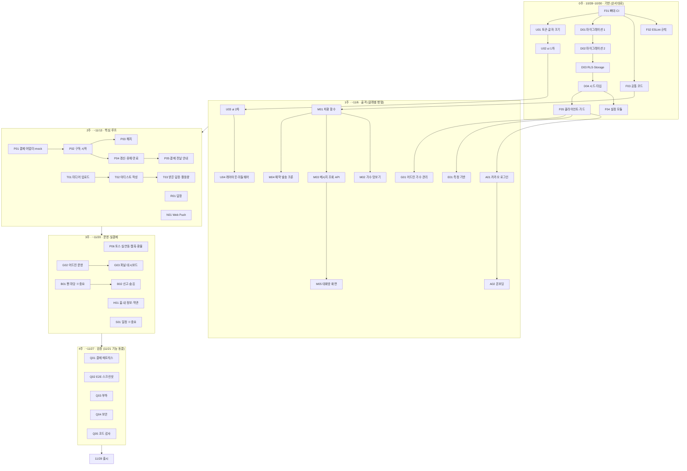

# 10. 개발 계획과 작업 카드

> 작성일: 2026-10-27 · 기준: 문서 00~08 (10/27 보정 반영)
> 기간: 10/28(수) ~ 11/28(금) 출시, 11/29~30 예비일
> 이 문서는 **"무엇을, 어떤 순서로, 몇 개의 PR로"** 만들지 정한다. **"어떻게 시키는지"**는 `11_agent_playbook.md`에 있다.

---

## 1. 일하는 방식 (5가지 약속)

1. **작업 카드 1장 = GitHub 이슈 1개 = PR 1개.** 카드보다 큰 일을 한 번에 시키지 않는다. PR은 300줄 이하이고, SQL·생성된 타입·테스트 코드는 이 제한에서 뺀다.
2. **0주차는 순서대로, 1주차부터 병렬로.** 빈 저장소에 에이전트 여럿을 동시에 풀면 서로 다른 구조를 만든다. 0주차에 기준 패턴(뼈대, 규칙, DB, 설정, 권한)을 한 줄로 세운 뒤에 갈래를 나눈다.
3. **같은 파일을 건드리는 카드는 동시에 돌리지 않는다.** 카드마다 "범위 파일"을 적어 두었다. 겹치면 한쪽이 끝날 때까지 기다린다(§5).
4. **완료 기준은 도구가 판정한다.** `npm run check:all`과 CI 통과가 기본이다. 사람은 그 위에서 설계 의도에 맞는지만 본다.
5. **머지는 사람만 한다.** 에이전트는 드래프트 PR까지만 만든다.

### 카드 읽는 법

| 칸 | 뜻 |
| --- | --- |
| ID | `W{주차}-{영역}{번호}`. 지시문, 브랜치 이름, PR 제목에 그대로 쓴다 |
| 담당 | A=리드(DB·결제·서버), B=프론트, C=풀스택(아티스트 모드·어드민·게시판), H=사람만 할 수 있는 일 |
| 프로필 | 에이전트 설정. `chore` / `default` / `high` / `critical` / `deep`. 뜻과 명령은 `11 §2` |
| 크기 | S=반나절 이하, M=하루, L=1~2일 (에이전트 작업 + 사람 리뷰 포함) |
| 선행 | 이 카드보다 먼저 머지돼야 하는 카드 |

영역 기호: F 기반 · D DB · U UI · A 인증·온보딩 · E 측정 · M 메시지 · P 결제 · R 답장 · T 아티스트 모드 · N 알림 · G 어드민 · S 일정 · B 팬 마당 · Q 검증 · X 선택

---

## 2. 사람이 해야 하는 일 (에이전트가 못 하는 일)

계정 생성, 계약, 심사, 비밀 키 발급은 에이전트에게 맡기지 않는다. 늦어지면 개발이 막히는 순서대로 적었다.

| ID | 할 일 | 마감 | 막히는 카드 |
| --- | --- | --- | --- |
| H-01 | GitHub 저장소 `trotyou` 생성. `main`·`develop` 보호 규칙(PR 필수, CI 통과 필수). `docs/`, `AGENTS.md`, `CLAUDE.md`, `.github/`, `.codex/`를 첫 커밋 | 10/28 오전 | 전부 |
| H-02 | Supabase **staging** 프로젝트 생성(리전 서울). URL·anon key·service role key 확보 | 10/28 | W0-D01 이후 staging 배포 |
| H-03 | Vercel 팀 **Pro** 전환, 저장소 연결, 함수 리전 서울(icn1), preview 환경 변수 입력 (D-11) | 10/29 | 매분 크론 배포 |
| H-04 | 카카오 디벨로퍼스 앱 생성, Redirect URI 등록(staging), **비즈니스 정보 인증 + 동의 항목 검수 신청** (D-12) | 10/28 신청 | W1-A01 |
| H-05 | 토스페이먼츠 가맹 + **자동결제(빌링)** 계약 신청. 카카오페이·휴대폰 빌링 가능 여부를 영업 담당에게 확인 (D-1, D-2) | 10/28 신청 | W3-P06 |
| H-06 | VAPID 키 생성(`npx web-push generate-vapid-keys`), `CRON_SECRET` 생성(32자 이상 무작위). 비밀번호 관리자에 보관 | 10/29 | W1-M04, W2-N01 |
| H-07 | Codex 클라우드 환경 `trotyou-staging` 생성 (`08 §4.2`). **W0-F01 머지 후** | 10/29 | 클라우드 병렬 작업 |
| H-07b | GitHub 알림 설정: 내 PR의 CI 실패를 메일·모바일로 받기 | 10/28 | PR·CI 확인 (08 §4.4) |
| H-08 | 시드 가수 2명의 프로필 사진·소개 글, 맛보기 메시지 예시 5개씩 (실제 계약 전이면 "예시"로 표기) | 11/3 | W1-M02 화면 확인 |
| H-09 | 사용성 테스트 참가자 8~10명 섭외 (50~60대) | 11/14 | W4-Q06 |
| H-10 | 로폼으로 약관·개인정보처리방침·환불 정책 초안 작성 → 검토 (D-9) | 11/17 | W3-H01 |
| H-11 | production: Supabase **Pro**(서울), Vercel production 환경 변수, 토스 라이브 키, 카카오 운영 Redirect URI, 도메인 | 11/25 | W5 출시 |

---

## 3. 전체 흐름

### 주차별 완료 정의 (07 §2와 같음)

| 끝나는 날 | 이 날 preview에서 되어야 하는 것 |
| --- | --- |
| 10/30(목) | `check:all`과 CI가 통과하는 빈 앱이 preview에 배포됨. 마이그레이션 14개 적용, 시드 가수 2명 |
| 11/6(목) | 카카오 로그인 → 온보딩 → 가수 고르기 → 맛보기. 어드민이 넣은 메시지가 크론으로 발송되어 대화방에 `{이름}`이 바뀌어 보임 |
| 11/13(목) | mock 결제로 "구독 → 메시지 → 답장" 루프 완성. 가수 계정으로 작성·예약·취소. Web Push 도착 |
| 11/20(목) | 실결제 1,000원 결제·환불 확인. 어드민으로 가수·맛보기·설정 관리. 일정·팬 마당 중 가능한 것 |
| 11/27(목) | 출시 기준(07 §4) 전부 통과 |

---

## 4. 작업 카드

### 0주차 · 기반 (10/28~10/30) — 리드가 순서대로, 프론트는 U 갈래만

| ID | 이름 | 담당 | 프로필 | 크기 | 선행 |
| --- | --- | --- | --- | --- | --- |
| W0-F01 | 저장소 뼈대·CI | A | default | M | H-01 |
| W0-F02 | ESLint 규칙(하드코딩·레이어) | A | high | M | F01 |
| W0-F03 | 공통 기반 코드 | A | default | S | F01 |
| W0-D01 | 마이그레이션 1 (0001~0005) | A | critical | L | F01 |
| W0-D02 | 마이그레이션 2 (0006~0012) | A | high | L | D01 |
| W0-D03 | RLS·Storage (0013~0014) | A | critical | L | D02 |
| W0-D04 | 시드·DB 타입 | A | default | S | D03 |
| W0-F04 | 설정 모듈 `getSetting` | A | high | M | D04, F03 |
| W0-F05 | Supabase 클라이언트·권한 가드·withCron·container | A | high | M | D04, F03 |
| W0-U01 | 디자인 토큰·글자 크기 3단계 | B | default | M | F01 |
| W0-U02 | ui 컴포넌트 1차 | B | default | M | U01, F02 |

0주차 카드의 **완성된 프롬프트**는 `11 §4`에 있다. 그대로 복사해 쓴다.

#### W0-F01 저장소 뼈대·CI
- **목표:** 이후 모든 작업이 올라갈 빈 앱과 자동 검사를 만든다.
- **문서:** 01 §4(디렉토리), 01 §5(env), 06 §9(npm 스크립트), 06 §8(CI)
- **범위:** Next.js(App Router, TypeScript strict, `src/`), Tailwind, Prettier, Vitest(unit·integration 두 프로젝트), Playwright 설치, `supabase` CLI(devDependency)와 `supabase init`, 01 §4의 빈 폴더(`.gitkeep`), `src/config/env.ts`, `.env.example`, `.github/workflows/ci.yml`
- **범위 밖:** 화면, ESLint 커스텀 규칙(F02), DB 스키마(D01)
- **수용 기준:** `npm run check:all` 통과 · CI의 `check` 잡과 `db` 잡(Supabase 로컬 기동 + `supabase test db`) 둘 다 초록 · Vercel preview 배포 성공 · env 누락 시 빌드 실패 확인

#### W0-F02 ESLint 규칙
- **목표:** 하드코딩 금지와 레이어 규칙을 사람이 아니라 lint가 잡게 한다.
- **문서:** 06 §1.1, 06 §2, 06 §5
- **범위:** `eslint.config.mjs`(폴더별 override), `tests/lint/`의 위반 예시 파일과 "이 파일들은 lint에 실패해야 한다" 테스트
- **수용 기준:** 숫자 리터럴·`process.env`·JSX 안 한글·경로 문자열·`console.log`·`any`·폴더 경계를 넘는 import·원시 `<button>/<a>/<input>`이 각각 예시 파일에서 오류로 잡힘 · `src/config/**`, `tests/**`는 예외 적용 · 기존 코드 lint 통과

#### W0-F03 공통 기반 코드
- **목표:** 모든 기능이 같이 쓰는 작은 부품을 먼저 만든다.
- **문서:** 03 §2.1·§2.2·§4·§5, 06 §6, 05 §3
- **범위:** `src/lib/result.ts`, `src/server/errors.ts`(에러 코드 ↔ HTTP 매핑), `src/lib/logger.ts`(pino, `call_name`·`phone`·`nickname`·`email`·`authorization` 가림), `src/config/routes.ts`(05 §3 전체 경로), `src/config/constants.ts`, `src/config/analytics-events.ts`, `src/lib/format.ts`(`formatKrw`), `src/lib/date-kst.ts`(KST 날짜·주 시작일)
- **수용 기준:** 각 파일 단위 테스트 · 로거가 가림 대상 값을 출력하지 않는 테스트

#### W0-D01 마이그레이션 1 (0001~0005)
- **목표:** 사용자·가수·구독·결제 테이블과 구독 상태 함수.
- **문서:** 02 §2, §3.1~§3.4 (10/27 보정 반영본)
- **범위:** `supabase/migrations/0001~0005_*.sql`, `supabase/tests/0005_subscription_state.test.sql`(pgTAP)
- **수용 기준:** `npm run db:reset` 성공 · `transition_subscription`의 허용 전이 전부 성공, 금지 전이 전부 `INVALID_TRANSITION` · `has_active_access`가 canceled라도 기간 안이면 true, 기간 밖이면 false · 회원 생성 시 `profiles`·`notification_preferences` 자동 생성

#### W0-D02 마이그레이션 2 (0006~0012)
- **목표:** 메시지, 게시판, 포인트, 일정, 알림 큐, 집계, 측정 테이블.
- **문서:** 02 §3.5~§3.11
- **범위:** `supabase/migrations/0006~0012_*.sql`, `supabase/tests/`의 신고·포인트 테스트
- **수용 기준:** 신고 3건이면 글이 자동 숨김(임계값은 `app_settings`에서 읽음) · 같은 날 출석 포인트 두 번 적립 실패 · `analytics_events`는 2026-10 ~ 2027-03 월별 파티션 + 다음 달 파티션을 만드는 함수 `ensure_analytics_partition(date)`

#### W0-D03 RLS·Storage (0013~0014)
- **목표:** 남의 데이터가 새지 않게 DB 단에서 막는다.
- **문서:** 02 §4(표 전부), §5
- **범위:** `0013_rls_policies.sql`(모든 테이블 RLS 켬, `auth_user_role()`, `is_artist_member()`), `0014_storage_buckets.sql`, `supabase/tests/0013_rls.test.sql`
- **수용 기준(pgTAP, 역할을 바꿔 가며):** 팬 A가 팬 B의 구독·결제·포인트를 못 봄 · 구독 안 한 팬은 맛보기 외 메시지를 못 봄 · 가수 계정이 `profiles.phone`·`nickname`을 못 봄 · 일반 사용자는 `notification_jobs`·`settlements`(남의 것)를 못 봄 · 팬이 `profiles.role`을 못 바꿈

#### W0-D04 시드·DB 타입
- **목표:** 개발과 테스트가 같은 데이터에서 시작하게 한다.
- **문서:** 02 §3.1 초기값 표, 07 §2(시드 가수 2명)
- **범위:** `supabase/seed.sql`(`app_settings` 전 키, 금칙 패턴은 실제 정규식: 휴대폰·계좌·URL), 가수 2명(B·C등급), 가수별 메시지 10개 중 맛보기 5개, `scripts/seed-users.ts`(Admin API로 팬2·가수1·어드민1 테스트 계정), `src/types/database.ts`(`npm run db:types` 결과)
- **수용 기준:** `db:reset` 후 `seed-users` 실행으로 네 계정 로그인 가능 · `app_settings` 키 목록이 02 §3.1 표와 일치

#### W0-F04 설정 모듈
- **목표:** "운영 값은 `app_settings`에서"라는 규칙을 타입 안전하게 쓸 수 있게 한다.
- **문서:** 02 §3.1, 06 §1, 03 §2.3
- **범위:** `src/server/settings/registry.ts`(키 → zod 스키마 + 설명. 어드민 설정 화면 W3-G02도 이걸 재사용), `get.ts`(`getSetting(key)` 반환 타입 자동 추론, 60초 캐시, 없는 키·타입 불일치 시 명확한 에러), 테스트
- **수용 기준:** 존재하지 않는 키는 타입 오류 · 레지스트리 키 목록과 시드 키 목록이 다르면 실패하는 통합 테스트

#### W0-F05 Supabase 클라이언트·권한 가드·withCron·container
- **목표:** 모든 서버 코드가 같은 방식으로 DB에 접근하고 권한을 검사하게 한다.
- **문서:** 03 §2.4·§5, 06 §6, 01 §2.4
- **범위:** `src/server/db/client.ts`(서버·관리자·브라우저 3종), `src/server/auth/guard.ts`(`requireUser`, `requireRole`, `requireArtistMember`, `requireSubscriber`), `src/server/cron/with-cron.ts`(시크릿 검사, 시간 제한, 오류 로그), `src/server/container.ts`(실제/모의 어댑터 선택), 테스트
- **수용 기준:** 가드마다 성공·실패 테스트 · 시크릿 없는 크론 호출 401

#### W0-U01 디자인 토큰·글자 크기 3단계
- **목표:** 글자 크기 하나로 앱 전체가 바뀌는 장치.
- **문서:** 05 §2
- **범위:** `src/config/design-tokens.ts`(하나의 객체에서 CSS 변수와 Tailwind 테마를 함께 생성), `src/app/globals.css`, 루트 레이아웃의 `data-font-scale` 주입(로그인 전 쿠키), `scripts/check-contrast.mjs`
- **수용 기준:** 세 단계 전환 시 본문·제목·버튼·간격이 같이 바뀜 · 팔레트 전 조합 대비 4.5:1 이상(스크립트) · 고정 `height` 없음

#### W0-U02 ui 컴포넌트 1차
- **목표:** 접근성 규칙이 들어 있는 기본 부품.
- **문서:** 05 §2.2·§4·§5, 06 §5
- **범위:** `src/components/ui/`: Button, IconButton(`label` 필수), Text, Heading, Input, TextArea, Card, EmptyState, Loading("불러오는 중…" 글자 + 스피너), ErrorBlock("다시 시도" 버튼), BackButton("뒤로" 글자) · 개발용 갤러리 `/dev/ui`(production에서는 404)
- **수용 기준:** 컴포넌트마다 role·label·최소 터치 크기 테스트 · 갤러리에서 세 단계 글자 크기 확인 가능

---

### 1주차 · 골격 (10/30~11/6)

| ID | 이름 | 담당 | 프로필 | 크기 | 선행 |
| --- | --- | --- | --- | --- | --- |
| W1-U03 | ui 컴포넌트 2차 | B | default | M | U02 |
| W1-U04 | 레이아웃·미들웨어·i18n | B | default | M | U03, F05 |
| W1-A01 | 카카오 로그인 | C | high | M | F05, H-04 |
| W1-A02 | 온보딩 (글자·이름·설치 안내) | B | default | M | A01, U04, F04, M02 |
| W1-E01 | 측정 기반 `track` | C | default | S | F05 |
| W1-M01 | `{이름}` 치환 함수 | A | default | S | F03 |
| W1-M02 | 가수 목록·맛보기 | C | default | M | M01, F05 |
| W1-M03 | 메시지 조회 API | A | high | M | M01, F04, F05 |
| W1-M04 | 예약 발송 크론 | A | high | M | M01, F05 |
| W1-M05 | 대화방 화면 | B | default | L | M03, U04 |
| W1-G01 | 어드민 가수 관리 | C | default | M | F05, U04 |
| W1-X01 | (선택) 사전 신청 페이지 | C | default | S | U02, E01 |

#### W1-U03 ui 컴포넌트 2차
- **범위:** Dialog + DialogProvider(동시에 하나만 열림, 큐), BottomSheet, Tabs, List/ListItem, Avatar, Badge, MicButton(`SpeechRecognition` 가능 여부 검사, 미지원 시 안내 문구, `onResult(text)`, 사용 시 `onUsed()` 콜백)
- **문서:** 05 §4·§5
- **수용 기준:** 다이얼로그 두 개를 연달아 열면 하나만 보임 · MicButton 미지원 환경 테스트

#### W1-U04 레이아웃·미들웨어·i18n
- **범위:** `next-intl` 설정과 `src/messages/ko.json` 구조, `(fan)` 하단 탭 5개(아이콘 + 글자), `(onboarding)`, `artist`, `admin` 레이아웃, 하위 화면 자동 BackButton, `src/middleware.ts`(세션 없음 → `/start`, 온보딩 미완료 → `/onboarding/font`, 역할별 `/artist`·`/admin` 차단)
- **문서:** 05 §3·§4·§6
- **수용 기준:** 역할 4종(비로그인·팬·가수·어드민) × 주요 경로 접근 테스트

#### W1-A01 카카오 로그인
- **범위:** S-01 `/start`, Supabase `signInWithOAuth('kakao')`, `/api/auth/callback`, `signOut` 액션. 동의 항목 검수(D-12) 전에는 닉네임만 요청하고, 연령대·성별은 검수 후 설정만 바꿔 켤 수 있게 스코프를 `env`로 둔다
- **문서:** 01 §2.2, 03 §3.1
- **수용 기준:** staging에서 실제 카카오 계정 로그인 → `profiles` 생성 → 온보딩으로 이동 · 로그아웃

#### W1-A02 온보딩
- **범위:** S-02 글자 크기(누르는 즉시 화면 반영, `updateProfile`), S-03 부를 이름(길이·욕설은 `app_settings`, MicButton), `/onboarding/install`(iOS 공유→홈 화면 그림 안내, Android 설치 버튼, 설치 후 알림 권한 요청은 W2-N01에서 연결), S-04는 M02 화면 재사용, `completeOnboarding`, 만 14세 확인 체크박스
- **이벤트:** `signup_complete`, `font_size_selected`
- **수용 기준:** 첫 로그인에서 가수 고르기까지 탭 6번 이내 · 이름 규칙 위반 시 인라인 안내

#### W1-E01 측정 기반
- **범위:** `src/server/services/analytics/track.ts`, `POST /api/analytics`(클라이언트 이벤트용, 이벤트명은 `AnalyticsEvent` 값만 허용), 클라이언트 훅 `useTrack`. 각 기능의 이벤트 심기는 해당 카드에서
- **문서:** 03 §4, 02 §3.11

#### W1-M01 `{이름}` 치환 함수
- **범위:** `src/server/services/message/render.ts`(`renderMessageBody(body, callName)`, 푸시용 미리보기 자르기 `renderPreview`)
- **문서:** 01 §2.3
- **수용 기준:** `{이름}` 여러 번, 이름 없음(기본 호칭은 `app_settings`), 특수문자 이름, 줄바꿈 유지 테스트

#### W1-M02 가수 목록·맛보기
- **범위:** `listActiveArtists`, `getArtist(slug)`, `GET /api/artists/{id}/preview`(치환 적용), S-04 가수 카드 목록, M-05 맛보기 화면(하단 고정 "구독하기" 버튼은 W2-P02 전까지 비활성 + 안내)
- **이벤트:** `preview_view`

#### W1-M03 메시지 조회 API
- **범위:** `services/message/list.ts`(`has_active_access` 재확인, 구독 시작 전 `message.visible_before_subscription_days`일까지만, 커서, `message.page_size`, 치환, 미디어 서명 URL), `GET /api/artists/{id}/messages`, `POST .../read`
- **문서:** 01 §3.4, 03 §3.4, 02 §5
- **수용 기준:** 비구독자 402 · 7일 경계 테스트 · 커서 이어 붙이기에서 중복·누락 없음

#### W1-M04 예약 발송 크론
- **범위:** `services/message/dispatch.ts`(`scheduled_at <= now` → `sent`, `for update skip locked`), 구독자별 `notification_jobs` 적재(알림 설정이 꺼진 사람 제외, 치환된 미리보기), `/api/cron/dispatch-messages`, `vercel.json`
- **문서:** 01 §3.3, 03 §3.9
- **수용 기준:** 크론 두 개가 동시에 돌아도 메시지 1번만 발송 · 구독자 1,000명 적재가 크론 1회 시간 안에 끝남(배치 크기는 설정값)

#### W1-M05 대화방 화면
- **범위:** M-01 내 가수 목록(안 읽은 수), M-02 대화방(첫 30개 서버 렌더 + TanStack Query 무한 스크롤), MessageBubble(글·사진·음성·영상), 음성 재생 속도 1.0/0.8배, M-03 크게 보기·저장
- **이벤트:** `message_open`(화면에 보일 때)
- **수용 기준:** 글자 3단계 스크린샷 3장 · 대화방 진입 1초 이내(시드 데이터 기준)

#### W1-G01 어드민 가수 관리
- **범위:** `/admin/artists` 목록·등록·수정(프로필 사진 업로드), `issueArtistAccount`, `setPreviewMessages`(최대 개수는 설정값), **임시 메시지 등록 폼**(1주차 완료 정의 확인용, W2-T02 이후 숨김)
- **문서:** 03 §3.8

#### W1-X01 (선택) 사전 신청 페이지
- **조건:** 수요검증을 하기로 결정했을 때만. 결정 전이면 만들지 않는다.
- **범위:** `/pre` 랜딩(맛보기 2~3개, "출시되면 알려 주세요"), 연락처 수집 동의, UTM 기록, 신청 수 어드민 표시
- **수용 기준:** 유입 경로별 방문·신청 수가 어드민에 보임

---

### 2주차 · 핵심 루프 (11/3~11/13)

| ID | 이름 | 담당 | 프로필 | 크기 | 선행 |
| --- | --- | --- | --- | --- | --- |
| W2-P01 | 결제 어댑터·mock·기간 계산 | A | high | M | F05 |
| W2-P02 | 구독 시작·결제 콜백·구독 화면 | A | critical | L | P01, M02 |
| W2-P03 | 해지·구독 관리 화면 | C | high | M | P02 |
| W2-P04 | 갱신·유예·만료 크론 | A | critical | L | P02 |
| W2-P05 | 결제 전날 안내 | C | default | S | P04, N01 |
| W2-R01 | 답장 (금칙 검사·마이크) | C | high | M | M05, F04 |
| W2-T01 | 미디어 업로드 | A | high | M | F05 |
| W2-T02 | 아티스트 메시지 작성 | C | high | L | T01, M01 |
| W2-T03 | 받은 답장·이번 주 활동량 | C | default | M | T02, R01 |
| W2-N01 | Web Push (구독·큐·서비스워커) | B | high | L | M04, U04 |

#### W2-P01 결제 어댑터·mock·기간 계산
- **범위:** `src/server/adapters/payment/provider.ts`(04 §1 인터페이스 그대로), `mock.ts`(성공·실패·지연을 env로), `src/lib/billing-period.ts`(1월 31일 → 2월 말일 보정)
- **수용 기준:** 기간 계산 경계 테스트(말일, 윤년) · mock으로 성공·실패 재현

#### W2-P02 구독 시작·결제 콜백·구독 화면
- **범위:** `services/subscription/start.ts`, `/api/payment/callback`, 첫 결제 금액 결정(D-8: 가수마다 첫 달 1회), 상태 전이 + 결제 이벤트 기록을 **DB 함수 하나**(`activate_subscription`)로 묶는 마이그레이션, M-04 화면(금액·다음 결제일·해지 방법 한 화면)
- **이벤트:** `subscribe_start`, `subscribe_complete`, `subscribe_fail`
- **문서:** 01 §3.1, 04 §2.1, 04 §4(신규·신규 실패)
- **수용 기준:** 브라우저 콜백만으로는 구독이 열리지 않음 · 결제 후 대화방까지 5초 이내 · 실패 시 M-04로 돌아와 안내 문구

#### W2-P03 해지·구독 관리 화면
- **범위:** `cancelSubscription`, U-02 화면(구독 중인 가수, 다음 결제일, 해지 버튼과 해지 후 이용 가능 기간 안내)
- **이벤트:** `cancel`
- **수용 기준:** 해지 후 기간 안에는 대화방 열람 가능

#### W2-P04 갱신·유예·만료 크론
- **범위:** `services/subscription/charge-due.ts`, `/api/cron/charge-renewals`, `canceled → expired`, `grace → expired`
- **이벤트:** `renew`
- **문서:** 04 §2.2·§2.3, 04 §4 매트릭스, D-10
- **수용 기준:** `08 §5` 지시문 예시의 수용 기준 그대로

#### W2-P05 결제 전날 안내
- **범위:** `services/notification/billing-notice.ts`, `/api/cron/notify-billing`(알림 큐에 적재만)

#### W2-R01 답장
- **범위:** `src/lib/validation/forbidden-patterns.ts`(패턴은 `app_settings`), `services/reply/send.ts`, `sendReply` 액션, ReplyComposer(입력창 최소 56dp, MicButton, 음성 결과를 보내기 전에 고칠 수 있음)
- **이벤트:** `reply_sent`, `voice_input_used`
- **수용 기준:** 전화번호·계좌·URL·욕설 각각 차단 테스트 · 글자 수 초과 차단

#### W2-T01 미디어 업로드
- **범위:** `POST /api/media/upload-url`(버킷·확장자·크기는 설정값), `StorageAdapter`, 브라우저 사진 리사이즈 유틸(긴 변은 설정값), 음성·영상 길이 검사 유틸
- **문서:** 01 §2.6, 02 §5

#### W2-T02 아티스트 메시지 작성
- **범위:** A-01 MessageComposer(글·사진·음성 녹음·영상, `{이름}` 넣기 버튼, "김순자 님에게는 이렇게 보여요" 미리보기, 예약 날짜·시간), `saveMessage`, `cancelMessage`(발송 후 설정 시간 안), 큐 삭제
- **수용 기준:** 글 메시지 작성부터 발송까지 1분 이내 · 취소 가능 시간이 지나면 `CANCEL_WINDOW_PASSED`

#### W2-T03 받은 답장·이번 주 활동량
- **범위:** A-02 `listReplies`(`call_name`만), A-03 콘텐츠 캘린더 보기 + 이번 주 메시지·사진 횟수(`services/settlement/weekly-stats.ts`의 함수를 크론과 공유) + 계약 기준 미달 안내
- **수용 기준:** 가수 화면 응답에 팬의 닉네임·전화가 없음(테스트)

#### W2-N01 Web Push
- **범위:** `NotificationChannel` 인터페이스, `adapters/notification/webpush.ts`, `/api/push/subscribe`, `services/notification/send-queue.ts`(배치, 재시도 횟수는 설정값), `/api/cron/send-notifications`, 서비스워커 푸시 수신·클릭 이동, 설치 후 알림 권한 요청 UI(A02 install 화면에 연결)
- **수용 기준:** Android Chrome·iOS(홈 화면 추가) 실기기 수신 확인 · 만료된 구독(410) 자동 삭제

---

### 3주차 · 운영·실결제 (11/10~11/20)

| ID | 이름 | 담당 | 프로필 | 크기 | 선행 |
| --- | --- | --- | --- | --- | --- |
| W3-P06 | 토스 실연동·웹훅·환불 | A | critical | L | P04, H-05 |
| W3-G02 | 어드민 운영(구독 현황·설정 편집·이용 제한·환불) | C | default | L | F04, P06 |
| W3-G03 | 퍼널 대시보드 | C | default | M | E01 |
| W3-H01 | 홈·내 정보·고객센터·약관 | B | default | M | M05, H-10 |
| W3-S01 | 일정·하루 전 알림 ※중요 | B | default | M | N01 |
| W3-B01 | 팬 마당 글·댓글·좋아요 ※중요 | C | default | L | T01, R01 |
| W3-B02 | 신고·숨김·어드민 처리 ※중요 | C | default | M | B01 |
| W3-G04 | 콘텐츠 캘린더 입력·활동량 대시보드 ※중요 | C | default | M | T03 |

※중요 카드는 11/20까지 못 끝나면 07 §1에 따라 출시에서 뺀다. 목요일 점검에서 결정한다.

#### W3-P06 토스 실연동·웹훅·환불
- **범위:** `adapters/payment/toss.ts`, `/api/webhooks/payment`(서명 검증, `webhook_receipts`로 중복 차단), 환불 서비스, 실결제 1,000원 → 즉시 환불 1회 확인 기록
- **문서:** 04 §1·§2.4, 04 §4
- **수용 기준:** 같은 웹훅 두 번 → 두 번째는 아무 변화 없이 200 · 실키는 preview 환경 변수에만, 코드·로그에 없음

#### W3-G02 어드민 운영
- **범위:** 구독 현황(가수별 구독자·신규·해지·재결제율), **설정 편집 화면**(W0-F04 레지스트리에서 폼을 자동 생성. 키마다 화면을 따로 만들지 않는다), 이용 제한, 환불 버튼
- **수용 기준:** 출시 기준 "`app_settings` 전 키가 어드민에서 편집 가능" 충족 · 잘못된 타입 저장 거부

#### W3-G03 퍼널 대시보드
- **범위:** 가입 → 유료 전환율, 첫 재결제율, 3개월 유지율, 월 답장 구독자 비율(북극성 지표). SQL 뷰 + 어드민 화면
- **문서:** 기획안 10장, 03 §3.8

#### W3-H01 홈·내 정보·고객센터·약관
- **범위:** H-01 홈(새 메시지, 오늘 일정, 인기 글 — 쿼리 3개 이내), U-01 내 정보(이름·글자 크기·알림 설정·알림 권한 다시 켜기), U-03 고객센터(전화·카톡은 `app_settings`의 `public.*`), `/terms`·`/privacy`(본문은 `src/content/legal/*.md`, 코드에 쓰지 않음)

#### W3-S01 일정·하루 전 알림
- **범위:** C-01 달력+목록(월 이동은 URL), C-02 상세(네이버·카카오 지도 링크 `lib/map-links.ts`), 일정별 알림 끄기, 어드민 일정 CRUD, `/api/cron/notify-schedules`(매시 실행, 설정 시각에만 발송)

#### W3-B01 팬 마당
- **범위:** B-01 목록(공지 고정), B-02 글 보기·댓글, B-03 글쓰기(사진 최대 개수는 설정값, T01 업로드 재사용, R01 금칙 검사 재사용, MicButton), 좋아요, 소프트 삭제
- **이벤트:** `post_create`

#### W3-B02 신고·숨김·어드민 처리
- **범위:** 신고 액션, 숨김된 글 표시 방식, 어드민 신고 목록·복구·삭제, 신고자에게 처리 결과 알림 큐 적재

#### W3-G04 콘텐츠 캘린더 입력·활동량 대시보드
- **범위:** 어드민 월간 주제·예시 문구 입력, 가수별 주간 활동량과 계약 기준 달성 표, `/api/cron/aggregate-weekly-stats`

---

### 4주차 · 검증 (11/17~11/27, 11/21 기능 동결)

기능 동결 후에는 버그 수정과 사용성 피드백 반영만 머지한다.

| ID | 이름 | 담당 | 프로필 | 크기 |
| --- | --- | --- | --- | --- |
| W4-Q01 | 결제 테스트 매트릭스 완성 (04 §4 전 행) | A | high | M |
| W4-Q02 | E2E 출시 시나리오 × 글자 3단계 × 뷰포트 2 + 주요 화면 22개 스크린샷 66장 | B | default (`ultra`로 병렬 가능) | L |
| W4-Q03 | 부하 테스트: 구독자 1,000명 발송 후 1분 내 푸시 (k6) | A | high | M |
| W4-Q04 | 보안 점검: 권한 침투 시나리오, 로그 개인정보 검사, 비밀 키 노출 검사 | A | critical + **교차 리뷰** | M |
| W4-Q05 | 전체 코드 감사: 레이어 위반, 남은 리터럴, 중복 코드, 문서와 다른 곳 | A | deep + **교차 리뷰** | M |
| W4-Q06 | 사용성 테스트(11/24~26) 결과 반영 | 전원 | default | L |

### 5주차 · 출시 (11/28)

| ID | 이름 | 담당 |
| --- | --- | --- |
| W5-L01 | production 배포 체크리스트 실행 (H-11 완료 확인, 마이그레이션 적용, 설정값 시드만, 크론 확인, 실결제 1회·환불) | 리드(사람) |
| W5-L02 | 출시 후 48시간 모니터링: 09·13·18시에 Vercel 함수 오류, Supabase 로그, 어드민의 결제 실패·구독 현황 확인. 결제 오류가 연속 3건이면 구독 버튼을 막고(설정값) 원인부터 본다 | 리드(사람) |

### 12월 이후 (07 §5)

정산 리포트·엑셀(첫 정산이 12월 초라 **12/1주 최우선**), 알림톡, 출석·포인트, 활동 등급, GPU 자막 실험(09 §4).

---

## 5. 병렬 작업 규칙

### 5.1 동시에 고치면 충돌 나는 파일

| 파일 | 규칙 |
| --- | --- |
| `supabase/migrations/*` | **A만** 만든다. 다른 갈래에서 컬럼이 필요하면 A에게 요청한다. 번호 충돌을 막기 위해서다 |
| `src/types/database.ts` | 마이그레이션 카드에서만 다시 생성한다 |
| `src/config/routes.ts`, `analytics-events.ts`, `src/messages/ko.json`, `vercel.json`, `src/server/container.ts` | **줄 추가만** 한다(AGENTS.md 규칙 7). 머지 전 `develop` 기준으로 rebase |
| `src/components/ui/*` | **B만** 고친다. 다른 갈래는 필요한 변경을 B에게 요청하거나, 자기 갈래 폴더에서 조립한다 |
| `eslint.config.mjs`, `tsconfig.json`, CI | A만 고친다 |

### 5.2 동시에 돌려도 되는 조합 (예)

- 1주차: `U03 → U04`(B) ‖ `A01 → E01 → M02 → G01`(C) ‖ `M01 → M03 → M04`(A)
- 2주차: `P01 → P02 → P04`(A) ‖ `R01 → T02 → T03`(C) ‖ `N01`(B). T01은 A가 P01과 P02 사이에 끼워 넣는다

### 5.3 브랜치와 이름

- 브랜치: `feat/W1-M03-message-list` (카드 ID + 짧은 영어 요약)
- PR 제목: `[W1-M03] 메시지 조회 API`
- 커밋: `feat(message): 메시지 조회 API와 커서 페이지네이션` (06 §8)
- 기준 브랜치는 `develop`. `main`은 출시할 때만.

---

## 6. 일정이 밀릴 때

| 상황 | 먼저 할 것 |
| --- | --- |
| 카드가 크기 예상의 2배를 넘김 | 카드를 둘로 나눈다. 나머지는 새 카드로 |
| 같은 카드를 에이전트가 두 번 실패 | `11 §3.7`로 도구나 effort를 바꾸고, 그래도 안 되면 사람이 직접 |
| 목요일 점검에서 완료 정의 미달 | ※중요 카드부터 뺀다(S01 → B02 → B01 → G04 순서) |
| PG 라이브 키가 11/17까지 안 나옴 | mock으로 출시 기준 테스트를 끝내고, 출시일에 실결제를 확인한다. 실결제가 안 되면 출시를 미룬다(결제 없는 출시는 하지 않는다) |
| 가수 계약 없음 | 기획안 11장 원칙: 출시 대신 사용성 테스트 반복 |
