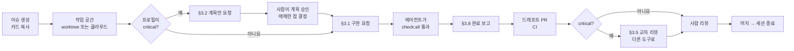

# 11. 에이전트 플레이북 — Codex·Claude Code에게 일 시키는 법

> 작성일: 2026-10-27 · 함께 볼 문서: `10_dev_plan.md`(작업 카드), `08_agent_workflow.md`(모델·클라우드 환경 설정)
> 원칙 한 줄: **카드 하나를, 새 세션 하나에서, 정해진 프롬프트로 시키고, 정해진 형식으로 보고받는다.**
> 작업 지시는 **사람이 직접, 업무 시간 안에서만** 한다. 밤이나 퇴근 후에 돌아가는 에이전트 작업은 없다.

---

## 0. 내일 아침 시작 순서

| 순서 | 누가 | 할 일 |
| --- | --- | --- |
| 1 | 리드 | 저장소를 만들고 이 문서 묶음(`docs/`, `AGENTS.md`, `CLAUDE.md`, `.github/`, `.codex/`)을 첫 커밋으로 올린다 (H-01). `CLAUDE.md`는 `ln -s AGENTS.md CLAUDE.md`로 링크한다 |
| 2 | 리드 | 로컬에서 Codex를 열고 §4.1 프롬프트로 **W0-F01**을 시킨다 |
| 3 | 리드·PM | F01이 도는 동안 사람 일 H-02~H-06을 처리한다(10 §2). 특히 카카오 비즈니스 인증과 토스 빌링 신청은 오늘 넣는다 |
| 4 | 리드 | F01 머지 → Codex 클라우드 환경 생성(H-07), GitHub CI 실패 알림 켜기(H-07b) |
| 5 | 리드 | **D01**을 §3.2 "계획 먼저"로 시작한다. 계획 검토를 기다리는 동안 F02, F03을 클라우드에 던진다 |
| 6 | 프론트 | F01 머지 직후 **U01 → U02** (§4.10, §4.11) |
| 7 | 풀스택 | 0주차는 H-04(카카오)·H-08(시드 가수 자료)를 챙기고, 10 문서의 1주차 C 갈래 카드를 미리 읽는다 |

0주차는 리드 한 줄이 병목이다. 서두르지 말고 **패턴이 맞는지**를 본다. 0주차 코드가 이후 모든 에이전트가 따라 할 본보기가 되기 때문이다.

---

## 1. 카드 한 장의 흐름



1. **이슈 만들기.** 10 문서의 카드를 `.github/ISSUE_TEMPLATE/agent-task.md` 양식에 붙인다. 주마다 월요일에 리드가 Codex로 한꺼번에 만들 수도 있다(§5.5).
2. **작업 공간 하나 = 카드 하나.** 로컬이면 git worktree, 클라우드면 Codex 클라우드 작업 하나(§5.3).
3. **프롬프트 보내기.** critical 카드는 계획을 먼저 받는다(§3.2). 나머지는 바로 구현(§3.1).
4. **보고 읽기.** 에이전트가 끝나면 §3.8 형식으로 보고한다. "추측한 것"과 "범위 밖"을 먼저 본다.
5. **PR과 리뷰.** CI가 초록이 아니면 리뷰하지 않는다. critical 카드는 다른 도구로 교차 리뷰한다(§3.5).
6. **머지 후 세션을 닫는다.** 다음 카드는 새 세션에서. 한 세션에 카드를 여러 장 이어 시키면 앞 카드의 맥락이 섞여 품질이 떨어진다.

---

## 2. 도구와 모델 배정

### 2.1 기본 원칙

- **Codex가 주력**이다. 모든 카드는 Codex로 시작한다.
- **Claude Code는 세 경우에만** 쓴다.
  1. Codex 사용량이 5시간 또는 주간 한도의 80%를 넘었을 때
  2. 같은 카드를 Codex가 두 번 실패했을 때(§3.7)
  3. critical 카드의 **교차 리뷰**. 코드를 쓴 모델과 다른 모델이 보면 같은 실수를 놓칠 확률이 줄어든다. 한도에 여유가 있을 때 권장
- **같은 카드를 두 도구에 동시에 시키지 않는다.** PR이 충돌하고 어느 쪽이 맞는지 사람이 다시 봐야 한다.

### 2.2 프로필 → 명령

10 문서 카드의 "프로필" 칸을 보고 아래 명령으로 연다.

| 프로필 | 쓰는 카드 | Codex | Claude Code (대체) |
| --- | --- | --- | --- |
| `chore` | 이름 바꾸기, 문구 옮기기, lint 수정 | `codex -p chore` (gpt-6-luna · low) | `claude --model claude-haiku-5-5` |
| `default` | 화면 조립, CRUD, 테스트 추가 | `codex` (gpt-6.1-sol · medium) | `claude --model claude-fable-5-1` (effort medium) |
| `high` | 크론, 권한 가드, 설정 모듈, 업로드 | `codex -p high` (gpt-6.1-sol · high) | Fable 5.1 · effort high |
| `critical` | 구독 상태, 결제, 웹훅, RLS, 보안 점검 | `codex -p critical` (gpt-6.1-sol · xhigh) + **계획 먼저** | Fable 5.1 · effort high + **plan mode** |
| `deep` | 저장소 전체 감사, 원인 모를 버그 | `codex -p deep` (gpt-6-astra · high) | Fable 5.1 · effort high |

- Fable 5.1 한도를 다 쓰면 같은 기준으로 `claude-opus-5-5`를 쓴다.
- 프로필은 `.codex/config.toml`에 있다. Codex 버전에 따라 프로필 문법이 다르면 직접 지정한다: `codex -m gpt-6.1-sol -c model_reasoning_effort='"high"'`.
- **effort를 습관적으로 올리지 않는다.** 결과가 두 번 틀리면 한 단계 올리고, 그래도 틀리면 지시문을 의심한다(08 §2.1).

---

## 3. 프롬프트 템플릿

`{ }` 부분만 바꿔서 쓴다. 카드에 이미 범위와 수용 기준이 다 있으므로, 프롬프트는 **카드를 가리키고 규칙을 상기시키는** 역할만 한다. 카드 내용을 프롬프트에 다시 베껴 쓰지 않는다. 베끼면 카드와 프롬프트가 어긋나는 순간이 생긴다.

### 3.1 표준 구현 (default·high 카드)

```text
[작업] {카드 ID} {카드 이름}

docs/10_dev_plan.md에서 {카드 ID} 카드를 찾아 읽어. 그 카드가 이번 작업의 전부야.
카드의 "문서" 칸에 적힌 섹션도 먼저 읽어.

참고할 기존 코드: {비슷한 구현 파일 경로. 없으면 "없음"}

지켜야 할 것:
- AGENTS.md 규칙. 특히 하드코딩 금지, 레이어 규칙, 공용 파일은 추가만.
- 카드의 "범위" 밖 파일은 고치지 마. 꼭 필요해 보이면 고치지 말고 보고에 적어.
- 문서와 코드가 다르거나 문서에 답이 없으면 추측하지 말고 멈추고 물어봐.
- 마이그레이션이 필요하면 만들지 말고 보고해. (D 카드 제외)

완료 조건:
- 카드의 수용 기준 전부를 테스트로 증명
- npm run check:all 통과

끝나면 브랜치 feat/{카드 ID}-{영문 요약}에 커밋하고,
docs/11_agent_playbook.md §3.8 형식으로 보고해.
```

**Codex 클라우드에서 돌릴 때 덧붙일 줄** (클라우드에는 Docker가 없어 로컬 Supabase를 못 띄운다):

```text
이 환경에서는 Supabase를 띄울 수 없어. 통합 테스트(test:integration, test:db)는 실행하지 말고
작성만 해. CI가 돌린다. 단위 테스트와 lint, typecheck, build는 여기서 통과시켜.
```

### 3.2 계획 먼저 (critical 카드)

**1단계 — 계획만 받기**

```text
[계획만] {카드 ID} {카드 이름}

docs/10_dev_plan.md의 {카드 ID} 카드와, 카드의 "문서" 칸 섹션을 읽어.
아직 코드는 쓰지 마. 아래 6가지를 적어서 보여줘.

1. 만들거나 고칠 파일 목록과 각 파일이 하는 일
2. 핵심 함수의 이름, 입력, 출력
3. 트랜잭션 경계: 무엇을 DB 함수 하나로 묶고, 무엇을 앱 코드에 둘지. 그 이유
4. 테스트 목록: 수용 기준 한 줄마다 테스트 이름 하나씩 짝지어서
5. 문서에서 애매하거나 빠진 부분 (내가 결정해야 할 것). 각각 선택지 2개와 네 추천
6. 이 작업에서 가장 틀리기 쉬운 곳 2가지와 그걸 막을 테스트
```

**2단계 — 승인하고 구현시키기**

```text
계획 승인. 5번은 이렇게 정한다:
- {결정 1}
- {결정 2}

테스트부터 써서 실패하는 걸 확인한 뒤 구현해(§3.3 규칙).
나머지는 docs/11 §3.1 규칙과 같아. 끝나면 §3.8 형식으로 보고해.
```

Claude Code에서는 **plan mode**가 1단계와 같은 일을 한다(§6.2). 그래도 위 6가지 항목은 그대로 요구한다. 형식이 같아야 계획을 빨리 검토할 수 있다.

### 3.3 테스트 먼저 (도메인 로직)

`render.ts`, `billing-period.ts`, 금칙 패턴, 정산 계산, 상태 전이처럼 **입력과 출력이 분명한 로직**에는 이 문구를 §3.1이나 §3.2에 덧붙인다.

```text
수용 기준을 테스트로 먼저 쓰고, 실행해서 실패하는 걸 확인한 뒤 커밋해. 그다음에 구현해.
구현을 맞추려고 테스트를 고치지 마. 테스트가 틀렸다고 생각하면 고치지 말고 이유를 보고해.
```

리뷰할 때는 **테스트 diff를 구현 diff보다 먼저 본다.** 테스트가 수용 기준을 제대로 옮겼으면 구현은 그다음 문제다.

### 3.4 화면 작업에 덧붙일 문구

```text
화면 규칙:
- src/components/ui 컴포넌트만 조립해. 원시 button/a/input 금지. 필요한 ui 부품이 없으면
  만들지 말고 보고해(ui 폴더는 B 갈래 소유).
- 문구는 src/messages/ko.json에 "추가만" 하고 t()로 읽어.
- 글자 크기 normal / large / xlarge 세 단계, 폭 360px로 Playwright 스크린샷 3장을 찍어
  test-results/{카드 ID}/에 저장하고 경로를 보고해. 글자가 잘리거나 겹치는 곳이 있으면 그것도 보고해.
```

### 3.5 교차 리뷰 (critical 카드, 다른 도구로)

Codex가 쓴 PR이면 Claude Code로, Claude Code가 쓴 PR이면 Codex로 리뷰한다.

```text
[리뷰] PR #{번호} ({카드 ID})

너는 이 코드를 쓰지 않은 리뷰어야. 코드는 고치지 말고 리뷰만 해.

읽을 것:
- docs/10_dev_plan.md의 {카드 ID} 카드와 카드의 "문서" 칸 섹션
- AGENTS.md
- 변경 내용: gh pr diff {번호}

찾을 것 (심각한 순서):
1. 돈이나 구독 상태가 틀어질 수 있는 경로: 동시 실행, 재시도, 중간 실패, 시간 경계
2. 권한: 다른 사람의 데이터를 보거나 바꿀 수 있는 경로
3. 수용 기준 중 테스트로 증명되지 않은 것
4. 하드코딩, 레이어 위반, 문서와 다른 것

지적마다 적을 것: 파일과 줄, 실제로 무슨 일이 생기는지 구체적인 상황, 고치는 방향.
확실하지 않으면 "추정"이라고 표시해. 문제가 없으면 없다고 해. 코드 스타일 지적은 하지 마.
```

리뷰 결과에 1·2번 지적이 있으면 원래 작업한 세션에 그대로 붙여 넣고 고치게 한다.

### 3.6 CI 실패 고치기

```text
PR #{번호}의 CI가 실패했어. gh run view --log-failed로 로그를 보고
(안 되면 아래 붙인 로그를 봐) 원인을 한 문단으로 설명한 뒤 고쳐.

테스트를 지우거나, 건너뛰게 하거나, 기대값을 바꿔서 통과시키지 마.
그렇게 해야 할 이유가 있으면 고치지 말고 이유를 보고해.

{로그 붙여넣기 (선택)}
```

### 3.7 막혔을 때와 도구를 바꿀 때

| 상황 | 할 일 |
| --- | --- |
| 1번 실패 | 같은 세션에서 실패 원인을 설명시키고 다시 시도 |
| 2번 실패 | effort를 한 단계 올리거나 도구를 바꾼다. 바꾸기 전에 아래 인수인계를 받는다 |
| 3번 실패 | 에이전트를 멈춘다. 카드가 너무 크거나 문서가 모호한 것이다. 사람이 카드를 나누거나 문서를 고친다 |

**인수인계 요청 (기존 세션에)**

```text
작업을 다른 작업자에게 넘길 거야. 아래를 적어줘.
1. 지금까지 한 일 (커밋 목록)
2. 남은 일
3. 시도했다가 실패한 방법과 실패한 이유
4. 다음 작업자가 가장 먼저 봐야 할 파일 3개
5. 네가 의심하는 원인
```

**새 도구에서 이어받기**

```text
{§3.1 표준 구현 프롬프트 전체}

이 작업은 이어받는 거야. 브랜치 feat/{카드 ID}-{영문 요약}을 체크아웃해서 시작해.
앞 작업자의 인수인계:
{인수인계 붙여넣기}

앞 작업자가 실패한 방법은 다시 시도하지 마.
```

### 3.8 완료 보고 형식

모든 에이전트는 작업 끝에 이 형식으로 보고한다(AGENTS.md 규칙 6). 이 보고가 PR 설명이 된다.

```markdown
## 완료 보고 — {카드 ID}

- **한 일:** (3줄 이내)
- **수용 기준:**
  - [x] {기준 1} — 증명한 테스트: `{테스트 이름}`
  - [ ] {기준 2} — 못 한 이유:
- **check:all:** 통과 / 실패 ({무엇이})
- **범위 밖에서 고친 파일:** 없음 / {파일과 이유}
- **추측한 것 (사람 확인 필요):** 문서에 없어서 내가 정한 것
- **다음 카드에 넘길 것:**
```

사람은 **"추측한 것"과 "범위 밖"을 먼저** 읽는다. 여기 적힌 게 있으면 그 결정을 문서에 반영할지, 되돌릴지 정한다.

### 3.9 나쁜 지시와 좋은 지시

| 나쁜 지시 | 무엇이 문제인가 | 좋은 지시 |
| --- | --- | --- |
| "결제 기능 만들어 줘" | 범위가 없어서 에이전트가 마음대로 넓힌다 | "`[작업] W2-P02` + §3.2" |
| "깔끔하게 리팩터링해 줘" | 끝나는 기준이 없다 | 리팩터링도 카드로 만든다. "레이어 위반 N건을 고친다, 동작은 바뀌지 않는다, 기존 테스트 전부 통과" |
| "테스트 통과하게 고쳐 줘" | 테스트를 고쳐 버린다 | §3.6 |
| 카드 내용을 프롬프트에 길게 베껴 넣기 | 카드와 프롬프트가 어긋난다 | 카드 ID로 가리킨다 |
| 한 세션에서 카드 세 장을 연달아 | 앞 카드 맥락이 섞인다 | 카드마다 새 세션 |
| "알아서 판단해" | 추측이 문서 없이 코드에 들어간다 | "애매하면 멈추고 물어봐" |

### 3.10 문서-코드 대조 (매주 금요일 오전, 리드가 직접)

에이전트가 상시로 지켜보지 않으므로, 문서와 코드가 어긋난 곳은 일주일에 한 번 몰아서 찾는다. `deep` 프로필로 연다.

```text
[대조] 이번 주 문서-코드 대조

코드는 고치지 말고 보고만 해. 아래 두 쌍을 비교해서 서로 다른 곳을 전부 찾아.
1. docs/02_database.md  ↔  supabase/migrations/ (테이블, 컬럼, 함수, RLS 정책)
2. docs/03_api.md       ↔  src/app/api/** 와 **/actions.ts (경로, 권한, 에러 코드)

표로 보고해: | 위치(문서 §, 파일:줄) | 문서 내용 | 코드 내용 | 추천: 문서를 고칠지 / 코드를 고칠지 | 이유 |
추천 기준: 이미 머지된 코드가 더 나은 판단이면 문서를 고치고, 문서가 결정 사항(00 §3)이나
보안·돈과 관련된 규칙이면 코드를 고친다. 확실하지 않으면 "사람 결정"이라고 적어.
```

결과를 보고 리드가 정한다. 문서 수정은 `chore` 카드로, 코드 수정은 새 작업 카드로 만든다.

---

## 4. 0주차 실제 프롬프트

카드만으로는 알 수 없는 **기술 선택**을 덧붙인 완성본이다. 그대로 복사해서 쓴다.

### 4.1 W0-F01 저장소 뼈대·CI — Codex 로컬 · `default`

```text
[작업] W0-F01 저장소 뼈대·CI

docs/10_dev_plan.md의 W0-F01 카드, docs/01 §4·§5, docs/06 §8·§9를 읽어.
저장소 루트에는 이미 docs/, AGENTS.md, CLAUDE.md, .github/, .codex/가 있어. 이것들은 건드리지 마.

만들 것:
1. Next.js 앱: TypeScript, App Router, src/ 폴더, Tailwind, import 별칭 @/*, 패키지 관리는 npm.
   create-next-app이 비어 있지 않은 폴더라며 거부하면 임시 폴더에 만든 뒤 파일을 옮겨.
   버전은 설치 시점의 안정판을 쓰고 package-lock.json을 커밋해.
2. tsconfig: strict, noUncheckedIndexedAccess, exactOptionalPropertyTypes를 켜.
3. Prettier. ESLint는 create-next-app 기본 설정만 둬(우리 규칙은 W0-F02에서).
4. Vitest: unit 프로젝트(src/**/*.test.ts, tests/unit)와 integration 프로젝트(tests/integration).
   테스트가 아직 없어도 통과하게(passWithNoTests).
5. Playwright: 설치와 설정 파일만. 테스트는 아직 없음.
6. Supabase CLI: npm devDependency로 설치하고 npx supabase init.
7. docs/01 §4의 폴더 구조를 빈 폴더(.gitkeep)로 만들어.
8. src/config/env.ts: docs/01 §5의 zod 스키마. 서버 전용 값과 NEXT_PUBLIC_ 값을 나눠서,
   브라우저 코드가 서버 비밀 값을 import하면 빌드가 실패하게 해. .env.example에 같은 키를 빈 값으로.
9. package.json scripts: docs/06 §9 그대로 + "test:db": "supabase test db".
10. .github/workflows/ci.yml: develop·main으로 가는 PR과 push에서 실행.
    - check 잡: Node LTS, npm ci, lint, typecheck, test, build.
      build에 필요한 env는 workflow에 테스트용 가짜 값으로 넣어(비밀 값 아님).
    - db 잡: supabase/setup-cli 액션, supabase start, npm run test:db, npm run test:integration.
11. .gitignore: .env* 무시하되 .env.example은 포함. test-results/ 무시.
12. README.md: 로컬 실행 방법 10줄 이내.

하지 말 것: 화면 만들기, DB 스키마, 우리 ESLint 규칙, 실제 비밀 값 넣기.

완료 조건:
- npm run check:all 통과
- env.ts에서 필수 값을 하나 빼면 build가 실패하는 걸 확인하고 보고에 적어
- CI 두 잡이 초록 (드래프트 PR을 열어서 확인)

끝나면 feat/W0-F01-scaffold 브랜치에 커밋하고 docs/11 §3.8 형식으로 보고해.
```

### 4.2 W0-F02 ESLint 규칙 — Codex · `high`

```text
[작업] W0-F02 ESLint 규칙

docs/10의 W0-F02 카드, docs/06 §1·§2·§5를 읽어.

eslint.config.mjs에 폴더별 규칙을 넣어:
- src/** 전체: no-magic-numbers(0, 1, -1과 배열 인덱스 허용), no-console,
  @typescript-eslint/no-explicit-any, process.env 직접 접근 금지(src/config/env.ts만 예외),
  JSX 안의 한글 문자열 금지, "/artists" "/board" "/schedules" "/me" "/admin" "/artist" "/api"로
  시작하는 문자열 금지(src/config/routes.ts만 예외).
- src/app/**, src/components/**: @/server/adapters/*, @/server/db/* import 금지.
- src/server/services/**: next/* import 금지, 전역 fetch 사용 금지, process.env 금지.
- src/components/ui/**: @/server/*, @/types/database import 금지.
- src/lib/**: @/server/* import 금지.
- src/app/**, src/components/{fan,artist,admin}/**: JSX의 button, a, input 태그 금지.
- 예외 폴더: src/config/**, tests/**, scripts/**, *.config.*

규칙이 실제로 잡는지 증명하는 테스트를 만들어:
- tests/lint/ 아래에 위반 예시를 코드 문자열로 두고, ESLint Node API의 lintText를
  filePath 옵션(예: 'src/server/services/x.ts')과 함께 호출해서 규칙마다 오류가 나는지 확인해.
  예시 파일을 실제 src/ 아래에 두지 마.
- 같은 방식으로 예외 폴더에서는 오류가 안 나는 것도 확인해.

완료 조건: 카드 수용 기준 전부, npm run check:all 통과.
알려진 구멍이 있으면 보고에 적어(예: 파일 안 최상단 const로 숫자를 숨기는 경우).
feat/W0-F02-eslint-rules에 커밋하고 §3.8 형식으로 보고해.
```

### 4.3 W0-F03 공통 기반 코드 — Codex 클라우드 · `default`

```text
[작업] W0-F03 공통 기반 코드

docs/10의 W0-F03 카드와 카드의 "문서" 칸 섹션을 읽어.

추가 지시:
- Result 타입은 { ok: true, data } | { ok: false, error: { code, message, details? } } 모양(03 §2.1).
  ok(), err() 헬퍼와 타입 좁히기 헬퍼를 같이 만들어.
- errors.ts의 에러 코드는 as const 객체 + 유니온 타입. 코드 → HTTP 상태 매핑 함수 포함.
- logger.ts: pino. 가릴 키 목록은 src/config/constants.ts에 둬.
- routes.ts: docs/05 §3 표의 경로 전부. 동적 경로는 함수(routes.artist(slug)).
- date-kst.ts: KST 기준 "오늘 날짜 문자열"과 "이번 주 월요일"을 구하는 함수.
  서버가 UTC로 돌아도 맞아야 해. 자정 직전·직후 테스트 포함.

이 환경에서는 Supabase를 띄울 수 없어. 통합 테스트(test:integration, test:db)는 실행하지 말고
작성만 해. CI가 돌린다. 단위 테스트와 lint, typecheck, build는 여기서 통과시켜.

npm run check:all 통과. feat/W0-F03-common에 커밋하고 §3.8 형식으로 보고해.
```

### 4.4 W0-D01 마이그레이션 1 — Codex 로컬 · `critical` · 계획 먼저

1단계는 §3.2 "계획만"에 아래를 덧붙인다.

```text
[계획만] W0-D01 마이그레이션 1 (0001~0005)

docs/10_dev_plan.md의 카드와, 카드의 "문서" 칸 섹션을 읽어.
아직 코드는 쓰지 마. 아래 6가지를 적어서 보여줘.

1. 만들거나 고칠 파일 목록과 각 파일이 하는 일
2. 핵심 함수의 이름, 입력, 출력
3. 트랜잭션 경계: 무엇을 DB 함수 하나로 묶고, 무엇을 앱 코드에 둘지. 그 이유
4. 테스트 목록: 수용 기준 한 줄마다 테스트 이름 하나씩 짝지어서
5. 문서에서 애매하거나 빠진 부분 (내가 결정해야 할 것). 각각 선택지 2개와 네 추천
6. 이 작업에서 가장 틀리기 쉬운 곳 2가지와 그걸 막을 테스트

이 카드에서 특히 계획에 넣을 것:
- 모든 테이블의 updated_at을 갱신하는 공용 트리거 함수 하나(set_updated_at)를 만들고 재사용할지
- security definer 함수에는 set search_path = public을 붙일 것
- handle_new_user 트리거가 카카오 메타데이터 키를 모를 때도 실패하지 않는 방법
  (실제 키 이름은 W1-A01에서 확인. 지금은 값이 없으면 null)
- pgTAP 테스트 파일 구성 (supabase/tests/, npm run test:db로 실행)
- 02 문서의 10/27 보정 내용(00_README §3-1)이 반영됐는지
```

2단계에서 계획을 승인할 때 확인할 것:

- 상태 전이 표(02 §3.4)의 허용·금지 조합이 테스트 목록에 **빠짐없이** 들어 있는가
- `payment_events`에 UPDATE·DELETE를 막는 장치(권한 회수 또는 트리거)가 있는가

### 4.5 W0-D02 마이그레이션 2 — Codex 로컬 · `high`

```text
[작업] W0-D02 마이그레이션 2 (0006~0012)

docs/10의 W0-D02 카드, docs/02 §3.5~§3.11을 읽어. W0-D01에서 만든
0001~0005와 set_updated_at 패턴을 그대로 따라.

추가 지시:
- posts.like_count, posts.comment_count는 트리거로 유지해(좋아요·댓글 추가와 삭제 모두).
- analytics_events: 2026-10 ~ 2027-03 월별 파티션을 만들고,
  ensure_analytics_partition(date) 함수로 다음 달 파티션을 만들 수 있게 해.
  PK는 (id, occurred_at) (10/27 보정).
- apply_report 트리거의 임계값은 app_settings에서 읽어. 값이 없으면 숨기지 않는 쪽으로.
- pgTAP: 신고 3건 자동 숨김, 같은 날 출석 포인트 두 번 거부, 좋아요 카운트 증가·감소.

이미 적용된 0001~0005는 고치지 마. 고쳐야 할 게 보이면 보고만 해.
npm run db:reset, npm run test:db, npm run check:all 통과.
feat/W0-D02-migrations-2에 커밋하고 §3.8 형식으로 보고해.
```

### 4.6 W0-D03 RLS·Storage — Codex 로컬 · `critical` · 계획 먼저

```text
[계획만] W0-D03 RLS·Storage (0013~0014)

docs/10_dev_plan.md의 카드와, 카드의 "문서" 칸 섹션을 읽어.
아직 코드는 쓰지 마. 아래 6가지를 적어서 보여줘.

1. 만들거나 고칠 파일 목록과 각 파일이 하는 일
2. 핵심 함수의 이름, 입력, 출력
3. 트랜잭션 경계: 무엇을 DB 함수 하나로 묶고, 무엇을 앱 코드에 둘지. 그 이유
4. 테스트 목록: 수용 기준 한 줄마다 테스트 이름 하나씩 짝지어서
5. 문서에서 애매하거나 빠진 부분 (내가 결정해야 할 것). 각각 선택지 2개와 네 추천
6. 이 작업에서 가장 틀리기 쉬운 곳 2가지와 그걸 막을 테스트

이 카드에서 특히 계획에 넣을 것:
- docs/02 §4 표의 칸 하나하나를 어떤 정책 이름으로 구현할지 표로
- 팬이 profiles.role을 못 바꾸게 하는 방법. 행 단위 정책만으로는 열을 못 막으니
  열 단위 권한(grant update (call_name, font_scale, ...))으로 막을지
- 가수가 받은 답장을 볼 때 팬의 call_name만 보이게 하는 방법.
  가수에게 profiles 조회 정책을 열지 말고, is_artist_member를 검사하고 call_name만 돌려주는
  security definer 함수(예: get_replies_for_artist)로 할지
- auth_user_role(), is_artist_member()의 성능(정책마다 불리는 함수)
- pgTAP에서 역할을 바꿔 가며 검사하는 방법(set local role, request.jwt.claims)
```

### 4.7 W0-D04 시드·DB 타입 — Codex 로컬 · `default`

```text
[작업] W0-D04 시드·DB 타입

docs/10의 W0-D04 카드와 docs/02 §3.1 초기값 표를 읽어.

추가 지시:
- app_settings는 02 §3.1 표의 키 전부. 값과 설명은 표 그대로.
- moderation.forbidden_patterns는 실제로 동작하는 정규식으로 채워(휴대폰 번호, 계좌번호, URL).
  "2026-11-28" 같은 날짜, "6,500원" 같은 금액, "010" 하나만 있는 문장은 걸리면 안 돼.
  이 경우들을 단위 테스트로 남겨(tests/unit/forbidden-patterns.seed.test.ts).
- moderation.profanity_words는 자리만 잡는 작은 목록. 실제 목록은 운영팀이 채운다고 설명에 적어.
- 가수 2명은 이름 앞에 "(예시)"를 붙여. 실제 가수 계약 전이야.
- scripts/seed-users.ts: Supabase Admin API로 팬 2명, 가수 1명(가수 1에 연결), 어드민 1명.
  비밀번호는 실행할 때 env로 받고, 저장소와 로그에 남기지 마.
- npm run db:types로 src/types/database.ts를 만들어 커밋해.

npm run db:reset, check:all 통과. feat/W0-D04-seed에 커밋하고 §3.8 형식으로 보고해.
```

### 4.8 W0-F04 설정 모듈 — Codex · `high`

```text
[작업] W0-F04 설정 모듈

docs/10의 W0-F04 카드, docs/02 §3.1, docs/06 §1, docs/03 §2.3을 읽어.

설계:
- src/server/settings/registry.ts:
  settingsRegistry = { 'reply.max_length': { schema: z.number().int().positive(), description: '...' }, ... }
  02 §3.1의 키 전부. as const로 두고, 키 이름 유니온 타입과 값 타입을 여기서 뽑아.
  이 레지스트리를 W3-G02 어드민 설정 화면이 그대로 재사용해서 폼을 만든다는 걸 염두에 둬
  (스키마에서 입력 종류를 알 수 있게).
- src/server/settings/get.ts:
  getSetting(key)는 키에 맞는 타입을 돌려줘(호출하는 쪽에서 타입을 적지 않게).
  getSettings([...keys])로 한 번에 여러 개. 캐시 시간은 src/config/constants.ts에 둬.
  DB에 키가 없거나 스키마와 안 맞으면 키 이름이 들어간 오류를 던져.
- DB 접근은 F05 전이면 간단한 인터페이스(SettingsSource)를 받아서 해. 테스트에서는 메모리 구현을 써.

테스트:
- 단위: 타입 추론(존재하지 않는 키는 타입 오류 — expectTypeOf 등), 캐시 만료, 잘못된 값 오류.
- 통합(tests/integration): 레지스트리 키 목록과 DB의 app_settings 키 목록이 정확히 같은지.

AGENTS.md 규칙을 지켜. 카드 범위 밖 파일은 고치지 말고, 문서에 답이 없으면 추측하지 말고 멈추고 물어봐.
npm run check:all 통과.
feat/W0-F04-settings에 커밋하고 §3.8 형식으로 보고해.
```

### 4.9 W0-F05 클라이언트·가드·withCron·container — Codex · `high`

```text
[작업] W0-F05 Supabase 클라이언트·권한 가드·withCron·container

docs/10의 W0-F05 카드, docs/03 §2.4·§5, docs/06 §6을 읽어.
참고할 기존 코드: src/lib/result.ts, src/server/errors.ts, src/server/settings/

설계:
- src/server/db/client.ts: @supabase/ssr로 서버용(쿠키), 관리자용(service role), 브라우저용.
  관리자용과 서버용 파일 맨 위에 import 'server-only'.
- src/server/auth/guard.ts: requireUser, requireRole, requireArtistMember, requireSubscriber.
  throw하지 말고 Result를 돌려줘(UNAUTHENTICATED, FORBIDDEN, SUBSCRIPTION_REQUIRED).
- src/server/cron/with-cron.ts: Authorization: Bearer {CRON_SECRET} 검사(시간 차 공격을 피하는
  비교), 시간 제한(constants.ts), 시작·끝·오류 로그, 결과 JSON 응답.
- src/server/container.ts: createContainer()가 deps 묶음을 돌려줘.
  { db, settings, clock, logger } + 앞으로 추가될 payment, notification, storage, analytics 자리.
  clock은 now()만 있는 인터페이스. 시간에 따라 달라지는 로직(구독 기간, 7일 범위, 취소 5분)을
  테스트에서 시각을 고정해 검사하려고 쓰는 거야. 서비스 코드에서 new Date()를 직접 쓰지 않게 해.

테스트: 가드마다 성공·실패, withCron 시크릿 없음 401·틀림 401·맞음 200.
AGENTS.md 규칙을 지켜. 카드 범위 밖 파일은 고치지 말고, 문서에 답이 없으면 추측하지 말고 멈추고 물어봐.
npm run check:all 통과.
feat/W0-F05-server-base에 커밋하고 §3.8 형식으로 보고해.
```

### 4.10 W0-U01 디자인 토큰·글자 크기 — Codex · `default`

```text
[작업] W0-U01 디자인 토큰·글자 크기 3단계

docs/10의 W0-U01 카드와 docs/05 §2를 읽어.

설계:
- src/config/design-tokens.ts 하나에 글자 크기 3단계(normal, large, xlarge)별
  본문·제목·설명·버튼 크기와 간격 단위, 터치 최소 크기, 입력창 최소 높이, 색 팔레트를 둬.
  단위는 rem(휴대폰 글꼴 크기 설정을 따라가도록). 05 §2.1의 px 값을 rem으로 바꿔서.
- 이 객체 하나에서 CSS 변수와 Tailwind 테마를 둘 다 만들어. 값이 두 곳에 있으면 안 돼.
- 루트 레이아웃이 <html data-font-scale>을 서버에서 넣어. 로그인 전에는 쿠키, 쿠키 이름은 config에.
  첫 화면에서 깜빡임이 없어야 해.
- scripts/check-contrast.mjs: 팔레트에서 실제로 같이 쓰는 글자색·배경색 쌍을 config에 적어 두고
  전부 4.5:1 이상인지 검사. npm run check:contrast로 실행.

화면은 만들지 마(U02가 갤러리를 만든다). 대신 세 단계 CSS 변수 값이 달라지는 걸 테스트로 확인해.
AGENTS.md 규칙을 지켜. 카드 범위 밖 파일은 고치지 말고, 문서에 답이 없으면 추측하지 말고 멈추고 물어봐.
npm run check:all 통과.
feat/W0-U01-tokens에 커밋하고 §3.8 형식으로 보고해.
```

### 4.11 W0-U02 ui 컴포넌트 1차 — Codex · `default`

```text
[작업] W0-U02 ui 컴포넌트 1차

docs/10의 W0-U02 카드, docs/05 §2.2·§4·§5, docs/06 §5를 읽어.
참고할 기존 코드: src/config/design-tokens.ts

규칙:
- 모든 크기·색은 토큰(CSS 변수)으로만. 고정 height 금지, min-height만.
- 누를 수 있는 모든 컴포넌트는 최소 터치 크기를 내장해.
- IconButton은 label이 필수 prop이고 화면에 글자로도 보여.
- 컴포넌트는 도메인을 몰라. props는 원시값과 콜백만.
- 문구가 필요한 기본값("불러오는 중…", "다시 시도", "뒤로")은 ko.json에 넣고 props로 덮어쓸 수 있게.
- 개발용 갤러리 페이지: routes.ts에 경로를 추가하고, production에서는 notFound().
  세 단계 글자 크기를 전환하는 스위치를 갤러리 위에 둬.

테스트: Testing Library로 role과 접근 가능한 이름, disabled 상태, 키보드 조작.
jsdom은 실제 크기를 못 재니까 최소 크기는 클래스·스타일이 붙었는지로 검사하고,
실제 크기는 W4-Q02 E2E에서 본다고 보고에 적어.

화면 규칙:
- 문구는 src/messages/ko.json에 "추가만" 하고 t()로 읽어.
- 글자 크기 normal / large / xlarge 세 단계, 폭 360px로 갤러리 페이지의 Playwright 스크린샷 3장을 찍어
  test-results/W0-U02/에 저장하고 경로를 보고해. 글자가 잘리거나 겹치는 곳이 있으면 그것도 보고해.

AGENTS.md 규칙을 지켜. 카드 범위 밖 파일은 고치지 말고, 문서에 답이 없으면 추측하지 말고 멈추고 물어봐.
npm run check:all 통과.
feat/W0-U02-ui-1에 커밋하고 §3.8 형식으로 보고해.
```

---

## 5. Codex 실전

### 5.1 처음 한 번

- 저장소 루트에서 `codex`를 실행하면 `AGENTS.md`를 자동으로 읽는다. 첫 세션에서 "AGENTS.md의 절대 규칙 9개를 한 줄씩 요약해 봐"라고 물어서 제대로 읽는지 확인한다.
- 승인 방식은 `.codex/config.toml`의 `on-request` + `workspace-write`를 쓴다. 전체 권한(full access) 모드는 쓰지 않는다.
- 비밀 값은 `.env.local`에만 둔다. 에이전트에게 비밀 값을 채팅으로 붙여 넣지 않는다.

### 5.2 로컬 병렬: worktree

한 폴더에서 에이전트 두 개를 돌리면 서로의 파일을 덮어쓴다. 카드마다 폴더를 따로 만든다.

```bash
# 카드 하나에 작업 폴더 하나
git fetch origin
git worktree add ../trotyou-W1-M03 -b feat/W1-M03-message-list origin/develop
cd ../trotyou-W1-M03 && npm ci && codex -p high

# 머지 후 정리
git worktree remove ../trotyou-W1-M03
```

Codex 앱을 쓰면 작업을 worktree로 옮기는 기능을 쓴다. 원리는 같다.

### 5.3 로컬과 클라우드 나누기

| 로컬 (Codex CLI·앱, Docker 있음) | 클라우드 (Codex 클라우드 환경) |
| --- | --- |
| D 카드 전부(마이그레이션, pgTAP) | lib·서비스 단위 로직(mock으로 테스트) |
| critical 카드(계획 검토를 바로바로) | ui 컴포넌트 |
| 화면 확인이 필요한 카드 | 테스트 보강, lint 정리, 문서 수정 |
| 통합 테스트를 직접 돌려야 하는 카드 | 같은 시간에 하나 더 돌리는 독립 카드 |

클라우드 작업에는 §3.1의 "클라우드 덧붙임"을 꼭 붙인다. 통합 테스트는 CI의 `db` 잡이 돌린다.

### 5.4 Codex 안에서 자주 쓰는 것

- `/model`: 세션 중 모델·effort 변경
- `/review`: PR을 열기 전에 자기 변경을 한 번 검토시키기. 교차 리뷰(§3.5)를 대신하지는 않는다
- 대화가 길어져 앞의 내용을 잊는 것 같으면 같은 세션에서 버티지 말고, §3.7 인수인계를 받은 뒤 새 세션에서 이어 간다

### 5.5 이번 주 카드를 이슈로 한꺼번에 만들기 (월요일, 리드가 직접)

```text
docs/10_dev_plan.md에서 {W1} 카드를 전부 읽고, 카드마다 GitHub 이슈를 하나씩 만들어.
- 양식: .github/ISSUE_TEMPLATE/agent-task.md
- 제목: "[{카드 ID}] {카드 이름}"
- 라벨: week-{1}, lane-{A/B/C}, profile-{프로필} (라벨이 없으면 먼저 만들어)
- 선행 카드가 이미 이슈로 있으면 그 번호를 "선행 카드" 칸에 적어
- 같은 제목의 이슈가 이미 있으면 건너뛰어
gh CLI를 써. 코드는 고치지 마. 끝나면 만든 이슈 번호와 제목 목록을 보여줘.
```

`profile-chore` 이슈처럼 작은 일이라 Codex 기본 프로필로 충분하다.

---

## 6. Claude Code 실전

### 6.1 열기

```bash
cd ../trotyou-W2-P04          # 카드용 worktree
claude --model claude-fable-5-1
```

- `CLAUDE.md`(= `AGENTS.md`)를 자동으로 읽는다.
- 세션 중 모델·effort 바꾸기는 `/model`. Fable 한도를 다 쓰면 여기서 Opus 5.5로 바꾼다.
- 처음에는 파일을 고칠 때마다 확인하는 기본 권한으로 쓴다. 패턴이 익숙해지면 편집 자동 승인으로 바꿔도 되지만, 권한 확인을 통째로 끄는 옵션은 쓰지 않는다.

### 6.2 plan mode (critical 카드)

- 입력창에서 Shift+Tab으로 plan mode로 바꾼 뒤 §3.2 1단계 프롬프트를 보낸다. plan mode에서는 파일을 고치지 않고 읽기와 계획만 한다.
- 계획을 보고 §3.2 2단계 문구로 승인하면 구현으로 넘어간다.

### 6.3 교차 리뷰를 터미널 한 줄로

```bash
# §3.5 리뷰 프롬프트를 파일로 저장해 두고(예: .github/prompts/review.md) 번호만 바꿔 쓴다
claude -p "$(sed 's/{번호}/123/g; s/{카드 ID}/W2-P04/g' .github/prompts/review.md)" \
  --model claude-fable-5-1 > review-123.md
```

결과 파일을 원래 작업한 Codex 세션에 붙여 넣는다.

---

## 7. 에이전트가 자주 하는 실수와 막는 법

| 실수 | 증상 | 막는 법 |
| --- | --- | --- |
| 테스트를 고쳐서 통과시킴 | 테스트 기대값이 바뀐 diff | §3.3·§3.6 문구. 리뷰는 테스트 diff부터 |
| 범위를 넓힘 | "김에 정리했다"며 다른 파일 수정 | 보고의 "범위 밖" 칸 확인. 넘치면 그 커밋은 되돌린다 |
| 문서에 없는 걸 지어냄 | 그럴듯한 정책·숫자가 코드에 들어감 | "멈추고 물어봐" 규칙, 보고의 "추측한 것" 칸 |
| 숫자를 파일 맨 위 상수로 숨김 | `const MAX = 100`이 서비스 파일 안에 있음. lint는 통과함 | 리뷰 체크리스트. W4-Q05 감사에서 일괄 점검 |
| 이미 있는 함수를 또 만듦 | 비슷한 이름의 함수 두 개 | 프롬프트의 "참고할 기존 코드" 칸을 채운다 |
| mock에서만 됨 | 실결제·실푸시에서 실패 | critical 카드는 staging 실제 확인을 사람 체크리스트로 |
| 적용된 마이그레이션 수정 | 0003 파일이 바뀐 diff | AGENTS.md 규칙 10. 고칠 게 있으면 새 번호 파일 |
| 비밀 값 노출 | 테스트·로그·예시 파일에 키 | `.env*` gitignore, 클라우드 환경엔 staging 값만, 리뷰 때 `git diff | grep -i key` |
| PR이 너무 큼 | 1,000줄 diff | 300줄 넘으면 나누라고 지시. 카드가 크면 카드를 나눈다 |

---

## 8. 하루 운영 (사람 3명)

에이전트는 사람이 지시할 때만 일한다. 업무 시간 밖에 돌아가는 작업은 없다.

| 시각 | 할 일 |
| --- | --- |
| 09:00 | 15분 점검: `gh pr list`로 열린 PR과 CI 상태 확인, 오늘 카드 배정. **사람당 동시에 진행하는 카드는 2장까지**(로컬 1 + 클라우드 1). 리뷰가 병목이라서다 |
| 오전 | critical 카드 계획 검토·승인. 독립 카드를 클라우드에 보냄 |
| 13:00 | 리뷰 큐 1차: CI 초록인 PR만 리뷰·머지 |
| 18:00 | 리뷰 큐 2차. 끝나지 않은 카드는 §3.7 인수인계를 받아 이슈에 붙여 두고 세션을 닫는다. 실행 중인 클라우드 작업을 남기지 않는다 |
| 월 09:00 | 이번 주 카드를 이슈로 만들기(§5.5) |
| 목 17:00 | 주간 완료 정의 점검(10 §3). 밀리면 10 §6 순서로 컷 |
| 금 오전 | 문서-코드 대조(§3.10) |
