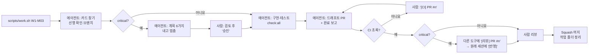

# 11. 에이전트 플레이북 (사람용 안내서)

> 작성일: 2026-10-27 (작업 번호 방식으로 개정) · 함께 볼 문서: `10_dev_plan.md`(작업 카드), `AGENTS.md`(에이전트가 따르는 절차), `08_agent_workflow.md`(모델·클라우드 환경)
> 원칙: **사람은 작업 번호만 보낸다.** 무엇을 만들지는 카드에, 어떻게 일할지는 `AGENTS.md`에 있다. 작업 지시는 사람이 직접, 업무 시간 안에서만 한다.

---

## 0. 내일 아침 시작 순서

| 순서 | 누가 | 할 일 |
| --- | --- | --- |
| 1 | 리드 | 저장소를 만들고 이 문서 묶음을 첫 커밋으로 올린다(10 H-01). 머지 방식은 Squash만, `CLAUDE.md`는 `ln -s AGENTS.md CLAUDE.md` |
| 2 | 리드 | `scripts/work.sh W0-F01` |
| 3 | 리드·PM | F01이 도는 동안 사람 일 H-02~H-07b를 처리한다. **카카오 비즈니스 인증과 토스 빌링 신청은 오늘** |
| 4 | 리드 | F01 머지 → Codex 클라우드 환경 생성(H-07) |
| 5 | 리드 | `scripts/work.sh W0-D01` → 계획을 받으면 검토하고 `승인`. 기다리는 동안 F02·F03을 클라우드에 `[작업] W0-F02` 식으로 보낸다 |
| 6 | 프론트 | F01 머지 직후 `scripts/work.sh W0-U01`, 이어서 `W0-U02` |
| 7 | 풀스택 | 0주차에는 H-04(카카오)·H-08(시드 가수 자료)를 챙기고, 1주차 C 갈래 카드를 미리 읽는다 |

0주차는 리드 한 줄이 병목이다. 0주차 코드가 이후 모든 카드의 "따라 할 코드"가 되므로, 서두르기보다 **패턴이 맞는지**를 본다.

---

## 1. 보내는 말

사람이 에이전트에게 보내는 말은 아래 8가지뿐이다. 각 말을 받은 에이전트가 무엇을 하는지는 `AGENTS.md`에 정해져 있다.

| 언제 | 보내는 말 | 예 |
| --- | --- | --- |
| 카드를 시작할 때 | `[작업] {카드 ID}` | `[작업] W1-M03` (보통은 `scripts/work.sh`가 대신 보낸다) |
| critical 카드의 계획을 받았을 때 | `승인` 또는 `승인: {결정}` | `승인: 5-1은 A안, 5-2는 추천대로` |
| critical PR을 다른 도구로 검토할 때 | `[리뷰] PR #{번호}` | `[리뷰] PR #42` |
| 리뷰 결과를 원래 작업자에게 줄 때 | `[반영] PR #{번호}` + 리뷰 결과 붙여넣기 | `[반영] PR #42` ↵ (리뷰 내용) |
| CI가 빨간색일 때 | `[CI] PR #{번호}` | `[CI] PR #42` |
| 하던 카드를 넘기거나 퇴근할 때 | `[인수인계]` | `[인수인계]` |
| 매주 금요일 오전 | `[대조]` | `[대조]` |
| 매주 월요일 09시 | `[이슈] W{주차}` | `[이슈] W2` |

이 8가지 말고 다른 지시를 하고 싶어지면, 그 일이 카드에 빠져 있다는 뜻이다. 지시를 길게 쓰지 말고 **10 문서의 카드를 고치거나 새 카드를 추가**한 뒤 작업 번호로 시킨다. 카드를 쓰는 법은 08 §5에 있다.

---

## 2. 카드 한 장의 흐름



사람이 하는 일은 세 가지다.

1. **시작:** `scripts/work.sh {카드 ID}`
2. **판단:** critical 카드의 계획 승인, 완료 보고 읽기, PR 리뷰
3. **머지:** Squash 머지(커밋 제목 = PR 제목) 후 `git worktree remove ../trotyou-{카드 ID}`

### 완료 보고를 읽는 순서

1. **"추측한 것"** — 문서에 없어서 에이전트가 정한 것. 맞으면 해당 설계 문서에 반영하고, 틀리면 `[반영]`으로 고치게 한다
2. **"만들 파일 밖에서 고친 것"** — 있으면 이유를 보고, 납득이 안 되면 그 부분을 되돌리게 한다
3. **"사람 확인 필요"** — 실기기·staging 확인을 사람이 한다
4. **완료 기준 체크** — 빈 칸이 있으면 머지하지 않는다

---

## 3. 도구와 모델

### 3.1 `scripts/work.sh`

```bash
scripts/work.sh W1-M03                 # Codex로 시작 (카드의 프로필에 맞는 모델·effort)
scripts/work.sh W1-M03 --tool claude   # Claude Code로 시작
scripts/work.sh W1-M03 --dry-run       # 무엇을 실행할지만 보기
```

스크립트가 하는 일:
- 10 문서에서 카드의 프로필을 읽는다. `종류: 사람` 카드는 거부한다.
- 저장소 옆에 카드 전용 작업 폴더 `../trotyou-{카드 ID}`를 만들고 브랜치 `feat/{카드 ID}`를 연다. 이미 있으면 그 폴더에서 이어간다.
- `npm ci` 후 에이전트를 열고 `[작업] {카드 ID}`를 보낸다.

카드마다 폴더가 따로라서, 한 사람이 로컬에서 카드 두 장을 동시에 열어도 서로 덮어쓰지 않는다.

### 3.2 프로필별 모델

| 프로필 | Codex (`.codex/config.toml`) | Claude Code |
| --- | --- | --- |
| `chore` | gpt-6-luna · low | Haiku 5.5 · low |
| `default` | gpt-6.1-sol · medium | Fable 5.1 · medium |
| `high` | gpt-6.1-sol · high | Fable 5.1 · high |
| `critical` | gpt-6.1-sol · xhigh | Fable 5.1 · high |
| `deep` | gpt-6-astra · high | Fable 5.1 · high |

- Fable 5.1 한도를 다 쓰면 `CLAUDE_MAIN_MODEL=claude-opus-5-5 scripts/work.sh … --tool claude`.
- Codex 버전에 따라 프로필이 안 먹으면 `.codex/config.toml` 주석의 직접 지정 방법을 쓴다. Claude Code의 effort 지정 방식이 바뀌면 `scripts/work.sh` 맨 위 설정 한 줄만 고친다.

### 3.3 언제 Claude Code를 쓰나

Codex가 주력이다. Claude Code는 세 경우에만 쓴다.

1. Codex 사용량이 5시간 또는 주간 한도의 80%를 넘었을 때
2. 같은 카드를 Codex가 두 번 실패했을 때(§5)
3. critical 카드의 교차 리뷰(§4)

같은 카드를 두 도구에 동시에 시키지 않는다.

---

## 4. 교차 리뷰 (critical 카드)

코드를 쓴 모델과 다른 모델이 보면 같은 실수를 놓칠 확률이 줄어든다. critical 카드(D01, D03, P02, P04, P06, Q04)와 Q05 감사에 쓴다.

1. 작업한 도구가 Codex였다면, PR이 올라온 뒤 Claude Code를 열고 `[리뷰] PR #42`를 보낸다.
   ```bash
   cd ../trotyou-W2-P04 && claude --model claude-fable-5-1 "[리뷰] PR #42"
   ```
2. 리뷰 결과에 ①(돈)·②(권한)·③(테스트 누락) 지적이 있으면, 원래 작업하던 Codex 세션에 `[반영] PR #42`와 함께 리뷰 결과를 붙여 넣는다.
3. 에이전트가 지적마다 "반영 / 반대(이유)"로 답하면, "반대"는 사람이 판단한다.

---

## 5. 막혔을 때와 도구를 바꿀 때

| 상황 | 할 일 |
| --- | --- |
| 1번 실패 | 같은 세션에서 "왜 실패했는지 설명하고 다시 해"라고 한다 |
| 2번 실패 | 세션에 `[인수인계]` → 세션을 닫고 `scripts/work.sh {카드 ID} --tool claude`(또는 한 단계 높은 effort) |
| 3번 실패 | 에이전트를 멈춘다. 카드가 너무 크거나 문서가 모호하다. 사람이 카드를 나누거나 문서를 고친다 |
| 퇴근 시간인데 안 끝남 | `[인수인계]` 후 세션을 닫는다. 다음 날 `scripts/work.sh {카드 ID}`로 열면 기록을 읽고 이어간다 |

`[인수인계]`의 기록은 브랜치의 `.handoff/{카드 ID}.md`에 커밋되므로, 도구나 사람이 바뀌어도 그대로 이어진다. 카드가 끝나면 에이전트가 이 파일을 지운다.

---

## 6. Codex 실전

### 6.1 처음 한 번

- 저장소 루트에서 `codex`를 열고 "AGENTS.md의 명령어 8개와 [작업] 절차 9단계를 한 줄씩 요약해 봐"라고 물어서 제대로 읽는지 확인한다.
- 승인 방식은 `.codex/config.toml`의 `on-request` + `workspace-write`. 전체 권한(full access) 모드는 쓰지 않는다.
- 비밀 값은 `.env.local`에만 둔다. 채팅에 붙여 넣지 않는다.

### 6.2 로컬과 클라우드 나누기

카드의 `실행` 꼬리표를 본다.

| `실행: 로컬` | `실행: 클라우드 가능` |
| --- | --- |
| `scripts/work.sh`로 연다 | Codex 앱에서 클라우드 작업을 새로 만들고, 환경 `trotyou-staging`을 고르고, `[작업] {카드 ID}`를 보낸다 |
| DB 카드, 화면을 바로 봐야 하는 카드, critical 카드 | 로컬에서 다른 카드를 하는 동안 하나 더 돌릴 때 |

클라우드에는 Docker가 없어서 에이전트가 통합 테스트를 작성만 하고 "CI에서 확인"이라고 보고한다(AGENTS.md [작업] 7단계). 퇴근 전에 실행 중인 클라우드 작업을 남기지 않는다.

### 6.3 Codex 안에서

- `/model`: 세션 중 모델·effort 변경
- `/review`: PR 전 자기 점검. 교차 리뷰(§4)를 대신하지는 않는다
- 대화가 길어져 앞 내용을 잊는 것 같으면 버티지 말고 `[인수인계]` → 새 세션

---

## 7. Claude Code 실전

- `CLAUDE.md`(= `AGENTS.md`)를 자동으로 읽는다. `scripts/work.sh … --tool claude`로 열면 모델·effort가 카드에 맞게 정해진다.
- 세션 중 모델 변경은 `/model`.
- critical 카드는 에이전트가 [작업] 절차 5단계에서 계획만 내고 멈춘다. Claude Code의 plan mode(Shift+Tab)를 따로 켤 필요는 없다.
- 처음에는 파일을 고칠 때마다 확인하는 기본 권한으로 쓴다. 권한 확인을 통째로 끄는 옵션은 쓰지 않는다.

---

## 8. 에이전트가 자주 하는 실수와 막는 법

| 실수 | 증상 | 막는 법 |
| --- | --- | --- |
| 테스트를 고쳐서 통과시킴 | 테스트 기대값이 바뀐 diff | AGENTS.md 절차 6·`[CI]` 규칙. 리뷰는 테스트 diff부터 |
| 범위를 넓힘 | "김에 정리했다"며 다른 파일 수정 | 보고의 "만들 파일 밖" 칸. 넘치면 되돌리게 한다 |
| 문서에 없는 걸 지어냄 | 그럴듯한 정책·숫자 | "멈추고 물어볼 때" 규칙, 보고의 "추측한 것" 칸 |
| 숫자를 파일 맨 위 상수로 숨김 | 서비스 파일 안 `const MAX = 100`. lint는 통과 | PR 체크리스트, W4-Q05 감사 |
| 이미 있는 함수를 또 만듦 | 비슷한 이름의 함수 두 개 | 카드의 "따라 할 코드". 없으면 카드에 추가 |
| mock에서만 됨 | 실결제·실푸시에서 실패 | 보고의 "사람 확인 필요"를 실제로 확인 |
| 적용된 마이그레이션 수정 | 기존 번호 SQL 파일이 바뀐 diff | AGENTS.md 규칙 10 |
| 비밀 값 노출 | 테스트·로그·예시 파일에 키 | `.env*` gitignore, 클라우드엔 staging 값만, 리뷰 때 `git diff | grep -i key` |
| 카드에 없는 지시를 사람이 채팅으로 함 | 다음 세션·다른 도구가 모름 | 지시 대신 카드를 고친다(§1) |

---

## 9. 하루 운영 (사람 3명)

에이전트는 사람이 지시할 때만 일한다. 업무 시간 밖에 돌아가는 작업은 없다.

| 시각 | 할 일 |
| --- | --- |
| 월 09:00 | `[이슈] W{이번 주}`로 이번 주 카드를 이슈로 만든다 |
| 09:00 | 15분 점검: `gh pr list`로 열린 PR과 CI 상태 확인, 오늘 카드 배정. **사람당 동시에 진행하는 카드는 2장까지**(로컬 1 + 클라우드 1). 리뷰가 병목이라서다 |
| 오전 | critical 카드 계획 검토·`승인`. 클라우드 가능 카드를 보냄 |
| 13:00 | 리뷰 큐 1차: CI 초록인 PR만 리뷰·머지 |
| 18:00 | 리뷰 큐 2차. 끝나지 않은 카드는 `[인수인계]` 후 세션을 닫는다. 실행 중인 클라우드 작업을 남기지 않는다 |
| 목 17:00 | 주간 완료 정의 점검(10 §3). 밀리면 10 §6 순서로 컷 |
| 금 오전 | `[대조]`로 문서와 코드가 다른 곳 확인 |
